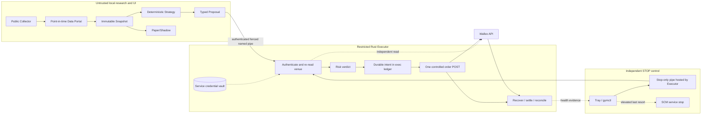
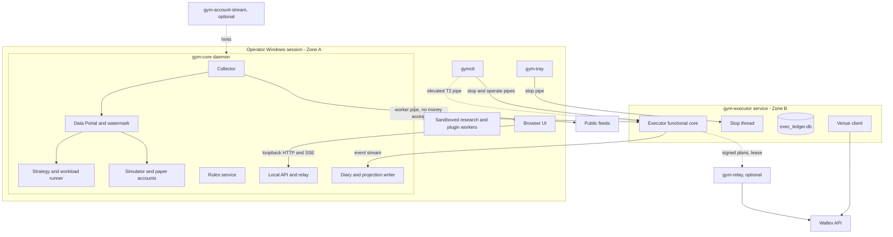

# TradingGYM: Master Specification and Plan

*31 October 2026 | **Master Specification and Plan, Revision 6** | Single operator, local Windows workstation | One order-book venue (Wallex) now; many venues, assets and timeframes by design*

> **Product promise.** Observe markets, test ideas, understand every decision, and trade a deliberately limited amount of real capital without turning routine operation into a compliance exercise. An independent Rust Executor controls venue orders. Everything else helps the operator understand or propose decisions.

This document is the self-contained product specification and implementation plan. It states intended behavior, not completed software or verified live exchange behavior. Illustrations, target metrics and default settings are design examples until tested. Product decisions are stated plainly; venue facts that still need confirmation are explicitly identified.

### How to read this document

| Part | Sections | Question it answers |
| --- | --- | --- |
| Product | 0-2 | What it is, who it serves, success measures, the mode ladder (0.4-0.5), the venue, its regulatory and economic facts, editable venue rules (2.8), spot and trade-credit accounts (2.9) |
| Architecture | 3-5 | Trust boundaries, the optional execution relay (3.9) and account stream (3.10), topology and IPC (3.7), code layering (3.8), core types, order-book data, storage schemas and data lifecycle (5.7-5.8) |
| Money behavior | 6 | Modes (including Assisted), orders, risk, venue stops, trade-credit risk and recovery |
| Intelligence | 7-8 | Strategies, SDK and components, model/agent governance, simulation, research, directional change, RL |
| Promotion | 9 | What evidence moves money authority up the ladder |
| Operations & UX | 10-12 | Security and threat model, releases, screens, settings, design system, journeys, keyboard, onboarding, notifications, service objectives |
| Engineering | 13-14 | Contracts, API, `gymctl`, configuration layering, tests, CI, budgets |
| Plan | 15-17 | Workstreams, work breakdown, risks, decision record, open decisions, scope disposition, venue questions |
| Appendices | A, B, E | Calculations, glossary and sources. The project inventory is in the companion file *TradingGYM_Reference_Companion.md* |

**Evidence tags:** `[proof: …]` means verified against a source (Appendix E), a supplied venue document or a computation. `{unverified}` means not checked. `[judgment]` marks a design decision. Venue facts carry the status labels of Section 0.3.

**Governing rule for all expansion:** breadth (data, timeframes, assets, research, strategies, UI, agents) lives in Zone A. The Executor grows only through certified capabilities and Tier-2 consent (Sections 3.2 and 6.7). Flexibility never comes from loosening the money boundary.

### Executive summary

**What TradingGYM is.** A local, single-operator Windows workbench for one Iranian order-book crypto exchange (Wallex). It lets the operator observe the real order book, trades, costs and trading regime, research ideas without fooling themselves, and automate small, capped real trades only after evidence justifies it. All funded orders go through an isolated money authority.

**Whom it serves and why.** One technically capable operator with four jobs:
1. Know what the venue really costs and when it can trade.
2. Preserve value against the rial through low-cost conversion and rebalancing.
3. Test strategy ideas honestly.
4. Automate only what has been shown to help, including, within an operator-set leverage limit, inside a trade-credit account.

**Product shape: a four-rung mode ladder** (Section 0.5). **Observatory → Lab → Assisted → Autopilot (capped).** Every rung is useful on its own. The ladder says which capabilities are enabled; it is not a forced march. Research stays fully available while funded trading runs, and the header shows the money-control state separately.

**Delivery: five workstreams, not one queue** (Section 15):
- **A, First usable workstation.** Public data and venue history, a small set of timeframes, one deterministic strategy, correct paper accounting, Markets/Research screens and the decision journal.
- **B, Money path, built in parallel.** Restricted Executor, durable orders, exact accounting, recovery, stop paths and Fake Venue tests.
- **C, Controlled integration.** Read-only venue validation, a budgeted live probe, then reconciled spot orders (Assisted first), certified venue stop orders and tested exits.
- **D, Expanded capabilities.** Trade-credit accounts with an operator leverage cap, the optional execution relay and account stream, resting (maker) orders, more features, timeframes and assets.
- **E, Advanced capabilities.** Multi-venue execution, multi-leg planning, visual builders, agents and RL, each when a concrete use case exists.

**Architecture in one paragraph** (Sections 3.1-3.10):
- **Rust Executor.** A restricted Windows service: the only holder of the trading key, the only path to the order transport, with an append-only ledger and a functional core.
- **Optional execution relay.** A small service on Cloudflare or a server the operator controls, holding its own trade-only key, which carries out signed protective exit plans (and, if armed, capped entries) when the workstation or its network is down (Section 3.9).
- **Python `gym-core` daemon.** Collector, Data Portal, strategy runner, simulator, rules, research jobs and a local API.
- **Browser UI.** React, bilingual English/Persian.
- **Stop and consent path.** An unprivileged tray app and `gymctl` for stop commands; elevated `gymctl` for Tier-2 consent.
- **Isolation.** Untrusted research and plugin code runs in sandboxed worker processes.
- **Data.** Trades, order-book snapshots and the venue's own candle history; every timeframe is derived from them. Regulation lives as editable, versioned rules.
- **Authority.** Comes from tiers and an installation ceiling, never from the UI or a model.

**Key decisions.** Recorded with alternatives and revisit triggers in Section 15.6.

**Top risks** (Section 15.5):
- No strategy survives the measured costs. The Observatory and conversion workloads still deliver value.
- Trade-credit liquidation or a fee that the strategy cannot beat. Handled by the operator leverage cap, liquidation-distance limits and fee-aware economics.
- Regulation and connectivity shocks. Handled by rules as data, venue stop orders, the optional relay and explicit unavailable states.
- Venue API unknowns. Handled by the probe ladder and capability registry.
- Scope creep. Held back by workstream gates.

**Deliberately not built.** HFT machinery, a matching engine, agent order authority, copy trading, margin positions, short sales, derivatives and autonomous instant-trade (OTC) orders (Section 16.3), cloud multi-tenancy, and promotion by timer or trade-count rituals.

### Why the plan looks like this (findings that shaped it)

1. **The venue's operating regime changes often, and per pair.** Since 30 September 2026 the central bank has restricted the **USDT/TMN market** at domestic exchanges, Wallex included: nightly closures (21:00-09:00, then 23:30-11:30 from 18 October 2026 until further notice) and a 2,000 USDT daily purchase cap per user. Wallex first cancelled open USDT/TMN orders at the 21:00 close, then kept them through the closure, and pauses liquidation during it [proof: X19] [proof: X20] [proof: X21]. The notices name only USDT/TMN. Earlier episodes include the June 2025 hour limits [proof: X4] [proof: X5] [proof: X22], payment-gateway cuts [proof: X6] and the 2026 internet shutdowns [proof: X7] [proof: X8] [proof: X9] [proof: X10]. This produced Sections 2.5, 2.8 and 3.9.
2. **The operator's own Windows user must not be able to raise authority.** This produced the tiers and installation ceiling in Section 3.2.
3. **Economics before scaling, not before engineering.** On an order book the cost of a round trip is the spread actually crossed plus the depth walked plus maker or taker fees on both legs (the venue's fee example shows 0.2% for each) [proof: X23]. Trade credit adds a fixed daily fee: in the venue's one realistic package example, 30 days of fees equal 30% of the operator's collateral [proof: X25] [proof: calc]. Live micro-trading cannot validate a modest edge quickly. This produced Sections 2.7, 2.9 and 9.2. Economic evidence governs claims and capital size; it does not block building the money path.
4. **IRT cash is not neutral.** Inflation has been above 40% for years [proof: X6]. This produced the numéraire rules and conversion workloads.

## 0. The product in one page

### 0.1 What the operator should experience

1. **Install once.** A normal Windows installer configures local services and private storage; it explains and requests elevated access only when necessary to establish the funded Executor's Windows identity. A failed service or key-isolation check leaves a working research/paper application, not a broken installation.
2. **Connect once.** The public market feed works without a key. The operator may add a venue credential through a protected, one-time flow when ready for funded trading. The application never asks for the credential on each launch.
3. **Explore immediately.** Markets, quality coverage, a simple strategy, paper portfolios, and a decision journal work without LLMs, accounts, plugins or cloud services.
4. **Choose one capital limit and a strategy.** A guided setup shows trade minimums, total possible loss, expected friction and the consequence of losing machine/venue connectivity. Advanced limits stay behind an optional disclosure.
5. **Learn the venue's real economics before building automation on them.** The highest-value unknowns (spread and depth by hour, maker/taker fees actually charged, the order-status sequence, partial-fill and cancel behavior, how stop orders trigger and fail, trading windows) are learned first from public data and the venue's candle history and, when funded use is planned, from a small **live probe budget**: tiny real orders, each confirmed by the operator, observed through the Executor's authenticated path. API-only facts (whether our `client_id` is echoed unchanged, duplicate-ID handling, filter honesty) are learned with that probe once the hardened order path and fake-venue crash tests pass. Full strategy paper/dry-run evidence is required for automated micro-live, not for a mechanics probe. The system blocks duplicate or unauthorized orders, not progress for arbitrary calendar periods or trade counts. Venue uncertainty is resolved with read-only checks where possible and a budgeted, explicitly authorized probe when a real order is genuinely necessary.
6. **Operate from one clear cockpit.** Always see current mode, holdings, available cash, net liquidation estimate, the last decision, pending order state, protection health and a prominent one-action **Pause entries** control. More detail opens on demand.
7. **Stop or investigate without ceremony.** Pausing entries and invoking emergency halt work when the UI/API is unhealthy. Reconciliation anomalies are scoped to their consequences instead of needlessly stopping unrelated healthy positions.

### 0.2 Non-negotiable boundaries and deliberate simplifications

| Keep firm | Keep lightweight |
| --- | --- |
| Only the restricted Rust Executor can submit/cancel funded orders or use the trading credential. | One modular Python daemon, not a microservice platform. |
| Write an accepted intent durably **before** the first venue POST; never blindly retry an ambiguous POST. | One deterministic funded candidate initially; no general strategy-graph engine required. |
| Decimal, unit-safe accounting; venue-reconciled orders and balances; independently operable stop path. | No fixed four-week/30-trade waiting periods; promotion follows evidence and capital at risk. |
| Distinguish new entries from protective reductions; preserve an explicitly authorized exit-only plan for open positions. | Risk parameters within an already tested envelope can be changed quickly, with an audit record. |
| Treat unknown venue state, fee conventions and data availability as unknown. | A single setup wizard; no routine typed confirmations, repeated key entry or mandatory third-party alerts. |
| Authority-increasing actions (raising the installation ceiling, provisioning credentials, approving a new order method or funded artifact, closing an unknown order as absent) require consent through a principal that same-user code cannot impersonate (Section 3.2). | Pause, Exit-only and Halt need no confirmation; everyday changes within the ceiling need at most one click. |
| Venue trading windows, pair halts, price bands, currency-unit changes and connectivity loss are venue facts that gate entries, exits and simulated fills. | No speculative model of regulator behavior; record what is observed and what is announced, with dates. |
| Every money figure, limit and performance number declares its numéraire (IRT or USDT); IRT cash is not treated as risk-free. | One operator-chosen reporting numéraire; the other is one click away. |
| Historical decisions use immutable point-in-time snapshots and real, versioned data. | Agents, RL, generic workflows, multi-order planners and elaborate dashboards are optional later work. |

**First release.** Workstream A delivers a usable research workstation with no order code. Workstream B builds the money path in parallel. Workstream C joins them: read-only venue checks, an optional affordable probe, Assisted orders, then a capped Autopilot for one workload. Funded use requires the money-path evidence of Section 9.3, not a research milestone. Economic evidence (Section 2.7) decides what may be **claimed** about a strategy and how much capital it may receive; it does not decide whether the Executor may be built or tested. **Not required for the first release:** model councils, weighted AI grades, optimizer farms, RL, shared-memory IPC, a matching engine, a generic workflow runtime, external monitoring subscriptions, the strategy zoo or all advanced chart widgets.

### 0.3 Labels and evidence

- **Documented:** described in the venue API documentation; may still differ in current production.
- **Unverified:** needs current documentation, support response, or a carefully bounded real test.
- **Observed:** directly recorded from a venue/source with time and origin.
- **Derived:** computed transparently from observed information.
- **Modeled:** simulated, estimated, forecast or hypothetical; never displayed as an actual fill.
- **Default:** a starting preference/threshold that may change after review, not a proven optimum.

Do not attach a row of badges to every UI number. Use compact, consistent source information on hover, in table metadata and in decision detail; make distinctions prominent whenever confusing actual and simulated outcomes could change a decision.

### 0.4 Users, jobs and success measures

| Job to be done | Product answer | Success measure (default target, [judgment]) |
| --- | --- | --- |
| "Show me what this venue really charges and when I can trade" | Observatory: live order book, trades, spread and depth study, cost model, trading-window bar, venue rules | All Section 17 questions answered or explicitly marked unknown; feed captured for ≥ 99% of venue-open time |
| "Help me move between IRT, USDT and BTC cheaply" | Conversion workload (Section 2.7) in Assisted, then Autopilot | Implementation shortfall against the arrival quote (including adverse FX movement while waiting, missed deadlines and any unconverted remainder), reported with an uncertainty band; no fixed number of conversions before automation |
| "Let me test ideas without fooling myself" | Lab: paper sessions, Arena, diagnostics, shadow ledger, evidence horizon | 100% deterministic replay; every result shows numéraire, baseline, cost model and sample needed |
| "Automate only what works, and never surprise me" | Assisted → capped Autopilot with tiers, ceiling and Exit Guard | Zero duplicate or unexplained orders; stop acknowledged ≤ 1 s (p99); every veto explained in plain language |
| "Keep running when rules or the network change" | Venue rules as data (2.8), regime states, per-destination routes | A rule change takes effect without restart; no crash or silent mis-trade during closures or shutdowns |

**Product health measures:**
- **Install:** ≤ 10 minutes from installer start to live quotes on screen. The demo replay is visible immediately.
- **Paper:** ≤ 5 minutes from the first paper-session click to running.
- **Daily check:** ≤ 30 seconds, with the Operate screen alone answering its six questions.
- **Assisted approval:** ≤ 30 seconds per order, preview included.

### 0.5 The mode ladder

| Mode | What the operator gets | Money authority | Entry requirement | Stage |
| --- | --- | --- | --- | --- |
| **Observatory** | Live order book, trades, spreads and depth, costs, FX-implied prices, regime and rules, alerts, external exposure, the cross-venue premium (optional) | None | Installed | A |
| **Lab** | Paper sessions, research runs, Arena and compare, shadow ledger, economic evidence report | Virtual only | Observatory data, or the demo replay | A |
| **Assisted** | The system prepares orders (conversion or strategy); the operator approves each one in the Execution Preview | Per-order T1 approval inside the installation ceiling | Money-path acceptance green; API probe facts recorded | C |
| **Autopilot (capped)** | Automatic orders for one armed workload, with Exit Guard | Session arming within the ceiling | Hard money gates (Section 9.3) green; the workload's own execution and recovery evidence reconciled; economic result reported, or the session labeled experimental | C |

Naming map: *Assisted* is promotion stage `ASSISTED` and mode `FUNDED_ASSISTED`; *Autopilot (capped)* is promotion stage `MICRO_LIVE` (later `SMALL`/`SCALED`) and mode `FUNDED_ENTRIES_ARMED`. The ladder is also the navigation story. The header shows the current rung in text and color. Lower rungs stay fully usable when a higher one is paused, halted or never enabled.

**Enabled capabilities versus money-control state.** The ladder says which capabilities are switched on; the last column names the workstream that delivers each. The money-control state (`PAPER`, `FUNDED_ASSISTED`, `FUNDED_ENTRIES_ARMED`, `EXIT_ONLY`, `DISARMED`, `HALTED`; Section 6.1) is shown separately in the header. Observatory and Lab never close while funded trading is active, and nothing requires the operator to climb rungs in order to use research.

## 1. Scope, product principles and operator control

### 1.1 Fixed scope

- **Local-first, one Windows operator:** no hosted backend, SaaS account, multi-tenant roles or mobile app. Optional outgoing alerts do not turn the app into cloud software.
- **Venue:** Wallex only. Adapters exist to enable a Fake Venue and replay, not to build a broker marketplace.
- **Market type:** spot order-book trading, long-only, on toman (TMN) and USDT pairs. Leverage only through Wallex **trade credit**: a separate sub-account in which spot orders use credit from the venue, capped by an operator-set maximum leverage (Section 2.9). No margin positions, derivatives, short sales or exchange matching.
- **English and Persian:** RTL, Jalali/Gregorian date preferences, explicit units, accessible keyboard use.
- **Outside product scope:** deposits/withdrawals, tax filing, social/copy trading, automatic transfers from the main wallet (including the venue's trade-credit "connect to wallet" top-up), direct model-to-venue access and unattended online self-modifying strategies.

- **Numéraire:** the operator chooses a reporting numéraire (IRT or USDT-equivalent); research evaluation defaults to USDT-equivalent because IRT has lost value rapidly and persistently. Limits are expressed and enforced in the quote currency actually spent, and reported in both.
- **Reference data:** public quotes from other venues (domestic or global) may be collected read-only as research and monitoring inputs. They never price, authorize or route a funded Wallex order.
- **Regulatory and connectivity regime:** the product records and respects venue trading windows, pair suspensions, price bands, payment-gateway restrictions and network shutdowns (Section 2.5); it never assumes 24/7 execution.

### 1.2 Principles applied as engineering decisions

1. **Money authority is not intelligence authority.** The proposer is replaceable and cannot pass a safety check on its own behalf.
2. **Fail closed on irreversible uncertainty, not on every warning.** Uncertain order identity or available cash freezes the dependent action. A missing historical comparison or an ill-defined research score does not halt the whole portfolio.
3. **Avoid making safety hostile to the user.** Protective exits have a separate, properly tested path. No arbitrary waiting ceremony substitutes for correct idempotency, reconciliation or exposure controls.
4. **Use one source of truth per kind of fact.** Funded money events originate in the Executor ledger. Market observations originate in the Collector. All displays and reports derive from those facts.
5. **Truthful evaluation beats complexity.** Same data, same assumptions, sensible baselines, believable costs, explicit limitations, and enough observations to support the actual claim.
6. **Only add machinery when it solves a measured problem.** For a minute-to-hour strategy, deterministic ordering and recovery matter more than sub-millisecond optimization.
7. **Show an actionable next step.** A warning specifies the affected asset/function, what remains allowed, whether the condition is transient and how it clears.
8. **User intent controls capital.** There is no automatic rise in funded capital, silent change in a strategy's money-relevant behavior, or hidden promotion of an AI-generated idea.

9. **Name the numéraire.** A result, limit or loss expressed without its currency is incomplete; flat IRT cash carries currency risk relative to USDT.
10. **Treat regulation and connectivity as part of the venue.** A protective exit, a simulated fill or a scheduled evaluation that falls outside an executable window is unavailable, not delayed success.

### 1.3 Low-friction safety policy

**Single confirmation** is appropriate for initial funded enablement, raising a capital cap, switching to a substantially different money policy, enabling a new venue order method and flattening all holdings. A short clear confirmation is sufficient; typing long phrases or holding a button is optional, not the standard workflow. A direct Pause/Halt action needs **no confirmation**. Lowering limits, stopping entries, opening diagnostics, acknowledging ordinary alerts and changing a parameter within its validated envelope need **no repeated approval**.

Where an action is Tier 2 (Section 3.2: raising the installation ceiling, certifying a new order method, approving a funded artifact, provisioning a credential), the single confirmation is the operating-system consent of the T2 principal, not an in-app click.

A safety check that frequently misfires must be repaired, not bypassed. The user can see which checks are hard money invariants, which are entry-policy settings, and which are optional warnings. It is never necessary to configure an LLM, external monitor, skill engine or research campaign before using paper mode or a properly capped deterministic strategy.

## 2. Wallex facts, economics and unresolved questions

Wallex publishes its API at `developers.wallex.ir`. On 31 October 2026, TradingGYM fetched and reviewed all **114 `/docs` pages listed in the official sitemap**: introduction and API keys, basic services, generated REST references, spot, margin, trade credit, instant trade and twelve WebSocket pages, including downloadable specifications where provided [proof: X23] [proof: X24] [proof: X25] [proof: X26] [proof: X27]. The site still contains internal disagreements (Section 2.1, last table). Every fact below is **documented** (Section 0.3) until a live probe confirms it.

**Currency naming.** Wallex market symbols end in `TMN` for the toman (for example `BTCTMN`, `USDTTMN`) or `USDT`. Inside TradingGYM the toman currency code is `IRT`, with the unit epoch of Section 2.6; the adapter maps `TMN` ↔ `IRT` at the boundary.

### 2.1 Documented interface - verify before real use

| Venue behavior described by documentation | TradingGYM implication | Still to verify |
| --- | --- | --- |
| **Order-book exchange.** Public, no-key market data includes the market list (`GET /hector/web/v1/markets`) with per-market flags (`is_spot`, `is_otc`, `is_margin`, `is_tmn_based`, `is_usdt_based`, `is_zero_fee`) and price/amount precision; depth per market (`GET /v1/depth?symbol=`) and for all markets (`GET /depth/all`); recent trades with side and time (`GET /v1/trades?symbol=`); historical OHLCV candles (`GET /v1/udf/history?symbol&resolution&from&to`); and fair price for all markets (`GET /v1/all-fairPrice`, the midpoint of the best fair bid and ask) [proof: X23] [proof: X27]. Public v2 WebSocket subscriptions likewise require no token. Account balances, account fees and trading remain authenticated. | `VenueProfile.market_model = ORDER_BOOK`. The Collector needs no credential and records trades and book snapshots; research can start from the venue's own candle history instead of waiting for self-collection. | Candle depth of history and maximum range per call; current narrative docs list `1`, `15`, `60`, `240`, `480`, `720`, `1D`, `2D`, `3D`, while generated material remains inconsistent. |
| **Fees.** `GET /v1/account/fee` returns, per market, a maker and a taker rate and the account's recent volume (example 0.2% maker, 0.2% taker); markets carry an `is_zero_fee` flag; every fill reports its fee, fee asset and maker/taker coefficients [proof: X23]. | `FeeSchedule` per market and liquidity role, refreshed daily; accounting posts the fee each fill actually reports, never a modeled rate. | Volume tiers and when they change; whether a zero-fee market is zero for both roles. |
| **Spot orders.** `POST /v1/account/orders` accepts `symbol`, `side`, `type` ∈ {`LIMIT`, `MARKET`, `STOP_LIMIT`, `STOP_MARKET`}, `price`, `quantity`, `stop_Price` and optional `client_id`. If `client_id` is omitted Wallex generates `clientOrderId`; if supplied it must be unique or the order is not registered. Detail and cancel by client ID (`GET` and `DELETE /v1/account/orders/{client_id}`); a second cancel form takes `clientOrderId` in the body; open orders (`GET /v1/account/openOrders`); order history with filters for market, type, side and a date range by day, up to 100 per page [proof: X23]. | **Our own ID is the recovery key.** The Executor always generates every `client_id`, stores it before the POST and recovers a lost acknowledgment by reading that ID (Section 6.3). | The docs claim letters `A–Z`, underscore and digits but show mixed-case examples; verify accepted casing and length, exact echo and duplicate-ID error. The complete status enum remains undocumented: current examples name `NEW`, `FILLED`, `CANCELED`, while cancel prose uses `FINISHED` as a terminal concept. The create table marks `price` required even though the order-types page says MARKET needs no price. |
| **Market-order guard.** A market order is **cancelled automatically** if its size exceeds the book or it would move the price more than **2%** from the last trade [proof: X23]. | A protective market sell can fail in a thin book. Exits plan for this outcome (Section 6.5). | The exact reference price and whether part of the order fills before the cancel. |
| **Stop orders.** `STOP_LIMIT` and `STOP_MARKET` stay outside the book until the **last traded price** crosses `stop_Price`; the direction is fixed at creation (a stop below the last trade fires when the last trade falls to it, a stop above fires when it rises to it); a triggered stop then behaves as a limit or market order [proof: X23]. | Venue stops protect positions while the workstation is off (Section 6.5). A triggered `STOP_MARKET` is subject to the 2% guard, so it is not a guaranteed exit. | Status values of a waiting, triggered and cancelled stop; whether a stop's quantity is locked while it waits. |
| **Balances.** `GET /v1/account/balances` gives `value` and `locked` per asset, with `is_dust` and `is_digital_gold` flags [proof: X23]. | Compare venue money facts with local postings; locked quantity (open orders and stops) is not spendable. | Propagation delay after a fill. |
| **Rate limit.** At most **20 order requests per 10 seconds**; repeated depth and trade polling may be throttled, and WebSocket is recommended instead. Responses carry `x-ratelimit-limit` and `x-ratelimit-remaining` headers [proof: X23] [proof: X25]. | One request scheduler per key with a token budget below the limit; market data comes from WebSocket with REST checks (Section 4.1). | Read-request limits and their windows. |
| **API keys.** Header `x-api-key`. Read is granted by default; trade and withdraw are optional permissions. Withdraw calls require the source IP to match the configured IP. A key is displayed once, remains active only until the operator-selected expiry, and Wallex documents a maximum of **three API keys**. The main account and each trade-credit account require their own key [proof: X23]. | The Executor's key is **read + trade only**; no key with withdraw permission is ever created for TradingGYM. Public collection uses no key. Key plan and rotation: Section 10.1. | Behavior at expiry (error code, grace); whether the three-key maximum is per account or across the main and trade-credit accounts. |
| **Money movement.** Toman withdrawal to an IBAN (`POST /v1/account/money-withdrawal`, withdraw permission), IBAN add and list, bank-card list, crypto deposit addresses [proof: X23]. | All absent from the Executor allowlist (`SEC-03`). | None needed. |
| **Trade credit, margin, instant trade and WebSocket** are separate API sections. | Section 2.9 (trade credit, margin, instant trade) and Section 4.1 (WebSocket). | See those sections. |
| **Transport, timestamps and numbers.** JSON request bodies use `Content-Type: application/json`. Time fields are endpoint/channel-specific: ISO 8601 UTC (`Z`), Unix seconds, or Unix milliseconds (including private WebSocket examples such as `1748773416376`). Numeric wire types are likewise schema-specific: many money and quantity fields are decimal strings with up to 16 fractional digits, while WebSocket depth fields are JSON numbers [proof: X23] [proof: X27]. | Preserve every raw time/numeric lexeme; parse time by the declared schema (and validate the expected magnitude) and parse numbers directly as decimal, never through a binary float. Fixtures pin every documented form. | Undocumented sub-millisecond precision. |

**Documentation inconsistencies that fixtures and probes must settle.**

| Topic | What disagrees |
| --- | --- |
| Host | The current canonical host is `https://api.wallex.ir`. Some historical generated/downloaded specifications and examples still say `api.wallex.com`; they are retained as discrepancy fixtures, not runtime fallback targets. |
| Authentication on market data | Older generated material marks some calls keyed, but the current public pages, public v2 WebSocket documentation and successful unauthenticated fixtures establish the listed market-data calls as public/no-key. Keep an unauthenticated acceptance fixture to catch regressions. |
| `/v1/trades` `symbol` | Required in the Swagger file, optional in the page table. |
| Candle parameters | All required in the Swagger file, optional on the page; the resolution lists differ. |
| Cancel | Path `client_id`, or body `clientOrderId`; the trade-credit variant uses `client_order_id`. |
| Order-list response shape | Examples are keyed objects; the schema names an array. |
| Stop-price field | `stop_Price` in requests, `stopPrice` in responses. |
| Order-list date filters | Day-granular (`YYYY-MM-DD`): too coarse for recovery windows, so recovery reads by `client_id` and open orders. |
| Trade-credit header | `sub-account-client-id`, `Sub-Account-Client-id` and `sub_account_client_id` in different places. The hyphenated form is used, because some proxies drop header names that contain underscores. |

### 2.2 The economic constraint

On an order book a round trip pays **the spread actually crossed, the depth walked for the order's size, and the maker or taker fee on each leg**. A taker buy pays the ask and the taker fee; a taker sell receives the bid less the taker fee. A resting (maker) order may earn a better price and a lower fee, but may fill partly, late or not at all. **No single constant summarizes this cost**: break-even is derived from the measured book at the order's size, the fee each fill reports and the drift between decision and fill (Appendix A.1).

Simple research must show a gross-versus-net outcome and a comparable hold benchmark. Fast timeframes, high-turnover signals and attractive frictionless backtests are not automatically funded candidates. The minimum viable holding horizon is an empirical result of the measured cost study, not a hardcoded number of hours. In a trade-credit account the daily fee is added to the hurdle for every day a package is open, whether or not it trades (Section 2.9).

An illustrative `1.25x` cost-stress run is useful for robustness; `2x` and `3x` are stress diagnostics rather than compulsory profit tests. An `expected-move / estimated-cost` indicator can be shown in the cockpit, but volatility, model confidence or a 0-100 score must not be presented as a validated directional return forecast. Entry-policy thresholds require evidence and are configurable within tested bounds, rather than an immutable `1.5x` or `2x` rule.

### 2.3 Domestic FX is not crypto alpha

For synchronized observations, compute a **derived** implied crypto-relative coordinate:

`implied_asset_USDT = mid(Asset/IRT) / mid(USDT/IRT)`.

Compare IRT returns with this coordinate and the separate domestic USDT/IRT factor so a toman movement cannot masquerade as simultaneous crypto-specific appreciation. Record each component's own timestamps, source and synchronization gap. If the USDT/IRT observation is missing or stale, mark the derived factor unavailable; **only strategies requiring that factor are affected**. Where the asset also trades against USDT on the venue, the directly traded `Asset/USDT` book is compared with the implied coordinate; their difference is a measured cross-market premium, not an arbitrage until both legs are costed.

Monitor spread and depth changes, the venue's fair price against the book midpoint, market activation changes and disagreement with reference feeds. The venue states that internal market makers keep some tokenized assets aligned with their reference prices [proof: X23]; such markets carry a `venue_market_maker` flag, and their book is not treated as independent price discovery.

### 2.4 Probe order and evidence budget

1. **Public read-only:** learn the WebSocket payloads, book and trade timestamps, candle history depth, market precision and minimums, fair prices and throttling signals; capture dated unauthenticated fixtures.
2. **Authenticated read-only:** balances, account-specific fees, open orders and order history with a read-capable key.
3. **Live probe with a budget** (Workstream C, operator decision O5): tiny real orders, **each confirmed by the operator**, to establish the facts no document settles:
   - `client_id` echo, syntax and the duplicate-ID error;
   - the order-status sequence for a limit order that rests, fills partly, fills fully and is cancelled;
   - the market-order guard on a deliberately oversized order in a thin market, if it can be done within budget;
   - a `STOP_LIMIT` and a `STOP_MARKET` that wait, trigger and (if achievable) get cancelled by the guard, and whether a waiting stop locks quantity;
   - fee posting and fee asset per fill;
   - for trade credit, if enabled: the exact sub-account header spelling/necessity, package close behavior, liquidation price source and scope of the three-key cap (Section 17).
4. Store each verified observation in a dated `VenueFacts` record; never automatically overwrite older evidence. The operator sets one total **probe budget**: the amount they explicitly accept losing in full (fees, spread and small adverse moves). Venue minimums never raise it. If a needed test exceeds the budget, say the probe is unavailable rather than silently increasing capital.

The application does not impose a lengthy data-collection countdown when the required facts and tests already exist. Likewise, missing venue facts never become facts because a hypothetical paper result looked good.

### 2.5 Regulatory, market-access and connectivity regime

The following are **externally reported facts** (sources in Appendix E). Each becomes a dated `VENUE` rule (Section 2.8) when entered or confirmed, and its current applicability is checked against the venue's own channel (Section 17, questions 16-19 and 23-24).

**Current episode (since 30 September 2026): the USDT/TMN market only.**
- From 30 September 2026, at the central bank's direction, domestic exchanges including Wallex stopped USDT/TMN trading nightly from 21:00 to 09:00 and capped USDT purchases at 2,000 per user per day [proof: X19]. The closures were extended several times.
- Wallex first announced that all open USDT/TMN orders would be cancelled automatically at the 21:00 close. It then changed this: open orders **stay in the book during the closure** and may execute after reopening, and **liquidation is paused** while the market is closed [proof: X21].
- From 18 October 2026 the nightly closure runs **23:30-11:30**, until further notice; the 2,000 USDT daily purchase cap remains, and Wallex again stated that liquidation stops during the closure [proof: X20].
- The notices name the USDT/TMN market only. Other crypto/TMN and crypto/USDT markets are not named and keep trading. The restriction is therefore **pair-scoped**, not venue-wide.

**Earlier episodes.**
- June 2025: nightly USDT/IRT closures, with open orders in spot and credit markets cancelled by the system at the close [proof: X22]; reported general hour limits of roughly 10:00-20:00 [proof: X4] [proof: X5].
- Rial payment gateways cut, conditions on reopening, and reported plans for daily caps on rial price moves [proof: X6].
- National internet cuts in January and from late February 2026; USDT/IRT suspended during the February shutdown [proof: X7] [proof: X8] [proof: X9] [proof: X10].

**Design consequences (normative):**

1. `VenueRegime` is a versioned set of `VENUE` rules (Section 2.8): `TradingWindow` (per pair and side, with timezone), `PairSuspension`, `PriceBand`, `GatewayRestriction`, `VenueQuota`, `OpenOrderPolicy`, `ProductAvailability` and `ConnectivityState` (venue, operator internet and global internet measured separately). Each record has source, announced or observed time, effective interval, verification status and freshness.
2. **Scope is part of the fact.** A rule names its pairs and sides. A USDT/IRT closure vetoes only USDT/IRT orders and plans that need a USDT/IRT leg. BTC/IRT and BTC/USDT remain executable unless their own rules say otherwise.
3. Outside an executable window, during a suspension or under a band lock, new entries on the affected pair are vetoed **and protective exits on it are `UNAVAILABLE`**, not `PENDING`. If the same asset has another executable market (for example BTC/USDT while BTC/IRT is closed), the ExitPlan may name it as an operator-approved alternative exit route (open decision O10). It is never used silently, because it changes the currency the operator ends up holding.
4. **FX factor freshness.** While USDT/IRT is closed, its quote is stale. The derived factor of Section 2.3 is marked `STALE_CLOSED`; strategies that need it defer, and reports show the gap. An optional **implied factor**, `bid(asset/IRT) / ask(asset/USDT)` from markets that remain open for one or more liquid assets, may be shown. It is labeled derived and non-executable, with its dispersion across assets.
5. **Quotas count every channel.** A `VenueQuota` (for example 2,000 USDT bought per user per Tehran day) applies to the account, so manual purchases in the venue's app consume it. The Executor reserves quota for its own orders, reads observed account activity where the API exposes it and otherwise treats the remaining quota as uncertain. A proposal that would exceed the known remaining quota is resized or vetoed. A venue rejection for quota is recorded as a rule fact, not an error storm.
6. **Open orders at a close.** `OpenOrderPolicy` records whether the venue cancels, keeps or freezes open orders at a closure. The Executor never leaves its own resting orders across a close unless the policy is verified as "kept", and it reconciles every order after reopening.
7. **Closed-period gap risk.** Exposure held across a known closed period is bounded by `max_exposure_into_close` (default: the per-asset cap) and reported as unprotectable for the length of the closure. Simulations and stress reports include gap moves across closures.
8. **Reopening policy.** At the first executable moment after a closure, halt or outage, stop triggers are re-evaluated on fresh qualified quotes only. The operator chooses `SELL_AT_REOPEN` (default for hard stops) or `REEVALUATE_AFTER_N_QUOTES` (default for soft or time-based exits); the choice is recorded in the ExitPlan.
9. The Simulator treats closed windows, suspensions, band locks and exhausted quotas as **nonfills** with a reason. A backtest that fills inside a closed window is invalid.
10. Connectivity is not symmetric: the venue may be reachable on the domestic network while global reference feeds, model providers and remote alerts are not, or the reverse. Every external dependency has its own route and health status (Section 10.3).

### 2.6 Currency unit and redenomination

Iran's parliament approved, and the Guardian Council then cleared, a redenomination in which **10,000 current rials = 1 new rial** (= 1,000 of today's colloquial tomans), with a multi-year dual-circulation transition. The venue's `IRT` unit is today's toman (10 rials). When the venue changes units, every IRT price, balance, limit and historical series changes scale by a factor of 1,000.

- Every IRT amount carries a `CurrencyUnit{code, unit_epoch, rials_per_unit}`. Conversion between epochs is explicit and exact; mixing epochs in one calculation is a type error.
- The Collector flags `UNIT_DISCONTINUITY` when a synchronized cross-asset price ratio jumps by a factor near 10^k while USDT-relative prices are continuous. On detection: freeze **new funded entries** in IRT pairs and pause **automated exits whose triggers are IRT prices** until the new unit is confirmed (operator confirmation or a recorded venue announcement). Exits that do not depend on the IRT price scale stay available: an operator-initiated sell, a sell on a USDT market, and a base-quantity protective sell whose trigger is USDT-relative. IRT proceeds received before confirmation are posted with an unresolved unit epoch. Historical series are rescaled **only in derived views**, never in stored observations.
- UI labels show the unit epoch whenever two epochs could be confused (for example "Toman (pre-2026 unit)" vs "New rial"). The amount-in-words rule (Section 11.6) applies to both.

### 2.7 Economic baseline, the numéraire and the first funded workload

**IRT cash is not a neutral position.** The rial has lost most of its value against the dollar over recent years and inflation has been reported above 40% for years. A long-only strategy whose flat state is IRT is, in USDT terms, short USDT whenever it is flat. Research therefore reports every result in USDT-equivalent first (with IRT nominal alongside) and always includes **hold USDT** and **hold BTC** baselines.

**Break-even depends on facts that are only partly known.** A taker round trip must recover the spread crossed, the depth walked and the taker fee twice. With the venue's documented example rate of 0.2% per side, a taker round trip needs the bid to rise by about the spread plus 0.4% (Appendix A.1). A maker leg can cut both price and fee, at the cost of fill uncertainty. Spread and depth change by market and hour, so each research run uses the book measured over its own period at the order's size. The fee rates the account actually pays, and markets flagged zero-fee, are the first facts to confirm. In a trade-credit account, the daily fee is part of the hurdle (Section 2.9).

**Candidate funded workloads, in order of how easily their benefit can be measured:**

1. **Cost-aware conversion and rebalancing** (operator states a target allocation or a conversion amount and deadline; the system executes when the observed spread/cost is in a favorable quantile, inside trading windows). The benefit is measured as **implementation shortfall against the arrival quote**: the executed result versus converting at the quote when the instruction was given, including adverse FX movement while waiting, any amount left unconverted at the deadline and the opportunity cost of delay. Spread savings alone are not the measure. No directional forecast is required.
2. **Low-turnover allocation rules** (trend or volatility-scaled exposure to USDT/BTC against IRT), judged against hold-USDT and hold-BTC.
3. **Directional minute-to-hour strategies.** These need the largest evidence base and are the least likely to survive the cost hurdle.

**Economic evidence report (a Workstream A deliverable).** A written report states, per candidate, the net result versus matched baselines under the measured cost model, the number of independent opportunities and the sample needed to detect the claimed effect (Section 9.2). It governs two things only: **what may be claimed** about a strategy (validated, promising or experimental) and **how much capital** an Autopilot workload may receive. It does not block building or testing the money path, and it does not decide the product's direction; that is operator decision O2 (Section 15.7). If no candidate clears it, the operator can still run conversion workloads, Assisted orders or an explicitly labeled experimental Autopilot inside the ceiling.

### 2.8 Regulation as editable, versioned data (Settings → Venue rules)

Regulations, venue policies and fee schedules can change at any moment and without notice (Section 2.5). **No regulatory fact is hard-coded.** Each is an editable, versioned rule that the operator can change in Settings at any time, without restarting, rebuilding or migrating. A change of regulation changes behavior; it never breaks the application. [judgment]

**Three rule classes with different authority.**

| Class | What it holds | Who sets it | Can it block a protective exit? | Affects live orders? |
| --- | --- | --- | --- | --- |
| `VENUE` | Facts about the venue: windows, suspensions, bands, quotas, fees, minimums, product availability, open-order policy, unit epoch | Entered from an announcement, support reply or observed evidence, or confirmed from a suggestion | Yes, when its status is `VERIFIED` or `REPORTED` (a dated source exists) | Yes |
| `POLICY` | The operator's own preferences: entry hours, exposure limits, alerts, conservative filters | Operator | Only when the operator explicitly confirmed it as an exit restriction; ordinary policies gate entries | Yes |
| `SCENARIO` | Hypothetical rules for simulations, counterfactuals and stress tests | Operator or research jobs | Never | Never; Research and paper only, always labeled |

**Rule families** (each a typed record with `class`, `scope` (venue / pair / side / currency / account / product), `effective_from`, optional `effective_until`, `source` (announcement, support reply, observed, operator), `status` (`VERIFIED`, `REPORTED`, `INFERRED`, `STALE`), `last_confirmed_at` and `note`):

| Family | Examples | What it gates |
| --- | --- | --- |
| `TradingWindow` | "USDT/IRT closed 23:30-11:30 Tehran time"; holidays; early close | Entries and exits on the scoped pair, simulator fills, evaluation clocks |
| `PairSuspension` | "USDT/IRT halted until further notice" | Entries and exits on that pair/side |
| `PriceBand` | Max daily % change; "block USDT buys after +4% in a day" | Side-specific vetoes; simulator nonfills |
| `VenueQuota` | "USDT purchases ≤ 2,000 per user per Tehran day, all channels" | Executor sizing and veto; simulator nonfills |
| `OpenOrderPolicy` | "Open USDT/IRT orders cancelled at the nightly close" | Whether resting orders may cross a close; reconciliation after reopening |
| `ProductAvailability` | "Trade-credit package 147 inactive"; "market WTMN unavailable in trade-credit accounts"; "UNGON deposits and withdrawals suspended" | Trade-credit market eligibility and package choice (Section 2.9); external-exposure warnings |
| `GatewayRestriction` | Rial deposits/withdrawals paused; withdrawal hold after a toman deposit | Warnings; conversion deadlines |
| `OrderLimit` | Min/max order size, allowed order methods | Executor sizing (RESIZE/VETO) |
| `LeverageCap` | "Trade-credit account: gross exposure ≤ 3 × equity"; "minimum distance to the liquidation level 25%" | Executor sizing and entry vetoes in trade-credit accounts (Section 6.10); a `POLICY` the operator sets, never looser than the package |
| `FeeSchedule` | Fee by market and 30-day-volume tier, fee currency, embedded or not | Cost model, break-even, simulator |
| `CurrencyUnit` | Unit epoch, rials per unit (redenomination) | Every IRT amount (Section 2.6) |
| `Custom` | Any future rule built from the generic fields (scope + time + side + action `BLOCK_ENTRY` / `BLOCK_EXIT` / `BLOCK_ALL` / `WARN`) | As declared, within its class's authority |

**Behavior (normative):**

1. **Atomic commit, then recheck.** Saving a rule commits a new `RuleSet` version. A money-relevant change (any `VENUE` rule, and any `POLICY` rule that gates entries or exits) is acknowledged in the UI only after the Executor has durably recorded it in `exec_ledger.db`. The Executor re-evaluates the current `RuleSet` immediately before every order submission, so a change takes effect at the next submission, not merely at the next strategy evaluation. Every decision, Proposal and RiskVerdict records the `RuleSet` version it used.
2. **Precedence by class, then restrictiveness.** `SCENARIO` rules are ignored in live operation. `VENUE` facts with `VERIFIED` or `REPORTED` status apply to entries and exits. `POLICY` rules apply to entries, and to exits only when explicitly confirmed as exit restrictions. Among the applicable rules, the most restrictive wins. The cockpit names the blocking rule, its class, source and age ("Blocked by VENUE TradingWindow 'USDT/IRT 23:30-11:30', source: exchange notice 2026-10-18, confirmed 2 days ago").
3. **No ordinary rule silently defeats a protective exit.** A `Custom` or `POLICY` rule with `BLOCK_EXIT` or `BLOCK_ALL` needs a separate confirmation that names the positions it would leave unprotected. Exit blocks appear in Operate as `UNAVAILABLE` with the responsible rule.
4. **Uncertainty and freshness.** Rules suggested from evidence (repeated rejections, `active=false`, unexpected fees, a unit discontinuity) enter as `INFERRED`. An `INFERRED` restriction may auto-apply to **new entries only** and never blocks an exit. It does not expire into permission: after its review interval (default 24 h) without confirmation it becomes `STALE`, stays applied to entries and raises a review item. A `VENUE` rule announced "until further notice" has no `effective_until`; it ends only when a newer source or the operator records the end. Suggested relaxations never auto-apply.
5. **Asymmetric friction (Section 1.3).** Adding or tightening a restriction applies with no confirmation (Tier 0). Loosening or deleting one takes one click (Tier 1); deleting a `VERIFIED` venue fact also asks for the reason or source. A rule edit can never raise a ceiling or bypass a hard Executor check (`MONEY-10`).
6. **Scheduling.** A rule can be entered in advance or with an expiry. Editing a rule whose `effective_from` is in the past takes effect from now; history is never rewritten.
7. **Point-in-time research.** Backtests use the rule vintage in force at each historical decision by default. Research can also apply today's rules or any `SCENARIO` set; such runs are labeled.
8. **Robust parsing.** Rules are data, never code. An unknown or malformed rule is quarantined and shown, never silently ignored and never crashing the app. If the rule store is unreadable, the system falls back to the last valid `RuleSet` and blocks new entries until it is reviewed.
9. **Profiles, import and export.** Rule sets can be exported and imported as JSON, diffed before applying, rolled back and seeded from presets ("USDT/IRT night closure, October 2026"). Each import previews what will change and which positions or workloads are affected. Imported rules keep their class; an import never turns a `SCENARIO` into a `VENUE` rule without confirmation.
10. **Audit.** Every rule change is an immutable event (who, when, old and new value, reason, source) in `exec_ledger.db` for money-gating rules and in `ledger.db` for the rest, visible in the Journal.

**UI.** Settings → *Venue rules* lists active, scheduled, expired, suggested, stale and quarantined rules by class, with a timeline view and a "what does this block right now?" preview. Operate's "When can I act?" strip (Section 11.2) and every veto explanation link straight to the responsible rule. The same operations are available through `gymctl rules list|add|edit|disable|import|export|rollback`.

### 2.9 The venue's product surface: spot, trade credit, margin and instant trade

Wallex offers four ways to trade. TradingGYM uses two of them for funded orders and observes the other two.

| Product (Persian name) | What it is | TradingGYM use |
| --- | --- | --- |
| Spot (معامله اسپات) | Order-book trading with the operator's own money in the main account | **Funded**: the default account for every workload |
| Trade credit (اعتبار معاملاتی) | A separate sub-account funded by the operator's collateral plus credit from Wallex, traded on spot (and on instant trade and convert) | **Funded, optional** (Workstream D): spot orders only, under an operator leverage cap |
| Margin (معامله تعهدی) | Long or short positions with borrowed funds, warning/liquidation levels and package/market-defined lifetime and fees | **Observed read-only** as external exposure; modeled in research scenarios |
| Instant trade (معامله آنی) | Immediate venue-quoted conversion; partial-fill and rejection semantics are not fully documented | **Operator-initiated conversions only**, through Assisted approval; never an autonomous route |

#### 2.9.1 Trade credit

**What it is** [proof: X25]. Activating a package creates a separate **sub-account** with its own wallet, order history and account-bound API key. It holds the operator's collateral (دارایی ورودی) plus the credit Wallex lends. The prose and worked example describe a 30-day package renewable in its last 5 days, but executable logic uses each package's `expire_days` and returned lifecycle fields. Daily/final fee fields are package data; their exact assessment and debit timing is reconciled from live package records rather than inferred from prose. Liquidation is **account-level**: when the package's total value falls to its `liquidity_limit`, Wallex closes the whole package, not one position. A package lists the markets that cannot be traded in it (`unavailableMarkets`).

**The one realistic example** (package 147, "600 million toman trading credit") [proof: X25] [proof: calc]:

| Item | Value |
| --- | --- |
| Collateral / credit / start value | 60 M / 600 M / 660 M TMN |
| Package leverage on collateral | 11× |
| Warning level | 642 M (97.3% of start; a loss of 30% of collateral) |
| Liquidation level | 624 M (94.5% of start; a loss of 60% of collateral) |
| Daily fee | 600,000 TMN (0.091% of the package's capital per day) |
| Full 30-day fee | 18 M TMN (30% of collateral; 3% of the credit) |

The other examples in the documentation come from a staging system and are internally impossible (a warning level above the start value; a warning level below the liquidation level). They are never used as test values.

**Interface** [proof: X25]:

| Purpose | Call | Notes |
| --- | --- | --- |
| Package catalogue | `GET /v1/prop/packages`, `GET /v1/prop/packages/{id}` | Collateral, credit, warning and liquidation levels, daily and final fee, `expire_days`, status; the detail call adds `unavailableMarkets` |
| Eligibility | `GET /v1/prop/user/packages/{id}/check-availability` | KYC level and balance checks |
| Activate | `POST /v1/prop/user/packages` with `prop_package_id` | Commits collateral and creates the package; returns the sub-account `clientId`; no idempotency key of ours. Exact fee assessment/debit timing is reconciled from the resulting records. |
| Live state | `GET /v1/prop/user/packages/active` (sub-account header) | `status`, `warningLimit`, `liquidityLimit`, `profit`, fee totals, `finalPayback`, `alertsData` (e.g. `public_warning_low_credit`), daily balance history |
| Overview and history | `GET .../overview`, `GET .../history`, `GET .../history/{subAccountClientId}` | Close records carry `close_reason`, `final_balance`, `final_payBack`, `profit` |
| Sub-account balances | `GET /v1/account/balances-detail` (sub-account header) | Per-asset totals, frozen and available |
| Fund the package | `POST /sub-accounts/transfers` (`currency`, `value`, `subAccount_client_id`) | **Main → sub-account only**; no transfer back until the package closes |
| Auto top-up | `POST`/`DELETE /v1/prop/user/packages/connect-to-wallet` (`credit`, `currency`, `usageCount`) | Below the warning level, Wallex moves money from the main wallet automatically, up to `credit × usageCount` |
| Renew, close | `POST .../enable-renew`, `DELETE /v1/prop/user/packages` | Close returns `start_balance`, `final_balance`, `final_balance_without_transfers` |

**How TradingGYM uses trade credit (normative).**

1. **Spot orders inside the sub-account are ordinary spot orders.** They use the same order endpoints, our own `client_id` and the same recovery rules (Section 6.3). Each sub-account is a separate `Account` with its own balances, reservations, ledger postings and order slots (Section 5.3); nothing is netted across accounts.
2. **The operator sets the leverage, not the package.** A `LeverageCap` policy (Section 2.8) limits gross exposure in the sub-account to *L* × equity, where equity is the account value less the credit owed and the fees accrued, and *L* is chosen by the operator at or below the package's own leverage (default 3×) [judgment]. A second limit, `min_liquidation_distance` (default 25% of the way from the current value to the liquidation level), vetoes new entries when the account is closer than that. Both are `POLICY` rules: tightening takes effect at once; loosening is a T1 action; raising *L* above the installation ceiling's leverage limit is T2.
3. **De-risking before Wallex liquidates.** When the distance to the liquidation level falls below `deleverage_distance` (default 15%), Exit Guard reduces exposure in the sub-account, largest risk first, until the distance is restored. This uses the same protective-exit path as any other exit (Section 6.5) and never waits for an entry signal.
4. **Package fees are observed costs.** The cost model uses the package's returned daily/final fee fields and reconciles actual assessments/debits; strategy reports show results net of observed fees and disclose any timing still unknown.
5. **Package lifecycle is operator authority.** Activating, funding, renewing and closing a package commit money or fees. They are **T2 actions** (Section 3.2) taken through elevated `gymctl` or the venue's website, never by a strategy or a model. The Executor reads package state with its read permission.
6. **Auto top-up stays off.** `connect-to-wallet` and its disconnect call are outside strategy authority and absent from the Executor allowlist (`SEC-03`). If the operator enables it elsewhere, Health adds `credit × usageCount` to worst-case exposure and Autopilot vetoes new entries unless an explicit policy permits that external setting.
7. **Forced closes are external events.** A liquidation, expiry or close by the venue is reconciled as an external event with its own provenance, never as a TradingGYM fill. Raw package `status`, `close_reason` and alert values are preserved case-sensitively; unknown values map to `UNKNOWN`, never to a guessed state. After close, balances return to the main account only as shown by the venue close record.
8. **Market eligibility.** A market in the package's `unavailableMarkets` is a `ProductAvailability` rule for that sub-account; proposals for it are vetoed.
9. **Closures.** Wallex pauses margin liquidation during the USDT/TMN closure (Section 2.5); whether trade-credit liquidation also pauses, and which price it uses, are probe questions (Section 17). Until they are answered, exposure carried into a closure in a trade-credit account counts against `max_exposure_into_close` at the package's full leverage.

#### 2.9.2 Margin, observed read-only

Margin positions [proof: X24] expose warning (`call_price`) and liquidation prices, `expires_at`, opening/trading/extension fees and per-market `max_age`; examples describe up to 21 days and four-hour extension periods, but executable logic uses the current market and preview fields such as `extend_time` and returned fees. **Opening a position takes no idempotency key of ours**, so margin is not a funded TradingGYM product. Authenticated margin GETs may be allowlisted solely for `ExternalExposure`, reconciliation and warnings; all margin writes remain excluded. The price-bearing close call is not assumed immediate. Raw `state` and `close_reason` values are preserved case-sensitively with an `UNKNOWN` fallback. The public dry-run (`POST /margin-trade/v1/public/dry-run`) lets research `SCENARIO`s reproduce venue arithmetic without account access.

#### 2.9.3 Instant trade, operator-initiated only

Instant trade [proof: X26] has a market list with current precision, minimum/maximum notional and `buyStatus`/`sellStatus`/`exchangeStatus`, a short-lived quote (`GET /v1/account/otc/price`), and an execute call (`POST /v1/account/easy-trade/orders` with `symbol`, `side`, `quantity`, `from: "otc"`). The order **does not reference the quote and has no price limit**, so quote expiry is only a pre-submit freshness check, not an enforceable execution envelope. Its ID (`OTC-<uuid>`) is venue-generated; partial-fill and rejection semantics are undocumented.

TradingGYM therefore uses instant trade only for **operator-started conversions**. Immediately before confirmation it re-reads availability flags, precision and notional bounds; an unknown/disabled flag makes the route unavailable. The captured quote is compared after execution with both the fill and fair/book midpoint. A zero-fee example is not a tariff: reconcile actual fill fees and measure implicit spread. A lost acknowledgment becomes `MAYBE_SENT`; reconcile by symbol, side, quantity and time and never auto-retry.

#### 2.9.4 External exposure (normative)

1. **Shown, not managed.** Margin positions, trade-credit packages the operator runs by hand and any balances outside TradingGYM's accounts appear as read-only `ExternalExposure`: product, encumbered assets, obligations in their own currency, expiry, fees due, warning and liquidation levels, marked at the executable side. Operate shows "Not managed by TradingGYM" with a liquidation-distance indicator, and Health warns as liquidation approaches.
2. **Encumbered assets are not spendable.** Collateral and other accounts' holdings are excluded from spendable cash, protectable quantity, the funded budget and paper-to-live comparisons. A venue liquidation, expiry or close that touches balances TradingGYM tracks is an external event (Section 6.6), never a TradingGYM fill.
3. **Research-only modeling.** A `SCENARIO` may model margin, financing fees, collateral and liquidation rules in paper and replay, including closures during which liquidation may or may not run.

## 3. Architecture, trust boundaries and runtime

### 3.1 Minimal deployable topology

| Component | Implementation | Authority and responsibilities |
| --- | --- | --- |
| `gym-executor` | Separate Rust service under restricted Windows identity | **Only** funded order/credential authority; risk, durable intent, reconciliation, order status, and independent protective exits. |
| `gym-tray` + `gymctl` | Small unprivileged user-session tray application and CLI (Rust or another compiled language); Windows Service Control Manager (SCM) recovery actions restart a failed Executor | Executor heartbeat display, STOP-class commands over the Executor's stop-only pipe, persistent local alerts. Elevated `gymctl` provides Tier-2 consent and the last-resort hard stop (SCM service stop). **No trade credential or order submission.** A separate supervisor *service* is added only if testing shows the Executor's stop thread can be starved or an independent read-only credential becomes available (Section 3.5). |
| `gym-core` | One modular Python daemon | Public Collector, canonical Data Portal, snapshot publisher, deterministic strategy runner, simulator/shadow accounts, read-only UI API, diary replication. **No venue trading credential.** |
| React/TypeScript UI | Served locally; no privileged process of its own | Operate, Markets, Research, Journal, Health, Settings; never reads secrets. |
| Research subprocesses | On demand, Python, CPU/RAM bounded | Backtests, training, model calls, lengthy analytics and archival work; no direct funded authority. |
| `gym-relay` (optional) | Small service on Cloudflare Workers or on a server the operator controls (Section 3.9) | Holds its **own** read+trade key; carries out signed exit plans, and capped entries only if armed, while the workstation or its network is down. No withdraw permission, no package lifecycle, no rule edits. |
| `gym-account-stream` (optional) | Separate low-privilege process on the workstation (Section 3.10) | Holds a Wallex **web session** to receive private account events; emits hints only, never ledger entries; never runs under the Executor identity. |

Keep four logical actors within `gym-core`: `Collector`, `WatermarkPublisher`, `StrategyEvaluator` and `Diary/ProjectionWriter`. They share typed messages, not mutable latest-price objects. An expensive model, backtest, Parquet compaction or PDF export **must run outside** the real-time event loop; a permanently separate dispatcher process is justified only if profiling shows interference.

No RabbitMQ, broker fleet, custom HFT actor kernel, shared-memory market ring, all-Arrow browser API or mandatory PyO3 binding is needed for the initial workstation. Use FastAPI, simple bounded queues and Windows-native named pipes. Extra processes are added to remove a proven reliability bottleneck or security issue, not to mirror an organizational chart.

### 3.2 Security boundary and authoritative reads

**Zone A:** all Python, UI, models, user-defined strategy code, analysis tools and imported third-party research. It may read public observations and a sanitized portfolio view, and submit typed, non-authoritative `Proposal` objects.

**Zone B:** the Rust Executor service and the private secret store. It validates the currently approved strategy, session epoch, balances, order slots, directly refreshed quotes, venue methods and limits; it then decides **PASS, RESIZE, VETO or DEFER**. It never trusts the proposer's proposed price, account balance, funded budget, available position size or research score. `VenueExecutionPort` is compiled only into the Executor; the Python package has no write client.

**Stop-only channel:** the Executor hosts a dedicated stop pipe, served on its own thread and independent of proposal processing and reconciliation, accepting only `PAUSE_ENTRIES`, `EXIT_ONLY` and `HALT`. It cannot arm, change risk limits, flatten, submit or cancel orders. The pipe has an explicit DACL (Executor service SID: full control; the operator's interactive SID: read/write data only; everyone else: no access), is created with `PIPE_REJECT_REMOTE_CLIENTS`, and denies `NT AUTHORITY\NETWORK`. The Windows default named-pipe descriptor is never used, because it grants read access to Everyone and the anonymous account. The emergency path must keep working when the Python API and UI have stopped. A browser request to the API is not the sole emergency path. If the Executor itself is unresponsive, an elevated `gymctl hard-stop` stops the service through SCM. Terminating the Executor is a **last-resort containment action, not a safe state**. It stops all further sending, including protective exits. A request already written to the network may still reach the venue; it is recovered as `UNKNOWN` from its durable intent. Every position loses software protection until the Executor restarts and reconciles. The hard-stop dialog says exactly this.

The Executor uses OS-enforced filesystem ACLs and a service identity **different from the interactive/research user**. Windows user-scoped DPAPI by itself is not process isolation if both programs run as the same user. The installer provisions the credential **in the service context** and runs a decryptability/ACL self-test; it never makes the operator manage an obscure service password. Funded mode is unavailable when real credential isolation cannot be established, but paper and read-only use remain available.

**Authority tiers and the honest threat statement.** Zone A code runs as the operator's own Windows user, so anything the operator can click in the browser, Zone A code can also send. Authentication of the proposal or relay channel therefore distinguishes *the operator's user* from *other users*. It does not distinguish the approved strategy from malicious code, and the `strategy_artifact_hash` in a `Proposal` is self-declared. Commands are therefore split by authority:

| Tier | Commands | Principal | Confirmation |
| --- | --- | --- | --- |
| T0 Stop | `PAUSE_ENTRIES`, `EXIT_ONLY`, `HALT` | Interactive user (tray, CLI, browser relay) | None |
| T1 Operate within ceiling | Arm/disarm a session; tighten risk; parameter edits inside a validated envelope; set the operator cap **at or below** the installation ceiling; flatten; acknowledge alerts | Interactive user via authenticated relay | At most one click (cap increase, flatten, first arming) |
| T2 Change the envelope | Set or raise the **installation ceiling**; provision or rotate the credential; certify a new venue method; approve a new funded artifact; set the probe budget; close an `UNKNOWN` order as absent; enable persisted exit-only recovery; provision or enable the execution relay and set its ceiling; activate, fund, renew or close a trade-credit package; raise a `LeverageCap` above the ceiling's leverage limit; enable the account stream | A principal same-user code cannot drive: credential prompt for a **separate administrator account** while the daily account is a standard user, or Windows Administrator protection | One OS consent per action |

**Executor venue-write inventory.** Spot order create/cancel are the only strategy-authorized funded writes. Instant-trade execute is a distinct operator-started Assisted command; trade-credit activation, funding, renewal and close are distinct T2 lifecycle commands. Margin writes, auto top-up, money movement, IBAN/card/wallet changes and withdrawal remain absent from the allowlist.

**Worst case under Zone A compromise (accepted, bounded risk):** forged proposals and T1 commands can churn or flatten positions within the installation ceiling, the allowlist and the per-day entry limits, losing spread and fees. They cannot withdraw, change the credential, enable new methods, open or fund a trade-credit package, raise a leverage cap or the ceiling, or command the relay. The ceiling is therefore sized for full loss. If the machine has no T2-capable principal (the daily account is an administrator with ordinary same-desktop UAC, which Microsoft does not treat as a security boundary), the operator may choose **standard-protection mode** after one acknowledgment that names the limitation. T2 actions then use a UAC consent, Health shows "ceiling protection: defense-in-depth only", and the ceiling is the amount the operator explicitly accepts as fully losable, recorded with the acknowledgment. Stronger separation stays one guided step away and is recommended before raising the ceiling; it is never presented as present when it is not. Authorization state (ceiling, approved artifacts, certified methods, armed session) lives **only** in `exec_ledger.db`. `state.db` holds untrusted copies for display.

### 3.3 Money and stop sequences



**Sequence rules:** risk validation precedes the durable order intent; the durable commit precedes **every** first POST; no second POST is issued while the first might exist. Secrets are not a downstream step after posting. Halt/Reduce-Only does not traverse the proposal queue. A failed POST response is evidence of a potentially **unknown** venue action, not proof of no trade.

### 3.4 Ports and message contracts

| Port | Purpose |
| --- | --- |
| `MarketDataPort` / `DataPortalPort` | Public observations, committed as-of snapshots/history, coverage, availability and source provenance. |
| `VenueReadPort` | Authenticated or public venue state (balances, order list/details, quotes, metadata), with normalized errors. |
| `VenueExecutionPort` | Internal Executor-only submit and cancel methods, with typed side/units and certified capability checks. |
| `ClockPort` | Live event-time scheduling and a deterministic replay `TestClock`. |
| `SecretPort` | Service-context credential reads and secure one-time provisioning. |
| `NotificationPort` | Local tray/toast and optional user-configured remote alerts. |
| `ModelPort` | Research-only structured model calls, no access to live venue order transport. |

Each IPC message has a version, length limit, command/correlation/causation ID, runtime epoch/fence, source principal and authenticated integrity where appropriate. Rust uses typed `CommandId`, `ClientOrderId`, `VenueOrderId`, `AccountId`, `InstrumentId(base, quote)` and side-specific `BuyQuoteNotional` / `SellBaseQuantity`; it never lets an opaque identifier or a float silently change semantic units.

### 3.5 Ownership, bounded work and minimal independent checking

- One writer each for `exec_ledger.db`, `ledger.db` and market-data partitions; publish read-only projections by committed sequence.
- High-priority money/control events and accepted research inputs are **never silently dropped**; presentation frames may be coalesced when the UI falls behind. A skipped strategy evaluation is logged as skipped, not backfilled as a live action.
- The tray watches Executor liveness, recent successful reconciliation and active mode, and raises a persistent local alert. SCM restarts a crashed Executor, which comes back without entry authority. The tray holds no credential. Wallex issues read-only keys (Section 2.1), so `gym-core`'s read-only key provides an **independent read** of balances and open orders that the tray displays next to the Executor's view; a disagreement raises an alert. The read-only key cannot place or cancel orders. The tray never implements a second risk engine.
- When a hard failure occurs, use a dedicated emergency channel and a best-effort durable alert record. Do **not** require a memory-mapped fatal spool, fixed 50-ms notification, hundreds of redundant ACL checks or a generic approval-workflow engine to enable a tiny controlled probe.
- Runtime fencing rejects commands from previous process generations. On restart, no automatic new entries; existing holdings are reconciled and their separately authorized exit-only policy can resume according to Section 6.2.
- No long SQLite cursor is held across an `await`. Backpressure and checkpoint activity may not block the Executor's accepted command/event write or emergency path.

### 3.6 Generalized core types and flexibility mechanics

| Noun | Simplest form | Generalized form | Why |
| --- | --- | --- | --- |
| **Instrument** | `InstrumentId(base, quote)` | `InstrumentId{venue, symbol, base, quote, kind}` where `kind ∈ {SPOT, FX_RATE, REFERENCE_INDEX, TOKENIZED_GOLD, EQUITY, …}`, plus a versioned `InstrumentSpec` (precision, min/max, fee schedule ref, trading-window ref, unit epoch) | The same strategy runs on any venue or asset; specs change point-in-time |
| **Venue** | Single-venue constant | `VenueProfile{market_model ∈ {DEALER_QUOTE, ORDER_BOOK, RFQ, REFERENCE_ONLY}, data_channels, order_methods (capability-registry refs), fee_model, settlement_model, regime_source, auth_model}` | Order-book and quote-only venues share every layer above the adapter |
| **Market data event** | Quote + 1-minute bar | Typed family: `QuoteTick(bid, ask, bid_cap, ask_cap)`, `TradeTick` (where venues publish trades), `BookSnapshot/BookDelta` (order-book venues), `Bar{resolution, kind}`, `ReferenceRate`, `RegimeEvent`, `DirectionalChangeEvent` | Each strategy declares which event types it needs; the Data Portal says whether a venue can supply them |
| **Resolution** | "1-minute bar" | `Resolution = Time(n, unit) \| Session \| Event(kind, threshold)`; e.g. `Time(5,s)`, `Time(1,h)`, `Session(venue_window)`, `Event(QUOTE_CHANGE, 50)`, `Event(DC, 0.8×round_trip_cost)` | One API for seconds-to-months and intrinsic time |
| **Money** | Per-quote-currency accounts | `CashBook` keyed by currency with unit epoch, plus a conversion graph of observed rates (each edge sourced and timestamped) | Multi-currency portfolios and IRT↔USDT routing without double counting |
| **Decision** | `Proposal` with a single instrument | `Proposal` with **either** an instrument action **or** a `PortfolioTarget{weights or quantities by instrument, numéraire}`, translated by a Zone-A *order planner* into per-instrument proposals the Executor checks one by one | Multi-asset allocation without giving the Executor a new authority model |

**Flexibility mechanics.**

- **Config-as-code** (TOML) with JSON-Schema validation, profiles (research, paper, funded) and a diff view before applying; money-relevant keys are Executor-owned and tier-gated.
- **Typed event bus** inside `gym-core` with topic schemas from `contracts/`; widgets and agents subscribe to topics, so adding a widget never touches strategy or money code.
- **Plugins** for data adapters, features, components, widgets and agent tools, each with a manifest (inputs, side-effect class, network needs). Plugins run in Zone A; none can be granted money IPC.
- **Headless parity for consequential operations**: every money-control command, rule change, research job, report and export has a CLI/API equivalent. Layout, view and other purely local interactions need not.
- **Generalization is a shape, not a promise.** Venue- and instrument-qualified types are built now because they are cheap. Universal execution adapters, new asset classes, portfolio routing and cross-venue semantics are conditional: a new venue or asset type may need new Executor behavior, its own probe ladder and new tests, not just a new adapter.

### 3.7 Process topology and IPC catalog



| Channel | Transport | Direction | Principals allowed (DACL) | Messages | Priority and failure behavior |
| --- | --- | --- | --- | --- | --- |
| **Operate pipe** | Named pipe, message mode | gym-core and gymctl → Executor | Executor service SID; operator SID (data read/write) | `Proposal`, T1 commands (arm, cap ≤ ceiling, flatten, assisted approve/reject, rule edits for money-gating families) → `RiskVerdict` and acks | Bounded queue; when full the reply is `DEFER`, never blocking; never shares a thread with stop handling |
| **Stop pipe** | Named pipe, dedicated thread | tray, gymctl, relay → Executor | Service SID; operator SID | `PAUSE_ENTRIES`, `EXIT_ONLY`, `HALT`, `STATUS` | Sets an atomic mode flag checked before every effect; acknowledgment target ≤ 1 s; a missing ack escalates to the hard-stop prompt |
| **T2 pipe** | Named pipe | Elevated gymctl → Executor | Service SID; Administrators only | Ceiling, credential provisioning and rotation, capability certification, artifact approval, absence resolution, probe budget | Every message is a ledgered T2 event; rejected unless the caller token is elevated |
| **Event stream** | Named pipe, sequence-numbered (outbox) | Executor → gym-core | Service SID; operator SID read-only | Ledger events as stored bytes plus hash | Consumer acknowledges by sequence; resumes from the last acknowledged sequence; gaps detected and refetched |
| **Local API** | HTTP + SSE on 127.0.0.1 | Browser ↔ gym-core | Host allowlist; session cookie; CSRF; Origin check | Projections (read); relay for T0/T1 commands only | Presentation frames may coalesce; control requests never do |
| **Worker pipe** | Anonymous pipes / multiprocessing | gym-core ↔ workers | Workers' sandbox identity only | Research jobs, plugin calls, model tool calls (R0-R3) | Workers cannot open the operate, stop or T2 pipes; time, CPU and memory limits per job |
| **Relay link** (optional) | HTTPS, every message signed (Ed25519) by the sender's pinned key | Executor ↔ `gym-relay` | Executor signing key; relay signing key; both pinned at T2 provisioning | Lease heartbeats, signed `ExitPlan` and ceiling snapshots, the relay's journal back to the Executor | A missing heartbeat starts the takeover timer (Section 3.9); unsigned or stale messages are refused |
| **Account stream** (optional) | Local named pipe | `gym-account-stream` → gym-core | Stream's own identity; operator SID read | `balanceUpdated`, `orderSaved`, `orderRemoved`, `tradeDetails` as hints | Hints trigger an Executor REST read; they never post money events |

**Sandboxed workers (new hardening, [judgment]).** Third-party research code, plugins, generated strategy candidates and model tool executions run in worker processes with a sandbox identity, so the pipe DACLs above exclude them. Windows lists the AppContainer sandbox as a serviced security boundary [proof: X16]. The first choice is an AppContainer per worker, with the `internetClient` capability only when the job needs network access and file access only to a per-job scratch directory. If a Python workload cannot run under AppContainer (to be prototyped, `{unverified}`), the fallback is a Job Object with a restricted token. In that case Health states that workers share the operator's authority boundary. Isolation is claimed only after `SEC-02` passes on the target machine: from inside a worker, the test tries to open each Executor pipe, read the credential store, write `exec_ledger.db` and reach the operator's profile, and records the worker token's SIDs and integrity level. Resource limits (Job Objects) are not authority isolation and are never described as such. This narrows Zone A's money-relevant surface to `gym-core`'s own pinned code.

### 3.8 Code structure, layering and concurrency

**Python (`gym-core`), with layers depending inward only:**
1. `gym.contracts`: types generated from `contracts/`.
2. `gym.domain`: pure logic for instruments, specs, bars and consolidators, features, accounting, rule evaluation and risk previews. No I/O, no wall clock, no randomness except injected.
3. `gym.sdk`: the strategy and workload API.
4. `gym.adapters`: venue data, reference feeds, storage, notifications.
5. `gym.services`: Collector, Portal, runner, Simulator, Rules, research jobs, Diary.
6. `gym.api`: HTTP/SSE and relay.

Strategies and plugins may import only `gym.sdk` and `gym.domain`. An import-contract check in CI fails the build on any outward import.

**Rust (Executor workspace), a functional core with an imperative shell:**
- `exec-core`: a pure state machine `step(state, input) → (state', effects)` covering order axes, reservations, risk policies, rule gating and accounting. No I/O, no clock.
- `exec-venue`: HTTP client, transport classification, response parsing.
- `exec-store`: ledger, projections, outbox.
- `exec-ipc`: pipes, DACLs, message codecs.
- `exec-svc`: the service host. It is the only crate that performs effects, and it timestamps inputs from the injected clock.

This structure makes three things possible:
- Any real incident can be replayed from the ledger into `exec-core` exactly.
- Property tests run millions of event permutations cheaply.
- The same core runs against the Fake Venue and the real venue.

**Concurrency:**
- **Executor.** One money loop is the single writer. It consumes an ordered input queue (proposals, commands, venue responses, timers). The stop thread sets the mode flag directly and also enqueues the stop. I/O runs on an async runtime and only produces inputs.
- **`gym-core`.** One asyncio loop for I/O, a process pool for CPU work, and bounded per-actor queues. Priority order: money and control events, then snapshots, then presentation.
- **Clock.** A single `ClockPort` supplies UTC, monotonic time and venue local time (`Asia/Tehran`, IANA). Replay injects a test clock.

### 3.9 Optional execution relay (Cloudflare or a server the operator controls)

**Purpose.** Keep positions protected, and optionally keep an armed workload running, when the workstation is off, crashed, or has lost its connection to the venue. The relay is **off by default** and TradingGYM is fully functional without it. Venue-side stop orders (Section 6.5) are the first line of protection; the relay is the second; the Executor, when alive, remains the only actor.

**Deployment targets.** Either (a) **Cloudflare Workers** with a Durable Object for state and alarms for timers, or (b) the same relay as a small service on a Linux or Windows host the operator controls (a home server, a VPS or a second PC). Both run the same relay logic and journal format [judgment]. Wallex may refuse connections from data-center or foreign IP addresses; whether Cloudflare's outbound addresses can reach the API is **not documented** and is the first relay probe (Section 17, question R1). If they cannot, option (b) on a domestic connection is used.

**Authority (normative).**
1. **Its own key.** The relay holds a separate Wallex key with **read + trade** permission only, provisioned through a T2 action and stored in the platform's secret store (Cloudflare secrets, or DPAPI/file ACLs on the operator's host). It never holds the Executor's key and never a withdraw-capable key. This uses another key slot; Wallex documents a maximum of three keys, but whether that cap spans the main and trade-credit accounts remains unresolved (Section 10.1). The public Collector uses none.
2. **What it may do.** By default only **protective exits**: it executes `ExitPlan`s that the Executor has signed, for positions the Executor has reported, within the signed relay ceiling. If the operator arms `relay_may_enter` (T2), it may also place entries for one armed workload, under a relay ceiling at or below the Executor's operator cap.
3. **What it may never do.** Withdraw; transfer between accounts; activate, fund, renew or close a trade-credit package; change rules, ceilings or credentials; accept commands from anything except the Executor's pinned key and the operator's stop command.
4. **One actor at a time (lease).** The Executor renews a lease with the relay every few seconds. The relay acts only after the lease has been missed for `relay_takeover_after` (default 60 s) **and** it has a valid signed plan no older than its expiry. On return, the Executor first reads the relay's journal and the venue's open orders, reconciles every relay-originated order, and only then takes the lease back. Each actor uses its own `client_id` namespace (for example `E-…` for the Executor, `R-…` for the relay), so every venue order is attributable and duplicate-free.
5. **Same money rules.** The relay runs the same `exec-core` decision logic (compiled to WebAssembly for Cloudflare, natively on a host) on the plan it was given: entry gating, the leverage cap, the market-order guard fallback and stop handling are identical, and it keeps its own append-only journal.
6. **Stopping it.** `PAUSE_ENTRIES`, `EXIT_ONLY` and `HALT` are mirrored to the relay with the next lease message. The operator can also disable it directly from `gymctl relay disable` and from the relay's own authenticated stop endpoint, which needs no workstation. Revoking the relay's key at Wallex is the last resort.

**What it buys and what it costs.** The relay closes the gap between a triggered-and-cancelled venue stop and the operator's return, and covers internet outages at the workstation. It adds a second key that can trade, a cloud or server dependency and a second journal to reconcile. Its worst case under compromise is the same as Zone A's (Section 3.2): churn within its ceiling, never withdrawal.

### 3.10 Optional private account stream

Wallex's WebSocket private channel (`private:user#<userId>`) pushes four events: `balanceUpdated`, `orderSaved`, `orderRemoved` and `tradeDetails` (with fee and maker/taker flag) [proof: X27]. Its token is obtained from `POST https://api.wallex.ir/v3/auth/token/refresh` with the user's **website login cookie**, not an API key; read `result.ws_access_token` and the returned `expires_in` (900 s is only the example). The token auto-subscribes the private channel, which counts toward the 64-channel cap; do not subscribe it manually (`105`). Publications are client-level and filtered by `ctx.channel`. Reconnect without the token to log out. Never log or export the cookie or JWT [proof: X27].

A website session can do everything the website can, including withdrawals. Therefore (normative):
1. The account stream is **optional**; every TradingGYM function works without it, using REST reads.
2. It runs as its own low-privilege process, never inside the Executor or relay and never under their identities; a separate host is preferred. Its session cookie is stored only in that process's protected store, and Health shows "web session present" while it runs. The operator is advised to protect the account with two-factor authentication and a withdrawal address whitelist.
3. Its events are **hints**: each one triggers an Executor REST read (order by `client_id`, balances). Nothing the stream reports is posted to a ledger directly.
4. Version 1 of the venue's WebSocket uses a `stream_key` returned by login instead; it carries the same risk and the same rules.

## 4. Data collection, point-in-time semantics and research inputs

### 4.1 Raw observation, collection and quality

The public Collector is the only authoritative writer of market observations. Its reproducible normalization path is:

`raw source event -> bounded parse -> timestamp/unit normalization -> deduplication -> book/trade validation -> age and cross-feed checks -> historical metadata join -> committed observation -> qualified closed bar`.

**Three observation kinds** [proof: X23] [proof: X27]:
- **Trades** (`public:<SYMBOL>@trade`): one message per trade with `price`, `quantity`, `timestamp` and `isBuyOrder`. `isBuyOrder: true` means the **resting (maker) order was the buy**, so the aggressor sold; the normalizer records the aggressor side explicitly.
- **Book snapshots** (`orderbook:<SYMBOL>@buyDepth` and `@sellDepth`): **every message is a complete snapshot of one side** (price, quantity and per-level quote notional `sum = price × quantity`), which replaces the previous one; nothing is merged. Values arrive as JSON numbers and their raw lexemes are parsed directly into decimals.
- **Candles** (`GET /v1/udf/history`, and `candle:<SYMBOL>@1m|1h|1d` live): the venue's own OHLCV, used for history before self-collection began and as a cross-check of self-built bars.

The venue's fair price (`public:all@fairPrice`, observed around 20–35 s but with no documented cadence SLA; identical to `GET /v1/all-fairPrice`) and the sparse changed-market publication `public:all@price` are recorded as reference fields, not executable prices. A missing fair-price symbol means unavailable now, not delisted; `24h_ch == 0` does not prove zero return.

Capture the bounded raw message, its SHA-256 digest, source identifier, local receipt sequence, `event_time`, `ingest_time`, `availability_time`, the normalized fields and source-quality flags. Invalid messages retain raw evidence and a typed parsing/quality error; they are never silently turned into zero prices. With the same source-arrival order and normalization version, replay must reconstruct identical committed rows and bar closures. **Change-only storage** applies to book snapshots: a snapshot is written when its top levels change or when a heartbeat interval elapses; unchanged repeats are counted, not duplicated.

**WebSocket recovery is channel-specific** [proof: X27]. Trade, price, fair-price, private and book channels have no replay or initial snapshot; candle channels alone retain up to 10 publications for at most 2 minutes. Therefore:
- the book is seeded from a REST depth snapshot at start and after every reconnect;
- a book side that has not updated within its staleness limit is marked `STALE` and blocks new entries that depend on it (a quiet market and a dead feed look the same until REST is checked);
- trade gaps are filled from `GET /v1/trades`, which returns recent trades only; a gap longer than that remains a recorded `GAP`;
- candle synchronization is: REST UDF history → subscribe and buffer live → request channel history → apply history oldest-first → apply buffered live; `offset` is publication sequence, not candle time, and rows insert/replace by `t`; after reconnect, refetch REST history;
- the fair-price channel is treated as dead after 60 s of silence, and a misspelled channel name (which subscribes silently and never delivers) is caught the same way.

**Connection rules** [proof: X27]: use v2 only at `wss://api.wallex.ir/connection/websocket` (Centrifugo; no trailing slash), with `connect` as the first command. A subscription acknowledgement is empty and carries no snapshot; publications are under `push.channel` and `push.pub.data`. SDKs handle heartbeat; raw clients echo `{}` within 8 s of the 25-second ping. The 64-channel cap includes private. Handle `3005` by refreshing the token and reconnecting, `3008` by fixing/backing off slow consumption, and `3012` as missed pong; never retry unchanged after `3500` invalid token or `3501` bad frame. Command errors are `102`, `103`, `105`, `106`, `107`, `108`, `109`. Never silently fall back to deprecated v1. Reconnect eligible failures with bounded exponential backoff and jitter. Per instrument, maintain:

```text
last_ws_ingest, last_rest_ingest, last_qualified_book, last_trade
last_cross_checked_book, source_age_ms
source_disagreement_status, source_event_ids
```

**Cross-feed comparisons are time-aligned.** Compare observations only when their event and receipt ages overlap within a documented tolerance. Never mark a fresh WebSocket snapshot wrong using stale REST evidence. An inconsistent or missing observation remains stored but is unavailable to dependent features. A questionable FX factor or temporary feed outage does not, by itself, order liquidation.

Relevant quality flags include `STALE`, `GAP`, `NON_POSITIVE`, `NON_FINITE`, `CROSSED`, `ZERO_SPREAD`, `OUTLIER`, `WIDE_SPREAD`, `THIN_BOOK`, `CROSS_FEED_DIVERGENCE`, `SOURCE_ERROR` and `FX_UNSYNCHRONIZED`. Numeric feature entry points reject NaN/infinity, impossible units and invalid prices, producing typed missingness rather than polluting downstream rolling windows. Use stable, correctly expired rolling calculations. Each feature declares its own minimum qualified warmup; a gap invalidates only the affected computation, not every asset or every strategy indefinitely.

Bars built from qualified observations include trade OHLCV, best bid/ask and mid OHLC, spread and depth statistics, and coverage. An incomplete bar is not a finalized bar.

**Universe layers (normative).** Keep three sets separate:
1. **Full catalog:** persist every row from `GET /hector/web/v1/markets` point-in-time and losslessly, including fields not yet interpreted.
2. **Observed universe:** default to 50 base assets, operator-configurable from 25 to 500. Rank active spot markets (`is_spot == true`) after excluding `isRisky`; compare 24-hour quote volume only after converting TMN volume through the contemporaneous USDTTMN price; include both TMN and USDT legs when listed, with USDTTMN retained as the valuation anchor. Operator add/remove market overlays are validated against the catalog; removal wins. An added risky or otherwise filtered market is observation-only and never inherits execution eligibility.
3. **Eligible universe:** Tier A is the small operator-approved funded allowlist with verified trade constraints; Tier B is paper/research eligible; Tier C is observation only. Store each inclusion/exclusion reason and as-observed time. Changes to the catalog or observed universe cannot silently expand Tier A.

Scale collection without pretending the venue publishes a public-data REST quota: at most 21 observed markets per WebSocket shard (64 documented channels, three channels per market), independently reconnect shards, start REST at a conservative aggregate 4 requests/s, honor `Retry-After` on `429`, back off adaptively and rotate depth reseeds/candle checks instead of bursting across the universe. These are implementation defaults, not claimed venue limits. A dated 31 October 2026 catalog probe saw 469 markets, 373 active spot markets, 277 active spot markets with positive quoted volume and 153 safely rankable base assets; these counts are evidence, not constants.

### 4.2 Publication, clocks and the immutable snapshot

All strategy-compatible state flows through a canonical `DataPortalPort` and `ClockPort`, which support:

```text
snapshot(as_of, eligible_universe)
history(instrument, field, window, resolution, as_of)
availability(instrument, field, as_of)
coverage(instrument, interval)
next_evaluation_time(strategy, after)
```

Internally, timestamps are typed UTC instants. At external API/tool boundaries, reject invalid or ambiguous (including unpadded) dates, inverted ranges and unsupported resolutions with a **typed, helpful error**, not a misleading empty dataset. Locale-aware UI date pickers remain easy to use; operators need not enter full UTC ISO strings manually.

At a completed evaluation boundary, publish `CommittedMarketSnapshot` with snapshot ID, ordered sequence, as-of watermark, asset universe hash, synchronized quotes/factor statuses, feature input references, portfolio **read-view** ID, quality and availability proofs. Every strategy sees one immutable cut. A fresh quote creates a new snapshot; it cannot change the stored inputs of a previous decision. The snapshot is **not** a claim of perfect simultaneous market observations. Per-field times and maximum synchronization skew are tracked.

Backtests use information **available by** the historical decision, not merely events carrying an earlier timestamp. Historical metadata is an as-observed, slowly changing record keyed by instrument/quote currency, source observation, availability interval and metadata version. It retains fee rates **and fee currencies**, buy/sell activation, executable quote currencies, minimum/maximum order amounts, price/quantity precision, side capacity and its verified units, and raw response digest. A later fee or precision change must affect later decisions but **never** retroactively change the assumptions of an earlier decision. Unknown historical values remain unknown or are explicitly modeled and labeled; today's settings are not backfilled as historical facts.

Historical queries also refuse fields not yet available at the requested watermark; absent data is represented as **missingness with provenance**, never silently replaced with a current value.

### 4.3 Timeframes, consolidation and evaluation clocks

The canonical stored observations are raw trades and book snapshots, and every timeframe is derived from them deterministically; the venue's candle history fills the period before collection began. The operational calendar records observed maintenance and outage windows and the intended evaluation schedule. It never assumes 24/7 execution.

1. **Consolidator graph.** Every derived series is a node: `source stream → consolidator(rule) → series`. Rules: time bars (aligned to UTC or to the venue's local calendar), session bars (bounded by `TradingWindow`), volume and trade-count bars, and directional-change events. Each node declares its `availability_time` rule (bar close + publication lag) and its warmup.
2. **Visibility rule (no lookahead across timeframes).** In a decision at time `t`, a higher-timeframe bar is visible only if `availability_time ≤ t`. A *forming* bar is accessible only through an explicit `forming()` call that returns a flagged partial value, never mixed into closed-bar history. Same rule in live, replay and paper (spec diagnostics `lookahead-check` and `mode-parity` extend to every node).
3. **Evaluation clocks.** A strategy subscribes to one or more triggers: `on_close(resolution)`, `on_event(kind)`, `on_schedule(cron, tz=Asia/Tehran)`, `on_regime(window_open|close)`. Multiple triggers are merged by the clock with deterministic ordering (timestamp, then resolution rank, then subscription order). This gives multi-timeframe strategies (e.g. a daily trend filter plus a 15-minute entry) a single defined event order.
4. **Storage by resolution.** Raw ticks stay in segment files. Bars are materialized only for resolutions in use (cache with content hash) and can be rebuilt from raw. Very short resolutions (seconds) are research-only until the venue's update cadence and API latency are measured. Fast funded timeframes buy nothing when a round trip costs the spread plus two fees (Section 2.7).
5. **Feature library contract.** Every indicator has **one canonical streaming implementation** (incremental; used live, in replay and in research) with unit and property tests over random series, gaps and warmup prefixes. A vectorized twin is added only when fast screening needs it; from then on a parity test between the two is mandatory. Indicators declare `inputs`, `resolution`, `warmup(params)` and `nan_policy`. This is the cheapest way to run a strategy at many timeframes without semantic drift.

**Timeframe identity and the consolidator.** Adopt `BarSpec{step, aggregation, price_type}` with `price_type ∈ {BID, ASK, MID, LAST}`. `BarType = InstrumentId + BarSpec + source{INTERNAL, VENUE}` is both the subscription key and the storage partition: `INTERNAL` bars are built from raw trades and book snapshots by one consolidator class with a pluggable `PeriodSpec` (`Fixed(Δ, anchor)`, `Count(n trades)`, `Volume(q)`, `Mixed`, `Calendar(fn)` for the Jalali week and month, and `DirectionalChange(δ)`); `VENUE` bars are the venue's candles, LAST only. Where both exist for a period, they are compared and a disagreement is a quality flag. The working bar is queryable only through the flagged `forming()` call. A clock "scan" closes bars during quiet periods. Ask and bid bars are separate series, so entry logic can read ask bars and exit logic bid bars; venue stop triggers are simulated on LAST, because the venue triggers stops on the last traded price (Section 6.5).

Event-sampling thresholds may be set relative to the empirical round-trip cost, but nothing proves that a move larger than cost is predictable. An event becomes available at its actual confirmation time; a confirmed reversal is never timestamped back to the earlier extreme.

### 4.4 FX attribution, market microstructure and research factors

The minimal feature set is trend/volatility, spread, depth and cost, coverage, domestic USDT/IRT factor, account exposure and a simple environment status. Useful empirical research extensions include order-flow imbalance from the trade tape, book imbalance, dynamic FX pass-through, reference-venue lead/lag, return covariance/PCA concentration, conditional volatility and realized order shortfall. These are **derived hypotheses**, not a mandated model for the funded gate.

Hurst thresholds, Ornstein-Uhlenbeck half-life, hidden Markov regimes, Kalman filters, Mahalanobis turbulence, fractional differentiation and volume-based Wyckoff proxies may be added as **research methods** with point-in-time tests, numerical stability checks, sufficient data and clear assumptions. No unvalidated hard-coded cutoff is imposed on every spot strategy. For time-varying factor models, account for the fact that a domestic FX factor can be correlated with a broad crypto move; do not claim a perfect orthogonal decomposition.

### 4.5 Storage, retention and reproducibility

Raw source frames go from day 1 to **append-only, Zstd-compressed segment files** (rotated hourly, each with a manifest: source, sequence range, byte length, SHA-256). They are not stored as SQLite rows. Normalized change-only quotes, qualified bars, quality events and historical metadata go to `market.db` (SQLite WAL, `synchronous=NORMAL` is acceptable here because the raw segments allow rebuild). As a planning estimate only: a full book snapshot per side changes several times a second on active markets, so book capture is limited to the Tier A and B universe (Section 4.1), with top-of-book changes kept for every market. Workstream A measures the real message rate and compressed size before retention is fixed. Retain observations that cannot be reliably fetched again. When measured size or read latency justifies it, migrate older committed daily partitions to immutable Zstd Parquet files indexed by a manifest and queried by DuckDB. A 72-hour hot ring and hourly snapshots are **implementation options**, not essential architecture. Never delete a source partition before export integrity and a restore/read test succeed.

Cold partitions include their source-event sequence range, row count, time range, schema/normalizer versions, hash and provenance manifest. Publish the export atomically only after a read-through integrity test; remove overlapping hot rows only after durable success. Archive repair creates a **new dataset vintage**, and earlier experiments still resolve their original vintage or are explicitly marked unreproducible.

Each research dataset has a content hash, time/watermark range, metadata vintage and transformation version. Store a quiet daily backup policy once, offer periodic restore verification, and surface backup age in Health without demanding a user perform a manual ceremony before each small trade.

### 4.6 Reference feeds and proxy history

**Venue history (observed).** The venue's candle history (`GET /v1/udf/history`) gives LAST OHLCV for periods before the Collector started. It has no bid, ask or depth, so it supports signal research and sample size but **not** cost calibration: costs come only from the book collected by TradingGYM. Self-collected book data begins on the day the Collector starts. Two optional, clearly separated inputs add to it:

- **Reference feeds (observed):** public tickers of other domestic venues (USDT/IRT and major assets) and of a global USDT-quoted venue, collected with the same raw-capture, quality and availability rules. Uses: cross-venue premium monitoring (`wallex_mid / reference_mid - 1`), USDT/IRT cross-checks during outages, and lead/lag **hypotheses**. Reachability depends on the network regime (Section 2.5).
- **Proxy history (modeled):** long global USDT-quoted price history multiplied by a separately sourced USDT/IRT history, with a spread and cost model calibrated from the collected Wallex book. Every proxy-derived series carries `MODELED` provenance, the calibration version and the overlap period used for validation. Proxy history may be used for signal research and sample size. It never substitutes for observed venue data in cost calibration, funded decisions or claims about Wallex execution. A strategy validated on proxy history must be re-checked on the observed overlap period before any funded use.

### 4.7 Multi-asset and multi-venue design

- **Venue adapter SDK** (Zone A for data; Executor-side for orders): `DataAdapter` (connect, subscribe, normalize to the event family, raw capture), `ReferenceAdapter` (read-only), and an `ExecutionAdapter` trait compiled into the Executor only after a venue passes its own probe ladder. A new venue therefore starts as **reference-only** and is promoted step by step.
- **Universe module.** Rule-based and ranked selection (liquidity = traded volume and depth at the intended order size, spread quantile, data coverage, regime availability), point-in-time with inclusion reasons. Tier A/B/C (Section 4.1) becomes the output of this module.
- **Portfolio construction and risk layers**: *signal/alpha → portfolio target → risk overlay → order planner*. Each layer is a swappable component with a hash. The Executor remains the final hard check.
- **Cross-currency routing (Workstream E; funded only after its own tests).** A target that needs USDT-quoted exposure funded from IRT becomes a multi-leg `ExecutionPlan` (sell IRT→USDT, then buy asset/USDT, or the direct IRT pair), compared by modeled all-in cost. Each leg is a separate Executor-checked proposal. Before any funded multi-leg plan, the **multi-leg failure contract** is implemented and tested (`MONEY-12`):
  - the plan declares every intermediate holding it may create, the maximum time and amount in each, and the exposure limit that applies while intermediate;
  - a leg starts only when the previous leg has settled, its window and quota are open and the remaining budget still covers it;
  - on partial fill, rejection, `UNKNOWN`, a window closing or a quota running out, the plan stops; nothing retries automatically except a `NOT_SENT` resend under Section 6.3;
  - the operator sees the intermediate state ("holding 412 USDT from a partly filled leg 1; leg 2 not started") and chooses continue, unwind (a new, separately checked plan) or keep;
  - an intermediate currency left by a stopped plan is ordinary holdings, valued and reported in the numéraire.
- **Asset-class extensions** worth anticipating, all `{unverified}` as to availability on reachable venues: tokenized gold, other domestic crypto venues with order books, a global reference venue (read-only), and a USDT/IRT reference feed from more than one source.

**Money and calendars.** `CashBook{currency → (amount, unit_epoch, conversion edge)}` with a declared account currency (the numéraire). Conversion edges use the **executable side** (bid when converting holdings into the numéraire), never mid. `VenueHours{tz=Asia/Tehran, weekly windows, holidays, early close/late open}` plus a dynamic **halt overlay** from `VenueRegime` (Lean has no equivalent). Strategies, simulator, risk `DEFER` and the cockpit all read this one source.

## 5. Event records, money accounting and durable storage

### 5.1 Stores and their authority

| Store | Owner | Contents and durability |
| --- | --- | --- |
| `exec_ledger.db` | Rust Executor only | Append-only funded commands, risk decisions, order/fill/status observations, balance snapshots, arming, stops and reconciliation. SQLite WAL with `synchronous=FULL` on every connection (the write rate is low, and in WAL mode only FULL makes a committed transaction durable across power loss or an OS crash). |
| `ledger.db` | Python diary/replica writer only | Research decisions, snapshots, features, experiments, model outputs, configuration changes and **verified read-only replicas** of Executor events. |
| `market.db` / later `market_lake/` | Public Collector | Raw public data, normalization, historical metadata, qualified bars and source manifests. |
| `state.db` | One local settings/registry writer (Zone A) | Display settings, research index, UI preferences, derived projections and **untrusted copies** of authorization state. Funded authorization (installation ceiling, operator cap, approved artifacts, certified methods, armed session, probe budget) is authoritative only in `exec_ledger.db`. Money views are rebuilt from the ledgers, never from an editable settings field. |
| `secrets.dat` | Executor's restricted Windows identity | Encrypted venue credentials; ACLs prevent research/UI identity from opening it. |

The execution ledger is the **only authority for funded events**. A one-way, sequence-numbered replication stream to `ledger.db` detects gaps, verifies event hashes and ignores duplicates. A lagging Research or UI projection never grants new money authority. If both ledgers disagree, block dependent funded activity only if the authoritative record itself or required money state is untrustworthy; otherwise show the replication lag and repair the read projection.

### 5.2 Durable event envelope

Every immutable event includes `event_id`, `source_ledger`, monotonically increasing `sequence`, `schema_version`, `event_type`, event/ingestion UTC times, actor/code version, correlation and causation IDs, session/strategy reference when applicable, `command_id`, `runtime_epoch`, typed payload, `previous_hash` and `event_hash`. For a funded order, reference the accepted source request/response body digest and the precise amount/fee units.

**Hashing is defined over stored bytes, so no cross-language re-encoding is needed.** The Executor serializes each event **once** to a UTF-8 JSON document that contains every header field (`event_id`, `sequence`, `schema_version`, times, IDs, `runtime_epoch`, typed payload) and stores those exact bytes. `event_hash = SHA-256(previous_hash || u64_be(len(event_bytes)) || event_bytes)`. Consumers, Python included, verify the hash over the stored bytes **before** parsing and never re-serialize to verify. Money values are exact decimal strings, never JSON numbers. The encoding profile is versioned, and golden vectors (bytes plus expected hashes) are kept in `contracts/`. The chain detects accidental divergence and many unauthorized changes. It is not a substitute for OS permissions or trustworthy off-machine backups if an attacker can rewrite a whole chain.

Persist the **intent and unique `client_id` before POST**, then record submit attempt, venue response (or timeout), state observations, economic effects and reconciliation in order. Never write a guessed fill to make a projection balance. Corrections are new referenced events, not edits to prior events.

For accepted order responses, retain a bounded protected copy of the raw body/status and an integrity hash **before interpreting an uncertain result**. A venue returning HTML, a malformed JSON fragment or an unknown status must leave a recoverable UNKNOWN order with raw evidence, not crash the Executor. Redact credentials and sensitive headers from all logs and exports; keep restricted raw evidence encrypted or service-ACL protected as appropriate.

#### The canonical Decision Record

A `DecisionRecord` is a **read projection of causally linked immutable events**, not an editable narrative or a replacement for the Executor ledger. Every evaluated opportunity has a distinguishable outcome: intentional `HOLD`, `BUY_REQUEST`, `SELL_REQUEST`, `ABSTAIN_UNREADY`, other invalid/missing-input `ABSTAIN_*`, `SKIPPED` (evaluation not run), Executor veto/resize, or a funded/paper order path.

| Evidence group | Persist or reference |
| --- | --- |
| Identity and time | Decision/session ID, strategy and effective-parameter hashes, evaluation time, source runtime epoch, correlation/causation IDs. |
| Exactly seen inputs | Committed snapshot ID, availability watermark, source timestamps, feature/input hashes, portfolio **read-view** revision, missingness and quality flags. |
| Strategy reasoning | Deterministic stage values or hashes, signals, requested action/units, expiry, explanatory reason codes and first unavailable input or failed stage. |
| Executor verdict | Independent trusted quote/balance reads, risk policy hash, `PASS/RESIZE/VETO/DEFER`, evaluated limits, approved amount and evidence times. |
| Actual order evidence | Pre-POST durable intent, `client_id` and venue IDs, raw response digest, observed status sequence, fill/fee/settlement, recovery proof and uncertain effects. |
| Position protection | ExitPlan version, stop/invalidation/deadline, last evaluated protection status and pending exit outcome. |
| Later evaluation | Observed qualifying follow-up marks, net cost attribution, baseline/challenger references and `PENDING/MISSING/OBSERVED_AFTER_GAP` maturity status. |

Maturing a follow-up outcome appends evidence; it cannot mutate the original decision's inputs. An invalid model response is not a strategic HOLD, an acknowledged order is not a fill, and a provisional fill is not a settled balance. The same chain powers Journal detail, programmatic queries and redacted exports.

### 5.3 Dual-asset, fee-aware accounting

Track cash and holdings per **actual currency or base asset**, not through a single undifferentiated equity value. Use exact decimal arithmetic and venue precision for postings; only statistical features may use floating-point methods. For a quote account `c`, a simple mark-to-venue-bid equity estimate is:

\[
E_t = C_{c,t}^{\mathrm{available}} + C_{c,t}^{\mathrm{blocked}} +
\sum_i \big(q_{i,t}^{\mathrm{available}}+q_{i,t}^{\mathrm{blocked}}\big)
P_{i/c,t}^{\mathrm{sell}}.
\]

If an asset is quoted in a **different** currency, convert only through a timestamped explicit **derived valuation rate**, disclose that it is not executable at that exact rate, and report uncertainties. **Available IRT and available USDT are not interchangeable cash**: enforce spendable budgets separately per actual quote account, and use a validated valuation rate only for aggregate reporting/exposure checks. A missing cross-currency rate blocks dependent *new* multi-currency exposure calculations but not an otherwise verifiable same-currency protective exit. The modeled **net liquidation estimate** separately deducts potential *future* exit fees/drift. It must never quietly replace the current bid-marked equity.

**Accounts.** Every money figure belongs to an `Account`: the main spot account, or one trade-credit sub-account per active package (Section 2.9.1). Each account has its own cash book, holdings, reservations, order slots and venue reads; nothing is netted across accounts, and transfers between them are recorded as transfers, never as P&L. A trade-credit account also carries a **credit liability** (the credit drawn) and **accrued daily fees**; its equity is value less both, and that equity is what its `LeverageCap` and liquidation distance use. `final_balance_without_transfers` in the package close record separates trading result from funding when the package ends. Balance fields are `value` and `locked` in the main account [proof: X23] and `total`, `freeze` and `available` in the sub-account [proof: X25]; locked or frozen quantity (open orders and waiting stops) is held but not spendable.

For a closed measurement period with net external contributions `F_t` expressed in the chosen reporting currency:

`net_PnL = equity_now - equity_start - net_external_contributions`.

A gross-to-net attribution of directional return, spread, explicit fees, FX movement and execution drift must sum to this same net P&L **once**. Do not subtract a fee from the formula if its monetary effect is already in cash/base holdings. Book the exact fee currency reported by the venue; a buy might credit net base asset after a base-denominated fee, while a sell might credit quote cash after a quote-denominated fee. Those behaviors are **venue facts to establish**, not universal assumptions.

**FX attribution must state how the interaction term is assigned.** Multiplicative returns do not add: a +20% USDT-relative move during a +30% USDT/IRT move is +56% in IRT, not +50%; the 6-point cross term must go somewhere. The canonical attribution uses **log returns**, which add exactly: `ln(1+r_IRT) = ln(1+r_crypto/USDT) + ln(1+r_USDT/IRT)` (here 0.4447 = 0.1823 + 0.2624). Cost components are subtracted in the same log space. Any simple-return attribution shown to the operator must display the interaction term explicitly rather than spreading it silently. **Scope:** this identity decomposes a *price* relationship between three rates. Ledger P&L for a dynamically traded portfolio with deposits, withdrawals and fees uses **cash-flow-aware monetary attribution**: each fill, fee and external flow is valued in the numéraire at its own time, so the components add exactly to the net P&L above. The log decomposition is shown only in the price-factor view.

A simple hypothetical audit example: start with 1,000 quote units, buy 100 at ask 10, receive 10 base gross but pay a 0.1-base fee, and mark the position at bid 9.9. Cash = 900; actual base = 9.9; bid-marked equity = `900 + 9.9 * 9.9 = 998.01`; total net change = `-1.99`. Subtracting the fee again from 998.01 would be wrong.

### 5.4 Reservations versus venue balances

Maintain **distinct source semantics**. The Executor's **local reservation** prevents spending the same available quote/base twice. It is not an additional amount of money on top of the venue's reported available balance. A venue **blocked balance** is an observed custodial state, which may appear after the local reservation. Pending-unblock and quarantine are accounting/reconciliation *classifications*, not fabricated asset increments.

A practical internal posting model may use `Available`, `ReservedLocal`, `BlockedVenue`, `PendingUnblock` and `Quarantined` sub-registers. Transfers between sub-registers must conserve the unit's total, and the mapping back to venue `available`/`blocked` must explicitly reconcile the local reservation overlay so no amount appears twice. Treat an unconfirmed provisional fill as a separate pending economic effect until order status and balance evidence establish it. A reservation alone does not change total equity, and a network timeout cannot release a reservation simply because no HTTP response arrived.

Virtual Accounts implement the same unit and conservation tests but use separate modeled fills and never share a funded balance register. Unexpected real funds, manually executed orders, deposits or withdrawals are **observations requiring reconciliation**, not local synthetic trades created to make accounting agree.

### 5.5 Settlement-aware reconciliation

The Executor compares (a) known local orders/fills/reservations, (b) the fresh venue order list/status, and (c) venue available and locked per asset and quote currency. There are two states of comparison:

- **Stable state:** no unresolved order for this unit; verify exact balances within documented quantization/tolerance, and require no unexplained cash/quantity effects.
- **Transition state:** submission, open order, possible fill or unblock pending; verify the allowed change envelope, source IDs, progress and measured age instead of naively demanding immediate available/blocked equality. Repeated or excessive settlement delay raises a **specific** warning/freeze, not automatic portfolio-wide HALT.

The settlement grace period is calibrated from observed API behavior, with a conservative maximum and operator-visible elapsed time; **120 seconds is not a universal documented finality guarantee**. A settled order can release its local slot only after sufficient account and order evidence. When an order cannot be resolved with bounded safe recovery, keep the dependent order slot and funds frozen.

A one-quantum or empirically understood dust discrepancy is logged and reviewed, not automatically corrected and not a CRITICAL global alarm. A larger discrepancy affecting only one base asset quarantines that asset. Shared IRT/USDT cash uncertainty disables new entries across affected currencies but may permit independently verified reductions. Only a compromised credential, broken authoritative ledger, forged/runtime-stale money command, irreconcilable global exposure or comparable integrity failure requires `HALTED` across all orders.

### 5.6 WAL, recovery and backups

Use bounded SQLite transactions, writer ownership, `busy_timeout`, active-reader monitoring and idle checkpointing so WAL files cannot grow indefinitely or stall the money writer. Reader queries from the API and tray are short lived and **never hold a transaction over an await**. On restart, replay the authoritative event chain and reconcile; start with **no permission for new funded entries**.

Optional projection snapshots can accelerate recovery after full replay correctness is proven. A snapshot includes ledger ID, sequence, event hash, schema/version and projection digest; it is cache, not authority. Reconcile again after loading it. Do not build elaborate signed binary snapshots before proving that a complete replay is already reliable and fast enough.

Offer automatic encrypted backups and a clearly presented restore test. **Backups must be restorable on a different machine:** DPAPI-protected material is machine- and account-bound, so backups are encrypted with a backup key derived from an operator recovery passphrase (or a printed recovery key) created at install, never with DPAPI alone. `secrets.dat` is **excluded** from backups. After a restore the credential is re-provisioned (and ideally rotated at the venue). The periodic restore test opens the backup on the same machine into a scratch directory, verifies the ledger hash chains and replays projections. At least one documented drill restores onto a second machine or a clean VM before raising the ceiling above the probe budget. Show failure in Health and explain what cannot be recovered. A valid recent backup is a go-live readiness concern, **not a fresh manual proof ritual every time the operator starts or pauses a tiny session**.

### 5.7 Minimal storage schemas and migrations

Illustrative minimum. Decimals are stored as TEXT; times as UTC ISO-8601 text plus monotonic sequence where ordering matters.

| Store | Tables (key columns) | Indexes and notes |
| --- | --- | --- |
| `exec_ledger.db` | `events(seq PK, event_id UNIQUE, type, bytes, prev_hash, hash, ts_utc)`; projections: `orders(intent_id PK, client_id UNIQUE, account_id, venue_order_id, instrument, side, type, units, L, E, S, last_seq)`, `accounts(account_id PK, kind, sub_account_client_id, status)`, `reservations`, `authorization(key PK, value, set_by_seq)`, `rulesets(version PK, bytes, effective_from)`, `outbox_cursor(consumer PK, acked_seq)` | `events` is append-only; projections can be dropped and rebuilt from `events` |
| `market.db` | `instruments`, `instrument_specs(instrument_id, valid_from, valid_to, spec, source)`, `trades(instrument_id, ts_event, ts_avail, price, qty, aggressor, seg_ref)`, `book_top(instrument_id, ts_event, ts_avail, bid, ask, bid_qty, ask_qty, depth_ref, flags)`, `venue_candles(instrument_id, resolution, t, o, h, l, c, v, fetched_at)`, `quality_events`, `segments(seg_id, path, seq_from, seq_to, sha256, bytes)`, `bars_cache(bar_type, ts_open, …, build_hash)`, `regime_events` | Index `trades(instrument_id, ts_avail)` and `book_top(instrument_id, ts_avail)`; full book snapshots live in raw segments (`depth_ref`); the bars cache is rebuildable and size-capped |
| `ledger.db` | `exec_replica(seq PK, bytes, hash)`, `decisions`, `snapshots`, `runs`, `hypotheses`, `shadow_positions`, `journal_notes`, `rule_events` (non-money families) | Replica verified by hash before parsing |
| `state.db` | `settings(key, value, profile, changed_at, changed_by)`, `layouts`, `watchlists`, `research_index` | Untrusted display copies only for authorization values |

**Migrations:**
- Numbered and forward-only, using expand-then-contract.
- Ledgers are never rewritten. New event types get new decoders, and old decoders are kept.
- Projections are dropped and rebuilt.
- Every migration is rehearsed automatically on a backup copy before it is applied. On failure, the update is aborted and the previous binaries stay in place.

### 5.8 Data lifecycle, export and decommissioning

| Data class | Default retention | Backup | Export |
| --- | --- | --- | --- |
| Raw source segments | Keep all (compressed). Optional size cap deletes oldest first, only after an export is verified | Yes | Segment bundle + manifest |
| Normalized quotes, metadata, regime events | Keep | Yes | Parquet/CSV |
| Bars cache | Rebuildable; size-capped | No | On demand |
| `exec_ledger.db` / `ledger.db` | Keep forever | Yes (off-machine copy recommended) | JSON lines + hash-verification tool |
| Run bundles | Pinned: forever; unpinned: 180 days | Pinned only | HTML/JSON |
| Logs and diaries | 30 days rolling | No | Redacted diagnostics bundle |
| `secrets.dat` | Until rotated | **Never** | **Never** |

**Decommissioning** (guided in Settings → Advanced, and via `gymctl decommission`):
1. Disarm, then flatten or detach positions.
2. Revoke the key at the venue.
3. Wipe `secrets.dat`.
4. Produce a verified export bundle.
5. Remove the services.

The flow cannot finish while an order is unresolved.

## 6. Execution, risk, stops and order recovery

### 6.1 Independent permissions and modes

| Mode/state | Entries | Protective reductions | Meaning |
| --- | --- | --- | --- |
| `PAPER` | Virtual only | Virtual only | Simulation; no venue writes. |
| `DRY_RUN` | Prepared and logged, never POSTed | Prepared and logged, never POSTed | Real inputs with zero venue order requests. |
| `FUNDED_ENTRIES_ARMED` | Approved, within cap and live checks | Approved, within exit checks | Real money enabled for one pinned strategy/session. |
| `FUNDED_ASSISTED` | Only individually operator-approved (T1), within cap and live checks | As configured by Exit Guard | A workload prepares each funded entry; the operator approves it in the Execution Preview; the approval expires with the Proposal's validity. |
| `EXIT_ONLY` | No new exposure | Allowed under the separately tested Exit Guard policy | New entries paused; existing protected positions remain managed while host, venue **and an executable window** permit. |
| `DISARMED` | No | Only if separately preauthorized recovered exit policy is active; otherwise no | Startup/no active entry authorization; UI must describe protection state precisely. |
| `ASSET_FROZEN` | No for affected asset | Only when order/quantity integrity is independently established | Local uncertainty, no cross-asset panic by default. |
| `HALTED` | No | No automated orders | Serious integrity/security fault; reconcile/incident actions remain. |

*Terminology:* `EXIT_ONLY` is the single mode name used in contracts, IPC and UI. "Exit Guard" names the protective policy that runs in that mode.

**Assisted approvals (normative).**
1. A workload's Proposal enters the approval queue with a computed Execution Preview: fresh quotes, approved amount after RESIZE, modeled all-in cost, break-even bid, rules and limits checked, and the evidence summary.
2. The approval binds an immutable order identity (`client_id`, account, instrument, side, amount after RESIZE) and an **executable price/cost envelope** shown on a concise order ticket: worst acceptable price, maximum all-in cost and break-even bid. Before approving, the operator can adjust the envelope within the workload's validated limits.
3. At submission the Executor re-runs every check against fresh venue reads. The order is sent only if the fresh executable price and modeled cost lie inside the approved envelope, no applicable rule changed and the identity matches. Quote moves inside the envelope do not invalidate the approval; a move outside it produces a new ticket. Nothing is sent on a stale approval.
4. Approvals expire with the Proposal's `valid_until`.
5. The operator may reduce size, never increase it beyond the RESIZE result.
6. Approve and Reject are T1 actions. Approval does not bypass any Executor check.

**Arming is a session-scoped permission, not a ritual repeated on each order.** During first setup, show the maximum capital, approved asset/strategy and order types; confirm once. Arming may last for the operator's chosen session or a configurable schedule, not an arbitrary mandatory eight-hour countdown. When entry authorization ends and positions remain, transition into a previously approved `EXIT_ONLY` rather than disabling protective stops. Explain clearly that local software protection cannot function if the machine, network or venue is unavailable.

After a restart, the Executor always starts without new-entry authority. If the operator opted into **persisted exit-only recovery** and its independent restart/reconciliation tests pass, the Executor may restore the narrowly scoped protective exit policy automatically; otherwise it remains DISARMED and announces exposed holdings. Neither path silently re-arms new buys.

### 6.2 Lifecycle and monotone state transitions

An order's state is **three independent facts**, persisted separately. The single display state is a projection of the three. This is required because a canceled or failed order can still carry a partial fill, and a terminal venue status says nothing about whether balances have settled.

| Axis | Values | Evidence |
| --- | --- | --- |
| Lifecycle `L` | `INTENT_LOGGED` → `SUBMITTING` → one of `NOT_SENT` / `ACKNOWLEDGED` / `UNKNOWN`; then `WORKING` → `TERMINAL_REPORTED` → `CLOSED` | Local transport evidence and venue status |
| Economic effect `E` | `NONE_OBSERVED`, `PARTIAL(q_filled)`, `FULL(q_filled)`, `UNKNOWN` | Fill fields **and** balance deltas; `q_filled` never decreases |
| Settlement `S` | `NOT_STARTED`, `PENDING`, `SETTLED`, `ANOMALY` | Locked/available evidence versus the expected envelope |

**Venue status → axes, provisional** (the documentation has no complete status list; current official examples show `NEW`, `CANCELED` and `FILLED` [proof: X23] [proof: X26] [proof: X27]. The live probe completes this table; any unlisted status → `L=UNKNOWN`, raw body retained, affected scope frozen):

| Venue status | `L` | `E` | `S` |
| --- | --- | --- | --- |
| `NEW` (resting, `active: true`) | `WORKING` | from `executedQty`: `NONE_OBSERVED` or `PARTIAL` | `PENDING` once locked funds observed |
| `FILLED` | `TERMINAL_REPORTED` | `FULL` (provisional until balance evidence) | `PENDING` → `SETTLED` on balance evidence |
| `CANCELED` (`active: false`) | `TERMINAL_REPORTED` | from `executedQty` and balances: may be `PARTIAL` | `PENDING` until locked funds are released |
| Waiting stop (status to be learned) | `WORKING` | `NONE_OBSERVED` | `PENDING` if the stop locks quantity |
| Market order cancelled by the 2% / depth guard | `TERMINAL_REPORTED` | from `executedQty`: possibly `PARTIAL` | `PENDING` until release proven |

`L=CLOSED` (slot and reservation released) requires either `S=SETTLED` with `E` reconciled to balances, or `L=NOT_SENT`, or a T2 absence resolution recorded with its `OrderRecoveryEvidence`. **Display projections** use this operator vocabulary: `IN_PROGRESS` (= `WORKING`), `FILLED_SETTLING` (terminal, `E∈{PARTIAL,FULL}`, `S=PENDING`), `FILLED_SETTLED`, `CANCELED_SETTLING`/`CANCELED_SETTLED` (terminal, `E=NONE_OBSERVED`), `PARTIAL_SETTLING`/`PARTIAL_SETTLED`, `UNKNOWN_FROZEN` (`L=UNKNOWN` or `E=UNKNOWN`), `ANOMALY` (`S=ANOMALY`), `ABSENT_CLOSED` and `NOT_SENT`.

**Order lifecycle refinement.** Add `DENIED` to the lifecycle axis (`L`): an intent refused by the Executor's own checks before any POST. `REJECTED` stays for venue refusals. Journal attribution then separates "we stopped it" from "the venue refused it".

Older polling data never reverses an already observed economic fill. Polls may skip intermediate venue states; record exact observed statuses without inventing missing transitions. An accepted cancel request is **not** proof of cancel completion. Status `failed` is not assumed harmless until balances and any possible fill are reconciled.

### 6.3 Idempotency and identity recovery

1. **Our ID is the order's identity.** Wallex makes `client_id` optional and generates `clientOrderId` when it is omitted; TradingGYM policy nevertheless always supplies its own ID, and a supplied ID must be unique for the order to register (Section 2.1). The Executor generates it as `<actor>-<account>-<ULID>` (actor `E` for the Executor, `R` for the relay; account a short code), within the syntax the probe confirms; it does **not** assume a format is accepted, preserved or unique merely because it looks reasonable.
2. Create the typed command and `ClientOrderId`; check current risk and order slot; commit intent plus request/hash and reservation before sending one POST.
3. Classify every POST outcome from transport evidence. Each order POST uses a **dedicated new connection** (no pooling). Classification relies on transport instrumentation **verified on the target platform**: the HTTP/TLS stack must report whether any application-data byte was handed to the socket. If that cannot be established, every failure is `MAYBE_SENT`. `NOT_SENT` applies **only** when the instrumented failure happened before any request byte was written (DNS failure, TCP connect refused or timed out, TLS handshake failure). Everything else is `MAYBE_SENT` → `UNKNOWN`: write or read timeout, reset after write, 5xx, HTML, malformed body, or state contradicted later. A timeout after the request was written is **not** a rejection. A `NOT_SENT` attempt may be resent once with the **same** `client_id`, within the proposal's validity and after a fresh risk check. Its reservation is kept until the resend outcome is classified.
4. Recover an `UNKNOWN` by reading `GET /v1/account/orders/{client_id}` and the open-order list; corroborate asset, side, amount, creation time and the balance effect. A found order is reconciled from that read.
5. A `404` for the `client_id` is **not** proof of absence until the probe has measured how long a newly accepted order can take to become readable (the consistency window). Close as absent only after that window has passed and a verified recovery process justifies it; if uncertain, ask for a deliberate operator resolution (a T2 action, Section 3.2). Never resend using a new `client_id` while the old one could exist.
6. Cancel by `client_id`, then observe the final outcome and reconcile. Test cancel/fill races explicitly: a cancel acknowledged after a partial fill leaves a `PARTIAL` order whose fill is booked once.

Exactly-once cannot be assumed across an external venue API. TradingGYM guarantees **one locally intended submission path** and **idempotent application of observed effects**; it does not promise an impossible venue-wide exactly-once guarantee without venue support.

**Two capability-gated simplifications.** (a) *Idempotent resubmission:* the venue states that an order whose `client_id` is not unique is not registered [proof: X23]. If the probe shows, across the consistency window and under concurrent submission, that a duplicate `client_id` is always refused with a distinguishable error and never creates a second order, `ExecutionCapabilityRegistry` certifies `SAME_ID_RESUBMIT`: a `MAYBE_SENT` order may then be recovered by resubmitting with the same `client_id`, and the response proves existence or absence. Without that certification, rule 5 stands. (b) *Serialized entries, independent exits:* during `VENUE_PROBE` and early `MICRO_LIVE`, at most **one unresolved entry order exists per account**, and at most **one unresolved order of any kind per instrument and account**. A protective exit on an instrument with no unresolved order is not blocked by an unresolved order on another instrument, provided the exit's base quantity is independently verified (its own base balance, untouched by the unresolved order).

#### Evidence required to resolve an ambiguous order

For every `UNKNOWN_FROZEN` attempt, maintain an append-only `OrderRecoveryEvidence` projection containing:

```text
original_intent_id, client_id, account_id, validated_client_id_echo_contract
single_post_attempt_id, dispatch_time, request_and_raw_response_digests
http_status_or_transport_error, known_venue_order_id
order_list_filters, pages_or_cursors_searched, query_times
exact_match_ids, rejected_false_matches, instrument/side/units/time_checks
balance_available_blocked_before_and_after, observed_status_event_ids
resolution: FOUND | STILL_UNKNOWN | PROVEN_ABSENT | SETTLED
recovery_rule_version, operator_resolution_if_any
```

A successful 200 response is evidence of a completed query, **not** proof that the venue honored its filters or that an order does not exist. Check each returned record's exact `client_id` and corroborating details across relevant pages and observed consistency windows. Only a venue-validated absence protocol or an explicitly recorded operator resolution can close a potentially accepted request as absent; an arbitrary number of polls or seconds cannot. Until closure, retain the affected reservation and slot. Apply a proven economic fill **once** across repeated, delayed or out-of-order status updates. A late fill remains a fill even when cancellation was requested.

### 6.4 Entry policy: clear, adjustable, measurable

The Executor's hard boundary is **no unauthorized, duplicate, unaffordable, wrong-side, wrong-unit or non-recoverable money action**. Separately, a set of configurable *new-entry* risk policies governs trading risk:

| New-entry control | Sensible initial setting | Operator experience |
| --- | --- | --- |
| Total capital budget | Explicit user-chosen amount based on affordable total loss and venue minimums | Set once; always visible when funded. |
| Per-order / per-asset / total open positions | Example ceilings: 20% of cap, 30% of cap and 3 positions | Shown in simple risk preset; can be adjusted within allowed limits. |
| Entries per day / same-asset cooldown | Example 10/day and 15-minute re-entry cooldown | Applies **only to entries**; configurable and reported as a reason when active. |
| Daily loss / peak drawdown | Example 3% of cap daily, 8% from peak | Pauses new entries / switches to Exit Guard; automatic liquidation is **not** implied. |
| Asset and market status | Tier-A funded allowlist; venue buy active, valid precision and actual allowed buy size | Missing ability or stale status vetoes that asset, not unrelated assets. |
| Quote age and adverse drift | Strict but calibrated new-entry freshness/drift settings, e.g. 10s and 0.3% starting examples | Thresholds reflect real feed/venue cadence, not immutable folklore. |
| Spread / cost | No unexplained spread anomaly; estimated favorable move supported by strategy evidence versus plausible friction | Explain forecast uncertainty; initial margin can be modest (e.g. 1.1-1.25x modeled cost), not a mandatory 2x alpha forecast. |
| Cash reserve and order slot | Venue available minus existing local reservations; one unresolved entry per account and one unresolved order per instrument (Section 6.3) | Always hard; never overcommit funds. |
| Trade-credit leverage and liquidation distance | `LeverageCap` default 3× equity; `min_liquidation_distance` 25%; daily fee in the hurdle (Section 6.10) | Shown on the account card; tightening is instant; loosening one click; above the ceiling's limit T2. |
| Book depth at size | The order's size must fill within the configured slippage cap against the current book, or it is resized or vetoed | Prevents a taker order from walking a thin book. |

**Definitions used by these controls (normative):** *Numéraire:* daily-loss and drawdown limits are computed in the session's declared numéraire (default: the quote currency of the funded allowlist). The other currency is reported, not enforced. *Day:* the trading day is the venue's local calendar day in `Asia/Tehran`, taken from the IANA time-zone database (no hard-coded offset). *Loss basis:* mark-to-bid equity change since the start of day, minus external flows, so each entry immediately counts its spread and fees. With the sampled quotes, one entry at 20% of cap marks about 0.24% of cap as loss at once; limits must be calibrated with that in mind. *Peak:* the highest mark-to-bid equity since the session was armed, reset only by a T1 action that is journaled. *Breach effect:* the session switches to `EXIT_ONLY`; nothing is liquidated automatically.

**Additional entry and position policies** [judgment]: a peak-drawdown **policy ladder** (warn → `EXIT_ONLY` → operator flatten *prompt*; never automatic liquidation); a maximum hold time and maximum open positions per workload; explicit arming per workload lane; and the invariant that **user preferences can tighten but never loosen a hard limit** (property-tested, `MONEY-10`).

The expected-move policy is not satisfied by inserting a guessed number into a Proposal. It uses the exact pinned strategy rationale, comparable out-of-sample excursion evidence where available, conservative fees and current venue prices. A volatility estimate is a **scale**, not proof of favorable directional movement. A manually approved, independently budgeted probe may run without a validated alpha estimate; that is a venue test, not a promoted strategy.

Risk tightening may take effect immediately. A **tested parameter-envelope** edit (e.g., lookback length or stop within an already approved range) becomes a new effective configuration hash and journal entry but does **not** restart a multiweek promotion ladder. Widening the funded capital cap or introducing a new execution behavior requires one explicit confirmation and targeted tests. An optional short cooldown can be used for substantial risk increases; it is not imposed on every change.

### 6.5 Protective exits: not hostage to entry filters

A verified position-reducing sell **bypasses** entry frequency/cooldown, projected-profit hurdle, normal spread-anomaly veto, new-entry price-drift veto, new-asset allowlist rules and model advisory filters. It **does not** bypass:

- Correct sell-side enabled status, an observed venue quote or validated emergency alternative, and available base asset at correct precision.
- An unresolved order or overlapping cancel/fill race **on the same instrument**, verified venue rate limits and hard identity/secret integrity. An unresolved order on another instrument does not block it (Section 6.3).
- Inability to know whether the request is truly exposure-reducing, or a global money-integrity HALT.

On an apparent flash wick or stale book, attempt an independently sourced REST recheck if permitted; do not force an unconditional 15-second hold during a crash merely because a magic threshold was crossed. An exit attempt can still fail at the venue; the UI must distinguish **triggered**, **request sent**, **filled**, and **settled**.

A protective exit cannot execute outside an executable window, during a pair suspension or while a price band blocks the side. It is then `UNAVAILABLE` with the next known executable time, and the ExitPlan's reopening policy (Section 2.5) decides what happens at reopening. Software protection is never described as active during a closure.

`ExitPlan` may hold a downside stop, optional trailing/ratchet protection, take-profit objective, max-hold deadline, strategy invalidation and stop-out re-entry pause. The minimum first release needs **one simple tested protective exit method** and a visible status; stop/target/time protection can be added independently, without changing the entry signal. A protection view distinguishes `ACTIVE`, `TRIGGERED`, `ORDER_PENDING`, `SUBMITTED`, `SETTLING`, `SATISFIED`, `MANUAL_ONLY` and `UNAVAILABLE`; the software never implies a trigger is a settled sale. A ratchet calculated from the actual net cost basis is **not** a guaranteed no-loss order under gaps, latency, fees or downtime.

A `SELL` is not blocked because the position has not yet broken even. Lot-level accounting can **explain** which fills would be profitable to close; it cannot veto a necessary protective reduction.

**Venue stop orders: always on, once certified** [judgment]. Operator decision: every funded position carries a **venue-side protective stop**, so it stays protected while the workstation is off. Rules:
1. **Order type.** The default is `STOP_LIMIT` with the limit placed a configurable offset beyond the trigger (default 1.5%, inside the venue's 2% market-order guard). `STOP_MARKET` is available per workload but is **not** a guaranteed exit: once triggered it is a market order and the venue cancels it if it would move the price more than 2% or exceed the book [proof: X23].
2. **Trigger and direction.** The venue triggers on the **last traded price** and fixes the stop's direction at creation by comparing `stop_Price` with the last trade. Before sending, the Executor checks the latest trade price; a protective sell stop already at or above the last trade is refused and replaced by an immediate protective decision, because the venue would treat it as a stop that waits for a rise.
3. **Triggered but not filled.** A stop that triggers and is then cancelled by the guard, or a `STOP_LIMIT` whose limit is passed by a gap, leaves the position **unprotected**. Exit Guard (or the relay, Section 3.9) treats every trigger as a check: it reads the order, and if quantity remains it places a fresh protective limit order with a wider, configured worst price, then repeats within the protective budget.
4. **Locked quantity.** If a waiting stop locks the position's quantity (a probe fact), every other exit first cancels the stop, confirms the cancel, then sells; the stop is restored if the sale does not complete. The Executor never leaves a position with neither a stop nor a pending protective order except while it is actively replacing one.
5. **Thin markets.** A stop on a market whose last trade can be moved by a small print may fire spuriously. The minimum book-depth rule for entries (Section 6.4) keeps funded positions to markets where this is unlikely, and the simulator triggers stops on the trade tape (Section 4.3).
6. **Certification.** Venue stops reach `FUNDED_APPROVED` only after the probe has shown a stop waiting, triggering and filling, and the status sequence of a stop cancelled by the guard if it can be produced within budget (Section 2.4). Until then, positions are protected only while TradingGYM or the relay is running, and Operate says so.

### 6.6 Reconciliation scope and manual trading

Classify anomalies by consequence:

1. **Dust/known rounding:** record, quantify, show INFO or low-level warning; do not fake a balancing trade, erase a quantity or globally halt.
2. **One asset/order unknown:** freeze that asset's conflicting money actions and show the order recovery state; manage other verified holdings normally.
3. **Shared quote cash or multiple assets uncertain:** block new entries in affected currency/accounts, prefer Exit Guard for separately verified holdings, and elevate if exposure itself is unreliable.
4. **Broken ledger integrity, credential compromise, unauthorized withdrawal or unrecoverable systemic state:** HALT all order sends, raise a clear CRITICAL incident and require supervised recovery.

If the operator buys/sells manually on the venue app, do not create compensating automatic trades. Detect external changes, offer **Keep manual / Reconcile and reattach**, record provenance and re-establish a trusted position/ExitPlan only when balances and basis can be justified. A local ledger discrepancy is never silently resolved by assuming the app caused a venue fill. Venue-initiated actions on external products (a credit-plan liquidation, a loan repayment taken from spot, a sale at plan maturity) are classified as **external events** with their own provenance, never as TradingGYM orders or fills.

### 6.7 Request scheduling and execution capabilities

Authenticated venue requests pass through one bounded scheduler using measured per-key/endpoint limits where known, and a configurable conservative budget where unknown. Its priorities are:

| Priority lane | Requests and treatment |
| --- | --- |
| **1. Safety and recovery** | Identity/status reads for ambiguous orders; safe cancellations, already authorized protective sells and their prerequisite balance/quote checks. Reserve capacity ahead of discovery and new entries. |
| **2. Fresh required reads** | Settlement/reconciliation, fresh authenticated money state and eligibility/quote reads necessary for an approved new entry. |
| **3. Discovery** | Nonessential metadata refresh, background probes, universe scans and research requests; postponed first when constrained. |

The scheduler cannot override actual venue rate limits. On `429` or `5xx`, apply bounded retry/backoff to **reads**, preserve and expose the state of uncertain POSTs, and never issue an automatic second order POST. Under pressure, defer discovery then new-entry work before safety/recovery. Collect per-endpoint latency, throttle/failure count and oldest pending safety request. A proposed `40/40/20` quota is only an example, **not** a documented venue allocation.

Maintain a per-method `ExecutionCapabilityRegistry`:

`UNSUPPORTED -> DOCUMENTED_UNVERIFIED -> PROBE_TESTED -> PAPER_CALIBRATED -> FUNDED_APPROVED`.

Record supported units, order states, precision/fee behavior, observed failures, cancellation, recovery fixtures and approved assets/sizes. Initial funding uses only methods that have passed the probe: **marketable limit orders** (a limit at the far side of the book plus the slippage cap, whose unfilled remainder is cancelled after `taker_ttl`, default 10 s), with `MARKET` for protective exits, and certified venue stops (Section 6.5). **Resting (maker) limit orders** are a separate capability, planned for Workstream D: they add partial fills, queue position, stale orders across closures and cancel races, and are certified on their own. Timed slicing, multi-leg IRT/USDT routes and instant-trade conversions stay optional until independently approved. A user's selection of a method in a plan cannot bypass this status.

### 6.8 Execution quality, cost attribution and calibration

Capture an execution timeline for **every real probe and funded order**, including failures and unresolved attempts. Fields are stored only when the venue actually provides evidence:

```text
order_id, command_id, client_id, account_id, instrument, side, type, notional_and_unit
strategy_artifact, execution_capability_version, cost_model_version
fresh_pre_submit_buy_quote, fresh_pre_submit_sell_quote
committed_snapshot_id, decision_best_bid_ask, decision_depth_at_size
fresh_pre_submit_best_bid_ask, fresh_pre_submit_depth_at_size
fresh_pre_submit_buy_quote, fresh_pre_submit_sell_quote
submit_monotonic_time, http_response_time, venue_id_observed_time
venue_order_snapshot_price, first_fill_observed_time, settlement_verified_time
actual_fill_price_and_amount_if_observed, fee_amount_and_currency
post_fill_marks_at_1s_5s_30s_5m_when_available
venue_health_state, source_age, quote_currency, order_size_bucket
protected_raw_response_reference, missingness_and_quality_flags
```

Derive decision-to-submit price movement, submit-to-ack latency, ack-to-first-observed-fill **interval**, fill-to-settlement delay, paid spread, fees, drift/implementation shortfall and qualified post-fill adverse selection. Each metric specifies its timestamp, quote convention and provenance. If the venue does not report the matching-engine fill time, show when the fill was **first observed**, never an invented exact fill timestamp. Late or unknown fees remain `UNKNOWN_FEE` or an explicit estimate until reconciled.

The gross-to-net cost waterfall must reconcile to **the same balance-based net P&L** as Section 5: spread paid, base-/quote-denominated fees, directional move, FX conversion where relevant, observed execution drift and any residual counted exactly once. Future exit fees belong to a separately labeled *modeled liquidation estimate*, not realized expense. Show a small-sample uncertainty range rather than a falsely precise cost line.

A versioned `CostCalibration` links the observation window, venue fee vintage, real and failed/unresolved samples, size/asset/side/quote-currency/time/health buckets, count per bucket, pooled fallback, outlier policy, distribution quantiles and uncertainty. Use conservative pooled estimates until a bucket has informative samples. An unsuccessful probe must **not** disappear from calibration because it lacks a fill price. Updated calibration applies prospectively to new simulations; it does not rewrite historical runs, settled postings or authorized capital limits. Material deterioration may pause **affected new entries** pending review, but never independently veto a valid protective reduction.

The initial operator view needs only estimated all-in cost, **actual vs. modeled** cost of the last order, sample count/uncertainty and useful tail latency when supported. Full per-bucket TCA dashboards are an optional research expansion.

An expandable **Execution Preview** shows venue-confirmed cash, best bid/ask and the book walked at the order's size, approved notional, maker/taker fee and break-even bid, post-order exposure, remaining cap and verified exit capability. A chart may overlay recent real entries and the modeled break-even line; an already armed session does not demand an approval click for each normal automated order.

### 6.9 Emergency controls

- **Pause entries:** immediate, one action, no confirmation. Existing positions remain subject to authorized protection.
- **Exit only (`EXIT_ONLY`):** stop new buys while the Exit Guard policy maintains vetted reductions.
- **Emergency halt:** immediate stop of *all* automatic sending (including protective exits). Always label this important consequence.
- **Flatten:** operator-initiated close-out; calculate size from trusted available holdings, cancel/reconcile pending orders and request exits. This has one concise confirmation because it can create irreversible sells; do not promise instant all-or-none success.

- **Hard stop (last resort, T2):** elevated `gymctl hard-stop` stops the Executor service through SCM when the Executor does not acknowledge a stop command within a bounded time. It is containment, not a safe state: no further sending, including exits; an in-flight request may still land and is recovered as `UNKNOWN`; positions are unprotected until restart and reconciliation. On restart the Executor is `DISARMED` and reconciles first.

Support tray, `gymctl` and a separate authenticated named-pipe stop path independent of the Python API and UI. The global hotkey defaults to **Pause entries** to avoid an accidental full HALT that disables needed exits; a separate clearly labeled emergency command provides HALT. Never assign a casual `Esc` key to irreversible liquidation or trust-boundary actions.

### 6.10 Trade-credit risk controls

A trade-credit account (Section 2.9.1) is funded trading with borrowed money and an account-level liquidation. Its controls are hard Executor checks, not advisory warnings [judgment]:

| Control | Default | Effect |
| --- | --- | --- |
| `LeverageCap` *L* | 3× equity, never above the package's own leverage | Gross exposure in the account ≤ *L* × equity; a proposal that would exceed it is resized or vetoed |
| `min_liquidation_distance` | 25% of the way from current value to the liquidation level | New entries vetoed while closer |
| `deleverage_distance` | 15% | Exit Guard reduces exposure, largest risk first, until the distance is back above `min_liquidation_distance` |
| Daily fee | From the package | Accrued every day; reports and the economic hurdle include it |
| Days left | From `expireAt` | No new entries in the last `no_entry_days` (default 2) unless the operator has renewed; open positions are reduced before expiry rather than left to the venue's automatic close |
| Into closures | `max_exposure_into_close` at full package leverage | Until the probe shows whether trade-credit liquidation pauses during the USDT/TMN closure |

**Distance to liquidation** is computed from the venue's own `liquidityLimit` and the account value the Executor reconstructs from its balances marked at the executable side, and is cross-checked against the value the venue reports in `GET /v1/prop/user/packages/active`. A disagreement beyond tolerance blocks new entries in the account. Wallex's `alertsData` warnings (for example `public_warning_low_credit`) raise an operator alert and tighten to `EXIT_ONLY` for that account.

The account card in Operate shows equity, gross exposure and effective leverage, *L*, distance to warning and to liquidation, fees accrued and per day, and days left.

## 7. Strategies, protection and optional intelligence

### 7.1 First funded strategy contract

The first funded champion is a **small deterministic function**, not an autonomous agent framework. It consumes a single committed snapshot and a sanitized portfolio read-view and returns one of `HOLD`, `BUY_REQUEST` or `SELL_REQUEST` in a typed `Proposal`.

```text
Proposal
  proposal_id, source_snapshot_id, portfolio_read_view_id
  strategy_artifact_hash, effective_parameter_hash
  runtime_epoch, correlation_id, causation_id
  instrument(base, quote), decision_time, valid_until
  action, sizing: BudgetFraction(decimal) | TargetBaseDelta(decimal, base_unit)   # tagged union, exactly one variant
  decision_reason_codes, feature_hash, expected_horizon
  optional_signal_expiry, optional_invalidation_condition
```

Requested sizing is **an intent within a strategy budget**, not an order amount. Every proposal has an expiry; an old signal is never executed as if fresh. A deliberate HOLD includes a meaningful explanation. Malformed data, unavailable required inputs or an uncertain scenario produce an `ABSTAIN_<REASON>` outcome (vocabulary in Section 13.1), not an invented positive signal. The Executor re-derives permitted money quantities from its own state.

The minimum component sequence is `Universe -> Features -> Environment/Signal -> Sizing request -> ExitPlan/Proposal`. It is a few pure functions, not a general graph compiler. One approved artifact includes code/dependency hash, parameter values or validated envelope, feature definitions, data requirements, cost-model reference, risk profile and tests.

### 7.2 Signals, FX conditions and protection

Begin with a few explainable, low-turnover candidates: a trend-following or range-breakout rule and a simple mean-reversion comparison. All use only available source fields, treat domestic FX and fee drag explicitly, and have a clear time horizon. Multi-timeframe agreement and a post-stop re-entry lockout are **testable strategy options**, not blanket risk rules that every candidate must obey.

An `EnvironmentState` may be `NORMAL`, `HIGH_COST`, `DATA_DEGRADED`, `DOMESTIC_FX_SHOCK`, `VENUE_STRESS`, `MARKET_SHOCK` or `UNKNOWN`. It can veto **new** entries when the approved strategy depends on it. No feature classifier may directly authorize order sending, override the Executor or block a verified protective sell simply because a model reports elevated volatility.

For each real position, store an independent `ExitPlan`: actual entry fill/fees and net quantity, risk/stop condition, optional take-profit or ratchet, optional max-hold deadline, invalidation condition, and the last evaluated and submitted exit event. A stop must be tested against the real available base and venue sell capability, not treated as guaranteed protection. A historical signal revision cannot silently rewrite an active position's approved exit rules.

### 7.3 User-friendly changes without erasing provenance

Treat strategy code and money-relevant behavior as versioned. This need **not** create a bureaucratic artifact approval system for every lookback edit. A test campaign may validate a **parameter envelope** (range and interaction limits). Changing an effective value within it is immediate (or next evaluation tick), recorded with a hash, and displayed in the Journal. A stop change inside its separately validated safe range requires targeted exit tests, not redoing unrelated alpha research. New strategy logic, an expanded risk envelope or a new venue order method requires the corresponding targeted evidence and one deliberate operator approval before funding.

Research may propose changes from closed trades, journal notes or model-assisted observations. It cannot deploy those changes into an armed session without an explicit validated artifact transition. If a money-path bug is found, disarm/exit-only and correct it; do not claim an untested hotfix is safe just because it has the same strategy name.

### 7.4 Progressive strategy composition

When multiple assets/candidates become genuinely useful, introduce pure logical components for `Universe`, `Environment`, `Condition`, `Feature`, `Signal`, `MetaFilter`, `PortfolioTarget`, `Allocation`, `Sizing`, `StrategyRisk`, `StopLoss`, `TakeProfit`, `ProfitGoal`, `MaxHoldTime` and `ExecutionPreference`. Components are independently hashed and receive immutable input; they do not each need their own service.

A more sophisticated strategy can transform observations into **nonnegative spot-only target weights** through selection, allocation, timing and a strategy risk overlay. Those weights still become untrusted proposals, never direct venue orders. Separate changes to predictive signal, sizing and exit logic in research comparisons so improvements are attributable. Optional strategy-level budgets (loss, turnover, asset, position count) remain subordinate to the Executor's absolute capital cap.

#### Strategy SDK, components and portfolio composition

| Capability | Design |
| --- | --- |
| Strategy SDK | Typed Python API: `on_init / on_trigger(ctx)`, `ctx.history`, `ctx.features`, `ctx.portfolio_view`, `ctx.propose(...)`. No I/O, no wall-clock, no randomness except the seeded `ctx.rng`, so replay is deterministic. |
| Parameter schema | Each strategy declares parameters as JSON Schema (types, ranges, envelope). The UI auto-generates forms, sweeps read the ranges, and envelope edits follow Section 7.3. |
| Component registry | `Universe`, `Feature`, `Signal`, `MetaFilter`, `PortfolioTarget`, `RiskOverlay`, `Sizing`, `ExitRule`, `ExecutionPreference`, discovered via entry points, each hashed. |
| Visual builder (later) | Block canvas over the same components (no new semantics); exports to the SDK form and back. |
| Research runners | Walk-forward, parameter sweep with trial ledger, Monte Carlo / block bootstrap of trades and returns, regime-sliced evaluation, cost-stress, event studies, alpha-decay curves, correlation of strategies, IC/RankIC for signals. |
| Notebook bridge | A read-only Jupyter kernel helper exposing the Data Portal and run bundles; notebooks can register runs but cannot reach any money IPC. |
| Experiment tracking | Every run → `RunBundle` (Section 8.3) with tags, comparisons and pinning; a run diff shows the first divergent decision. |

**Strategy and portfolio composition.** Section 7.4 lists components; two further elements (Workstream E):
1. **Portfolio as strategy** with explicit run modes: *signal aggregation* (several signals vote into one target), *fund allocation* (sub-strategies receive budgets), *shared account* (sub-strategies compete for one cash book).
2. **Weight-centric overlay chain**: selection → allocation → timing → risk overlay, emitting a `PortfolioTarget`. The Zone-A order planner converts it into single-instrument Proposals, each checked by the Executor (Section 3.6).

### 7.5 Observers, explainers and comparisons

- **Watcher:** continuously observes market/feed/venue behavior and emits typed telemetry or advice. It does not place an order. An anomaly can inform a funded strategy only if that input was approved and available at decision time.
- **Analyzer:** inspects completed/historical evidence, produces reports or hypotheses. A post-trade metric is never a hidden current-tick feature.
- **Quick posture:** one fast, **deterministic** read-only snapshot of spread, FX movement, data quality, risk headroom, positions and last decision. No LLM key or agent startup required.
- **Paired compare:** the funded or paper champion, a baseline and one challenger evaluate the **same committed snapshot**, each with its own simulated account. Highlight first diverging stage, requested exposure, downstream veto, cost model and later observed mark. The comparison cannot switch real-money strategy authority.

In larger experiments, a many-challenger Arena may display virtual equity and disagreement by asset/regime. Separate *active candidates* from **zero-trade abstainers**; an inactive account can be a useful cash benchmark, but must not win an active-trading leaderboard merely by never paying friction. Always distinguish model API cost from venue spread/fee drag.

### 7.6 Model gateway - optional, off by default

Maintain separate configurable model roles if enabled: a general research/LLM role and an optional decision-advisory role, each with its own endpoint/protocol, model selection, credential pool, proxy route, call/time/cost limits and clear disable switch. Rotating one selected model per call must **not** be displayed as combining several judgments. Multiple-model debate or voting is a separately versioned research strategy, not a free authority upgrade.

A model receives compact deterministic feature/value summaries and, when required, a sanitized read-only portfolio view. Prompts are built from independently versioned policy, schema, task, role and data segments; external documents/news are clearly delimited as untrusted data. Provider-specific parameters are validated against the selected service, rather than hardcoding a model version or unsupported reasoning setting. Models cannot see the venue credential, install tools, loosen limits, write configuration or call the funded order transport.

Use a strict structured output schema. Distinguish:

- `STRATEGIC_HOLD`: valid, intentional, schema-compliant HOLD.
- `ABSTAIN_INVALID_OUTPUT`, `ABSTAIN_TIMEOUT`, `ABSTAIN_MISSING_EVIDENCE`: non-actionable failures that count toward fault rates, **not** HOLD skill.
- `BUY_REQUEST` / `SELL_REQUEST`: advisory proposals which still pass all deterministic and Executor constraints, when that role has been explicitly admitted to a separately evaluated strategy.

During the first funded stage, **all model activity is research/advisory only**. A future entry-only model veto can restrict buys if it passes its own parity/false-veto tests; it never authorizes buys and never blocks protective reductions. Do not install a slow mandatory LLM call into the first funded strategy.

#### Model and agent governance

**Model and agent governance.**
1. **Look-ahead checklist**, enforced as eval assertions:
   - every input's publish time ≤ the decision time;
   - outcomes scored from the **first executable quote after the decision**, including the spread;
   - holds settled across closed windows and halts;
   - memory may hold only items published before the decision.
2. **Tool gate:** before any model tool call, check that the tool exists, that the arguments match the schema, and that the caller's scope allows it. Each surface (UI, CLI, MCP) has its own allowlist. The Gateway refuses to start if a shell, arbitrary file-write or network-write tool is registered. State changes happen only through **mediated** tools whose effects the Gateway itself performs: an R2 tool submits a typed journal note or registry record that the Gateway validates and writes; an R3 tool drafts a proposal into the human review queue. Tool classes are **R0 read snapshot / R1 background compute / R2 write journal or registry / R3 draft proposal into the human review queue**. These are named R* to avoid clashing with the authority tiers T0-T2 in Section 3.2. No class can reach the Executor.
3. **Shadow ledger (Workstream D):** every Proposal from a registered deterministic strategy gets a hypothetical position scored at bid/ask, whether or not it was executed. Free-form model ideas are scored only when registered as hypotheses in advance. HypothesisRegistry items settle automatically against later snapshots.
4. **Compare and hybrid modes:** rule versus model on the same snapshot, never ordering; in hybrid mode the model may only confirm, veto or downsize a rule signal. A confidence floor maps low confidence to `ABSTAIN`.
5. **Risk critics (optional, off by default):** three single-round critics (conservative, neutral, aggressive) that each see the others' opening arguments. Their output is a critique with a size multiplier ≤ 1, attached to the EvidencePacket, never a verdict.
6. **Plan compare:** up to three plans drawn on the chart with entry, exit rule, modeled cost and break-even bid. Nothing is sent until the operator approves through the normal T1 path, and every plan is checked with exact decimals and minimum notional.
7. **Preferences cannot lower hard limits** becomes an explicit invariant: user configuration can tighten Executor limits, never loosen them below the installation ceiling's rules.

#### Advisory tools and automation

- **Read-only MCP server** exposing `status`, `markets`, `why_hold(decision_id)`, `run_summary(run_id)`, `cost_breakdown`, `journal_search`, so an external assistant can analyze the system without any write path (tool side-effect class `READ`).
- **Alert rule engine** (Watcher): declarative conditions on quotes, spreads, premiums versus reference, regime events, strategy states, and health. Delivers through the NotificationPort. Alerts never trade.
- **Scheduled research jobs**: nightly cost-calibration refresh, data-quality report, paper-session roll, "what changed" digest.
- **Agent roles**: analyst roles produce `EvidencePacket`s with contrary evidence; a reviewer role critiques run bundles; a journal role drafts trade post-mortems. All outputs are typed, scored point-in-time, and none can propose orders unless admitted as a separately evaluated strategy (spec §7.6).

### 7.7 Research evidence, specialist agents and memory

A later `EvidencePacket` can contain technical, regime/FX, cost, portfolio, source-quality and contrary-case information, each citing source IDs, freshness and limitations. Specialist agents may gather these in parallel under declared time/tool/token/cost budgets. Their synthesis must retain disagreement and a thesis invalidation statement. **No agent majority, confidence band or rubric grade is proof of positive expected return.** The full agent council is optional even when an ordinary model role is enabled.

For users who want a rubric, show a **research-only evidence profile** (technical, cost, FX, portfolio and thesis) with per-dimension values/unknowns. An experimental composite 0-100 score is acceptable **only with explicit calibration, visible formula and a label 'Research score - not trade approval'**. Do not ship arbitrary 25/25/20/15/15 weights, A+ 'strong buy' labels or sentiment/fundamental scores unsupported by the available venue data as a mandatory feature. Missing evidence is missing, never assigned a reassuring grade.

Keep persistent lessons in a `HypothesisRegistry` with a falsifiable claim, links to supporting and opposing decisions, regime scope, outcome horizon, maturity and expiry. Outcomes move through `PENDING -> OBSERVED -> REVIEWED -> HYPOTHESIS -> TESTED`, with source decision time separate from record insertion time. A four-day thesis does not mature from a favorable one-hour mark. Historical backfills cannot displace the latest live hypotheses. Memory suggests experiments, **not automatic live strategy edits**.

### 7.8 Research tools, generated strategies and RL - later

A future `ToolManifest` declares input/output schema, side-effect class, filesystem/network access, secrets, allowed callers, point-in-time safety, determinism, cost and resource bounds. `Skill` is a bounded artifact-producing method; `Workflow` composes validated steps; `AgentRole` is an optional inference worker. Transport (CLI, local HTTP, plugin protocol) **never grants authority**. No generic research tool receives venue order-write permission.

A later Strategy Compiler may transform a written hypothesis into a typed component graph or sandboxed candidate code, run unit/property/leakage/canonical-replay tests, and emit an **untrusted candidate artifact**. It cannot mark its own code validated or funded. Generic workflow manifests are for **research automation**, not for rebuilding straightforward `gymctl preflight`, `probe`, `backup-check` or `incident` money procedures as a complex DAG.

A later RL Environment Registry versions observation schema/missingness, action-to-target translation, reward equation, portfolio/fee accounting, episode boundaries, terminal liquidation, training seeds and the evaluation model. Useful RL state includes exposure, costs and **remaining trade budget/cooldown** so policies cannot learn free high-frequency churn. Validate reward ablation, overtrading, false activity and held-out regimes. An RL output is abstract target exposure, not a BUY notional. RL, agent interoperability and external research skills are deliberately **not milestones for the first funded trade**.

## 8. Simulation, virtual accounts and the Research workspace

### 8.1 Honest simulation and complete paper-session lifecycle

Paper/replay and funded evaluation invoke the **same canonical feature and strategy implementation**, but their venue outcomes are not equivalent. The Simulator models the actual buyer/seller quote sides, fee and precision behavior, order latency, capacity constraints, nonfills, reservations and settlement. Nothing it computes is an observed venue execution.

#### Simulated order/fill contract

1. For a virtual market order, select the first **qualified and available** source observation at or after `decision_time + modeled_latency`; do not fill at the signal-triggering quote simply because it is in the same historical bar. A changed latency may legitimately change the fill or turn it into a nonfill.
2. BUY uses the buyer-facing **ask** and a quote-denominated notional; SELL uses the seller-facing **bid** and verified virtual available base quantity. Record gross/net base separately, exact simulated fee units and cash/asset postings.
3. When venue fee inclusion/denomination is unverified, evaluate separately named assumptions, not a made-up universal fee constant. Apply spread, fees and adverse drift **once each**, with clear cost-model version.
4. Respect historical minimums, maximums, precision and capacity only where their meaning and units were actually known at the decision. A capacity overrun follows the pinned `REJECT`, `RESIZE`, `NONFILL` or scripted fault policy; never promise a venue partial fill on the strength of a synthetic dealer quote.
5. A missing, stale or late observation, unavailable sell capability or unknown fill rule produces a modeled nonfill/unknown or excluded opportunity with a reason. Do not generate a synthetic central order book, matching queue or ideal limit fill merely from dealer `buy_price`/`sell_price`.

6. A decision or fill time outside a recorded `TradingWindow`, during a `PairSuspension` or against a `PriceBand` lock produces a nonfill with that reason. Closed-period gaps are applied to marks at reopening.

Stress results at `1x`, `1.25x`, `2x` and `3x` modeled costs are comparisons, not automatic profitability gates. The Fake Venue uses deterministic scripted status and failure responses to validate state transitions; it is **not** evidence about undocumented live order mechanics.

#### Paper-session state and readiness

```text
CONFIGURED -> WARMING_UP -> RUNNING -> FINISHING -> ENDED
Any nonterminal state -> ABORTED (retain reason and replay cursor)
```

| State | Required behavior |
| --- | --- |
| `CONFIGURED` | Store universe, starting quote cash, strategy/effective parameters, seed, data vintage/initial snapshot, cost model, duration and warmup policy. |
| `WARMING_UP` | Track each selected instrument's readiness against **the strategy's actual feature history**, not a universal bar count; show what remains unready and why. |
| `RUNNING` | Evaluate committed snapshots; maintain **independent** virtual cash, orders, fees, positions and results. Record skipped/unavailable evaluation ticks, not a fake HOLD. |
| `FINISHING` | Stop new virtual intents; apply only pending **modeled** settlement events under the session's declared rules. |
| `ENDED` | Freeze last qualified marks and report. **Do not auto-sell holdings**; display observed bid-marked holdings and a *separately modeled* exit valuation. |
| `ABORTED` | Preserve partial evidence, failure reason and final reproducible cursor; do not score the session as clean and complete. |

By default, requested *trading duration* starts once required warmup completes. The operator can instead select an all-inclusive wall-clock duration. Show both clocks, per-asset ready fraction through time, source gaps and the period each asset was truly eligible. Ending a four-hour post-warmup session means four hours of eligible evaluation **when enough qualified data exist**, not four hours of fictitious trading. Multiple simultaneous sessions never share virtual money/order IDs.

Creating a session reuses preset values and asks only for missing basics: capital/quote currency, universe, duration and strategy. Show the effective cost assumption and estimated warmup; hide seed and detailed simulation knobs unless requested. A session ending or aborting is not a funded order or an automatic liquidation instruction.

### 8.2 Virtual accounts and baseline fairness

Each candidate/challenger/baseline owns an isolated `VirtualAccount`: cash by currency, base balances, local reservations, pending modeled orders, exact fee/cost postings, mark-to-bid equity, cost-model hash and trade counts. Scaling a reference target to virtual capital never **rounds up** a sub-minimum order into unauthorized exposure; it becomes `BELOW_MIN_NOTIONAL` / HOLD. Fair comparisons use the same initial capital, data window, observable snapshots and realistic bid/ask/fee/precision assumptions. Empty accounts and zero-trade runs are reported rather than discarded.

First-release baselines are **hold IRT, hold a USDT-equivalent and hold BTC** with matching time and cost disclosures. Later add eligible equal-weight hold, matched-turnover random entries and family-specific simple baselines. A baseline with unavailable prices is marked unavailable rather than scored as zero. Report both IRT nominal and qualified, derived USDT-equivalent outcomes so inflation/FX movement is not confused with crypto timing skill.

Every comparison table states its numéraire. The headline ranking uses USDT-equivalent results, with IRT nominal results alongside. For conversion workloads the baseline is **immediate execution of the same conversion** at the decision time, plus a time-sliced (TWAP-like) schedule over the same window; the benefit claimed is cost saved, with its uncertainty.

### 8.3 Research objects without excess bureaucracy

The compact minimum is:

`Research question/Hypothesis -> Experiment or Campaign -> RunBundle -> Finding -> Candidate Artifact -> Validation Record`.

A `ResearchTicket` is an optional structured starting point: anomaly, mechanism, required data, turnover/horizon, cost concern, likely confounders, falsification test and priority. It prevents endless arbitrary optimizations but should be a small editable note, **not a mandatory seven-field form for each exploratory chart**.

Every attempt has a stable unique ID (**never timestamp alone**) and a reproducible `RunBundle`: research question/hypothesis, dataset vintage with source availability interval and metadata version, strategy/feature/effective-parameter hashes, decision clock/seed, cost model, selected metrics and warnings. It links the **complete** observed evaluation sequence (signals, intentional HOLDs, unready/skipped evaluations), modeled orders/fills/fees, independent virtual-account balances and equity path, matched baseline history, diagnostics, failed/pruned trials, and the qualified finding. Large raw series remain content-addressed references, not duplicated inside an oversized JSON object.

Attempted, pruned and failed variants remain in the campaign record so statistical search counts are honest. Machine-readable run evidence is the default; one-click offline HTML and optional PDF are convenience exports, **not** a report/signature ceremony after each experiment.

A hypothesis is preregistered **before an expensive optimizer or claim of out-of-sample proof**, not before every exploratory calculation. Changing an optimization objective or search range counts as more search, rather than quietly pretending that the new best trial was the originally planned test.

### 8.4 Validation and diagnostic commands

Provide practical commands and UI drill-downs:

| Diagnostic | Detects | Required when |
| --- | --- | --- |
| `lookahead-check` | Use of data unavailable at each historical decision; verify future truncation parity. | Any candidate seeking real-money promotion. |
| `warmup-stability` | Recursive indicator startup/history bias and effects of legitimate data gaps. | Any recursive/windowed feature used by that candidate. |
| `snapshot-repeatability` | Different decisions from identical committed data/parameters. | All promoted deterministic strategies. |
| `mode-parity` | Different strategy outputs between replay, paper and dry-run before venue behavior legitimately diverges. | Before funded use; after semantic strategy changes. |
| `numeric-and-fx-perturbation` | NaN/Inf propagation, missing quotes, stale FX inputs, spread stress, size and precision errors. | On relevant changed feature/risk code. |
| `implementation-parity` | A vectorized/fast proxy disagreeing with the canonical event-driven strategy. | Only when fast/generated alternatives are used. |
| `artifact-semantic-diff` | Which component/input/parameter first changed a decision. | On strategy revisions where behavioral equivalence matters. |
| `cross-timeframe-lookahead` | A higher-timeframe bar, feature or event used before its `availability_time`; forming bars mixed into closed history. | Any multi-timeframe strategy. |
| `feature-parity` | Streaming and vectorized feature implementations disagree (random series, gaps, warmup prefixes). | Only for features that have a vectorized twin. |

Each diagnostic produces an inspectable counterexample: first divergent decision watermark and field, source event/availability evidence, expected versus actual values, relevant artifact/configuration, failure reason and a one-click rerun. Future-truncation/as-of parity specifically checks the same decision on (a) a dataset ending at `t` and (b) a longer dataset evaluated only through data available at `t`. Warmup checks compare legitimate history-prefix lengths. Paper/replay/dry-run parity compares **pre-venue decisions**; modeled and real fills are not forced equal.

A replay dependent on a known lookahead or unstable-warmup defect is invalidated and easily rerun. Failures need not produce an intimidating manual approval workflow; they must identify **the first reproducible wrong row** and the data/logic that caused it.

### 8.5 Research speed and the evidence boundary

A later vectorized `FastScreenEngine` can evaluate many simple ideas cheaply. It may identify promising *regions*, and it registers attempted variants, but it never grants promotion. A candidate must be re-run through the canonical event-driven implementation and the normal diagnostics, costs and venue constraints. Fast screens, notebooks and model-generated proxies **cannot overwrite** production strategy semantics by accident.

Optimization campaigns may use grid, random or adaptive search under a declared trial/compute budget. Report folds, tried/pruned/failed/completed counts, winner stability across windows, changes to search space, multiple-testing penalty and the final untouched validation result. A held-out dataset is not a one-shot magical guarantee; if it has been repeatedly inspected, log the reuse and treat later results as explored rather than untouched confirmation.

### 8.6 What research reports must say

A result page opens with a compact evidence summary: **period, effective sample, currency, net cost assumptions, closest baseline and the primary limitation**. Full diagnostics and qualified conclusions are one click away; do not stamp an enormous 'What we can and cannot conclude' paragraph onto every small card.

Useful metrics include net equity/drawdown, return in IRT and USDT-equivalent, turnover, spread/fees/drift drag, exposure time, time under water, per-asset/regime contribution, participation/abstention and cost uncertainty. For advanced campaigns, consider IC/RankIC, rank stability, time-to-recovery, Ulcer Index, tail ratios and block-bootstrap intervals, with N/A for insufficient observations. Show **frictionless versus 1x observed/model cost**, plus selected `1.25x`, `2x`, `3x` stress scenarios; these additional scenarios are information, not compulsory profitability conditions.

A score or Sharpe number is not an acceptance gate by itself. A large search producing a single lucky win is reported with trial count and adjusted evidence. A quiet low-turnover strategy is not penalized just for failing to produce an arbitrary number of transactions; equally, no one may claim an edge from an almost empty sample.

### 8.7 Strategy examples and experiments

Provide a small documented strategy zoo, clearly marked **examples until validated**:

- Hold IRT / USDT-equivalent / BTC (mandatory, comparable baselines).
- Simple EMA/trend continuation and range/dual-thrust breakout with closed bars.
- Conservative mean reversion and volatility-aware entry timing, if current data support them.
- Heikin-Ashi trend and trailing-protection benchmark, if their smoothing/latency behavior is tested.
- Directional-change/intrinsic-time and event-regime indicators as later, derived research datasets.
- Bounded DCA/grid **simulator stress fixtures** to expose reservation, fee and dust bugs; not a default funded strategy.
- Pair rotation, Kalman/PCA/Hurst/OU/meta-labeling and advanced factor models only after validating cointegration, stationarity, costs, source availability and multiple-search effects.

No unsupported volume/depth/derivatives input is invented just to make a textbook strategy runnable. Any method that relies on a global reference feed remains explicitly labeled as a research choice and cannot silently price a funded Wallex order.

### 8.8 Post-trade evidence loop

Link actual Decision Record -> expected thesis/ExitPlan -> Executor resize/veto -> executed order/fee/settlement -> later qualified market marks -> challenger counterfactual -> optional new research hypothesis. A completed journal review is helpful, not a daily approval gate. A hypothesis created from one good trade cannot mutate the funded strategy automatically.

### 8.9 Directional change (Workstream D)

**Intrinsic-time sampler.** Port the directional-change `Runner` to `features/intrinsic_time.py`:
- In a down-trend, an upward DC fires when `ln(bid/extreme) ≥ δ_up`; in an up-trend, a downward DC fires when `ln(ask/extreme) ≤ −δ_down`.
- Overshoot steps fire every `δ*` beyond the DC point.
- Events: ±1 for a DC, ±2 for an overshoot step.

Port `LocalLiquidity` as a regime and sizing gate. It is an EMA of the surprise values 0.0834 (DC) and 2.5257 (overshoot step), z-scored against the null via H1 and H2. Recalibrate the 0.08 constant per asset rather than assuming it.

The long-only **Coastline** zoo strategy needs these changes:
1. No short agent.
2. Threshold ladder floored above the round-trip cost (roughly {1.5, 2.5, 4, 6}% instead of the original 0.25-1.5%).
3. Add at the ask; take profit at the bid.
4. Size in quote currency with a hard inventory cap instead of unit counts.
5. Only settled lots are sellable.
6. Runners pause across closed windows, with a gap flag.
7. Implement the missing close-out rule (cash target or drawdown stop); the original `tryToClose` is incomplete.

Golden fixture: seeded GBM path → expected event counts.

### 8.10 Strategy zoo additions (Workstream D)

**Strategy zoo additions (Workstream D)** (quotes only; ⚠ = needs data the venue lacks):

| Strategy | Inputs |
| --- | --- |
| DC Coastline (long) | DC events on bid/ask |
| DC liquidity-gated trend | DC events, `LocalLiquidity` |
| Heikin-Ashi | Mid OHLC |
| Parabolic SAR | High/low |
| Awesome Oscillator | Median of high/low |
| MACD crossover | Close |
| Bollinger W-bottom / squeeze | Close |
| RSI with pattern | Close |
| Shooting Star | OHLC |
| Dual Thrust | Prior-window OHLC, anchored to the trading window |
| Session-open breakout | High/low of the window's first hour |
| KAMA timing overlay | Close |
| DCA with safety orders | Price, levels; **conversion workload** |
| Grid | Range; spacing must exceed spread + 2 × fee, or the fixture fails |
| IRT-vs-USDT basis | Both quote legs of the same coin |
| Residual-momentum rotation | Closes across coins |

⚠ Order-book imbalance, volume bars and volume-based features are not available on this venue.

### 8.11 RL Environment Registry (Workstream E)

**RL Environment Registry (Workstream E).**
- *Components:* registered `ActionScheme`, `RewardScheme`, `Observer`, `Stopper`, `Informer`, plus a frozen env hash (instrument, resolution or DC δ, fee model, window, split, seed).
- *Actions (long-only):* all-in/all-out, exposure buckets {0, .25, .5, .75, 1}, or act only on DC events.
- *Masking:* actions are masked when the window is closed, before settlement, or below the minimum notional.
- *Reward:* Δ log net worth **marked at bid after fees**, plus an explicit turnover penalty and an episode drawdown stopper.
- *Forbidden:* cost-blind position-change rewards and hold bonuses.
- *Observations and splits:* warmup is masked, never zero-padded; folds are walk-forward with an embargo.
- *Regression test:* a strategy that is profitable at 0% cost must be re-evaluated at the measured cost before any claim is made.

## 9. Validation and promotion - fast where risk is tiny, rigorous when scaling

### 9.1 Distinguish three different questions

1. **Can the software move money without duplicating or losing track of it?** Answer with deterministic state-machine, secret boundary, crash/reconcile and venue-probe tests. This is non-negotiable for any amount.
2. **Can the system place and manage a tiny live order at the actual venue?** Answer with a separately capped operator-approved probe, verified balances/status/fees and a tested stop/exit method. This does **not** require proving a strategy's alpha first.
3. **Is it rational to give a strategy more capital?** Answer with out-of-sample economic evidence at **realistic** costs, paired baselines, stability and actual execution quality. This needs far more data than a small first probe.

Combining these into one '30 round trips or wait four weeks' rule delays facts the real venue alone can reveal and can perversely encourage unnecessary turnover. The gates below are based on **capability and risk exposure**, not fixed waiting periods.

### 9.2 Promotion stages and minimum evidence

These are capability stages, **not a rigid chronological queue**. A one-off venue-mechanics probe may be done after the money core and its directly relevant rehearsals, without a complete strategy paper campaign. Automated micro-live must subsequently satisfy the research and dry-run evidence appropriate to its strategy.

| Stage | Authorization | What must be demonstrated |
| --- | --- | --- |
| `RESEARCH` | No venue writes | Proper as-of data, honest simulation, one clear hypothesis and reproducible diagnostics. |
| `PAPER` / `SHADOW` | Simulated orders only | Accounting conservation, basic baseline/cost transparency, observable data quality and no obvious semantic bugs. Paper may run concurrently with research. |
| `DRY_RUN` | Real reads; payloads never POSTed | Same pinned strategy and risk path, clean pre-submit checks, restart/uncertainty drills and correct UI mode. A representative run is essential; **24-48 hours is a helpful observation target, not a timer-based veto** if sufficient evidence was otherwise captured. |
| `VENUE_PROBE` | Minimal separately authorized real orders | Actual API contract, order ID recovery, settlement and fee behavior, test exit/reconciliation; operator-chosen affordable total probe budget. |
| `ASSISTED` | Operator approves each funded order (T1) inside the installation ceiling | Money-path acceptance green; API probe facts recorded; the Execution Preview shows observed quotes, modeled all-in cost and break-even bid; after each order, balances reconcile with no unexplained difference. Assisted is optional: automating a workload needs its own execution and recovery evidence (the order types, sizes and failure paths it will use), not a fixed count of approved orders. |
| `MICRO_LIVE` | One explicitly capped deterministic champion | Hard money tests green, funded market capability certified, tested protective-reduction path, meaningful dry-run evidence and transparent **experimental/not-proven-edge** label where sample is small. No arbitrary 30-trade requirement. |
| `SMALL` / `SCALED` | Operator raises cap by explicit step | Sufficient independent cost-adjusted out-of-sample and actual live results for the **size increase**, stability across representative regimes and reconciled venue economics. No automatic scaling or unreviewed strategy swap. |

Minimum venue orders may not be economically tiny at every asset; if a safe probe needs more than the operator's configured loss budget, **stop and show the constraint**. A valid strategy that rarely trades is judged on elapsed market coverage, meaningful opportunities, evidence confidence and practical cost behavior, not coerced to churn to satisfy a transaction count.

**Evidence horizon.** Every promotion report shows the sample needed to support its claim and states the test, power, effect size, variance estimate and dependence model. Planning approximation for a mean net return per trade `μ` with per-trade standard deviation `σ`, independent and roughly normal observations, a two-sided 5% test and 80% power: `n ≈ ((1.96 + 0.84)·σ/μ)²`. With an illustrative `σ = 3%`, that is about **71** trades for `μ = 1%`, **283** for `μ = 0.5%` and **1,764** for `μ = 0.2%`; at one trade a day, roughly 2.3, 9.3 and 58 months [proof: calc]. Overlapping holding periods, serial correlation, fat tails, comparison against a benchmark and selection among many candidates all raise the effective requirement; the report adjusts for them (for example with an effective-sample estimate and a multiple-testing correction) and says so. These are illustrations, never automatic promotion quotas. Micro-live results therefore mainly evidence **execution and cost behavior**; directional edge evidence comes mostly from long research samples (including labeled proxy history, Section 4.6) and is only *checked* live.

### 9.3 What is hard versus advisory at promotion

**Hard money/readiness gates:** authentic and restricted service credential, correct account/venue/side/precision, durable pre-POST commit, tested unknown-response recovery, no conflicting in-flight order, successfully reconciled initial balances, emergency stop available independently, demonstrated relevant exit capability, and an explicit cap that can accommodate the actual venue minimum without overspending.

**Required research diagnostics for an automated champion:** snapshot/canonical repeatability, no future leakage, applicable warmup stability, realistic cost and currency assumptions, a comparable baseline, and reviewed known failure conditions. A strategy with few observations can be admitted only as a **clearly experimental micro-live strategy** under a capital limit chosen for near-total loss, not described as profitable or statistically validated.

**Advisory or later:** 2x/3x profitability; a mandated four-week paper history; 30 round trips; A+/composite score; LLM debate; an external heartbeat subscription; weekly manual backup signoff; a full 13-node component graph; and a general procedure engine. These do not block a completed, risk-bounded first venue probe or early deterministic micro-live once hard safety evidence exists.

**Economic evidence and capital.** The economic report (Section 2.7) does not gate engineering, Fake Venue tests, the venue-mechanics probe, Assisted orders or conversion workloads. It governs what a strategy may be called and the capital it may receive: without it, an Autopilot strategy runs only as **experimental** inside a ceiling sized for full loss, and larger allocations (`SMALL`/`SCALED`) require it.

### 9.4 Quantitative validation when evidence matters

For larger capital, report walk-forward and regime/asset splits; purge overlapping outcome windows and embargo when using correlated labels; keep a genuinely held-out period where possible; show parameter-neighborhood stability, sample-adjusted uncertainty, block bootstrap, turnover concentration and cost stress. Count **all attempted variants**, including pruned or failed trials, for multiple-comparison assessment. Repeatedly viewed holdout periods become explored data and are reported as such. Use deflated performance or analogous search-adjusted intervals **when applicable and interpretable**, not a mechanically meaningless formula on a tiny sample.

A candidate's evidence must remain linked to the exact source availability window, feature warmup, fee metadata vintage, strategy behavior hash and actual number of qualified opportunities. A run with missing historical fees cannot quietly be described as fee-exact, and a low-turnover candidate is not forced to create trades simply to satisfy a numerical gate.

For horizon labels, a future mark is scored only after its actual availability and finalized observation. On a feed outage, either leave the result pending/missing or explicitly mark delayed settlement at the first qualified post-outage observation; never silently claim an intended timestamp's price was observed. Historical news/metadata have publication/ingestion availability boundaries, not merely dates appearing inside documents.

The promotion report says **what the evidence can and cannot support** and shows how many tested opportunities/trades/regimes contributed. The operator can increase a cap with a visible risk/coverage summary; no ritual repeats a stale checklist if the underlying tests, artifact and venue capability have not changed.

## 10. Windows security, reliability and everyday operations

### 10.1 Security proportional to the threat

Wallex can issue withdrawal-capable credentials, but TradingGYM provisions only read+trade credentials and never enables withdraw. The greatest risks are unauthorized account access, malicious research dependencies running under an overprivileged Windows identity, secrets in logs, a forged local command, and a restart/partial-failure that leaves an order untracked.

**Funded hardening:**

- Register the Executor under a restricted, noninteractive Windows service identity separate from the UI/research user. Install and configure its ACLs automatically with an administrative prompt **once**, not on each trade. Do not permit interactive/research principals to read `secrets.dat` or inject funded Executor commands.
- Encrypt the credential in the service context (DPAPI or an equivalently appropriate Windows secret facility), and verify at setup and startup that the same identity can decrypt it **without** the research user being able to do so. Use one-time secure provisioning through a correctly ACL-protected pipe; never put a credential in a command argument, environment variable, shell history, URL or application log.
- The Executor has no withdraw/deposit code path. If the venue offers scoped or withdrawal-disabled keys, prefer them. Minimize total funds at risk by using an intentionally limited trading account or subaccount when available. Warn clearly if other holdings or address whitelists could expand the loss beyond the software capital cap.
- Treat TLS certificate and hostname validation as essential; do not use TLS-intercepting proxies on the funded route. Avoid brittle certificate pinning that can brick the system at a legitimate certificate rotation unless managed rollover and diagnostics are proven.

- Create every named pipe with an explicit DACL and `PIPE_REJECT_REMOTE_CLIENTS`, and deny `NT AUTHORITY\NETWORK`. Never rely on the default pipe descriptor (it grants read access to Everyone and the anonymous account).
- Loopback HTTP services validate the `Host` header against an allowlist (`127.0.0.1:<port>`, `localhost:<port>`) on **every** request, so a hostile site using DNS rebinding cannot read holdings or orders. `Origin` checks and CSRF tokens (Section 13.3) are in addition to, not instead of, the Host check.
- The venue key is a bearer credential with an operator-selected expiry (Section 2.1): it never appears in logs, crash dumps, exports or model prompts. Public collection holds no credential. Executor crash dumps are disabled or written only inside the service-ACL directory, and the key is held in memory only as long as needed.
- **Venue custody risk is outside software control and may exceed software risk.** Domestic exchanges have been hacked at large scale. Health shows total funds held at the venue against the installation ceiling, and recommends (but never automates) keeping the venue balance near the funded need.
- Restrict all internal services to loopback or appropriately ACL-protected Windows pipes. The browser has no direct credential or privileged venue-write capability. **Loopback binding alone does not authenticate a browser command**: unrelated websites and hostile local origins must be unable to trigger control endpoints. A Windows administrator or malware with full system control may still defeat local safeguards; never promise impossible isolation.

The operator should **not** have to understand service SIDs, DPAPI contexts, root certificates or database WAL files to trade. The installer performs the checks, reports actionable failure reasons and offers a paper-only fallback if it cannot establish the funded boundary.

### 10.2 Dependency and external-code policy

Pin and review dependencies in lockfiles; prefer small, established libraries for money-critical functions. Check known vulnerabilities and unexpected install-time scripts; block genuinely exploitable money-path findings, and document reviewed exceptions rather than requiring zero low/moderate advisories anywhere in the tree. Do not run `curl | shell` installers or automatically fetch executable agent skills on the funded host. An optional external research plugin must run with declared capabilities and **no access to Executor secrets or order IPC**.

Research code can legitimately require network access or subprocess execution for approved data collection and experiments. A blanket AST ban on Python imports such as `socket` or `subprocess` would be both fragile and obstructive. Enforce authority **at OS/process, credential and IPC boundaries**, supplemented by sandboxing, explicit permissions and automated tests.

Startup checks verify sensitive file and pipe ACLs and refuse **funded arming**, not the whole research workstation, when isolation is broken. Secret scanners inspect configuration/exports for likely accidental plaintext exposure; they should not block startup on harmless filename coincidences without showing the exact problem and allowing repair. Fuzz untrusted response/IPC parsers and check length limits; no arbitrary multi-million-iteration milestone is a prerequisite for a small first probe.

### 10.3 Operational safety that does not demand babysitting

Normal operation uses the tray watcher, SCM recovery, clear modes and automatic diagnostics. A critical condition should raise a persistent local tray/desktop alert even when the browser is closed. External phone/webhook/email or an off-host heartbeat is **optional and configurable**, recommended for larger or unattended exposure but **not a forced two-channel signup** before first micro-live.

- Clock: track system time against a trusted reference and use monotonic timers for latency. An offset that makes a specific quote/nonce/decision materially unreliable blocks **that time-sensitive entry**; warning thresholds are calibrated, not universally fixed at 2 or 5 seconds.
- Connection: if public WebSocket fails, use a verified REST fallback; if both are stale, block new entries. Protective reductions use the separate trusted quote-recheck policy and may still be unavailable if the venue cannot be reached.
- Power: warn before sleep/update/reboot when holdings depend on software stops. Do not pretend the application can enforce network availability or power supply. An optional venue-native stop may mitigate host downtime **only after its semantics are independently proven**.

- While an armed session or Exit Guard depends on software protection, the Executor requests system-required execution state (`SetThreadExecutionState` with `ES_SYSTEM_REQUIRED | ES_CONTINUOUS`) so idle sleep does not suspend it. It cannot prevent forced updates or power loss. The installer offers to set Windows Update active hours around the operator's trading window.
- **Per-destination network routes.** Each external dependency (venue API, venue WebSocket, each reference feed, model providers, remote alerts) has a configured route (direct or a named local proxy) and its own reachability health. The funded venue route is direct, with no TLS interception. A failing global route never marks the venue unhealthy, and a failing venue route never blocks research on stored data.
- Backups: schedule quietly and verify restoration periodically. Failure is visible, but the user does not need to manually sign a restore checklist each morning.
- Resource contention: put heavyweight research jobs in resource-limited child processes. If they fail, stop those jobs and keep the Collector, UI and Executor responsive. Use Windows Job Objects when they solve a real containment problem.
- Updates: prefer disarmed/exit-only maintenance windows, snapshot, migrate, start, replay/reconcile and run smoke tests. A non-money UI hotfix should not automatically require a full capital-promotion campaign.

### 10.4 Useful response to failures

| Situation | Automatic response | What the operator sees |
| --- | --- | --- |
| Public feed delayed but REST good | Use fallback with source/age; continue only eligible strategies | "WebSocket delayed; REST fresh. Entries using missing data paused." |
| One unknown order | Freeze affected asset, recover by exact IDs/pagination; other verified positions remain manageable | Status, elapsed age, last successful poll, next safe step. |
| One settled dust discrepancy | Record and show low-level explanation; no silent balance rewrite | Amount, asset precision, threshold and review action. |
| Shared quote cash mismatch | Pause new entries in affected account; manage only independently verified exits | Clear exposure-at-risk and which actions remain allowed. |
| Ledger chain corruption or stolen key | HALT sending; display incident procedure and venue website guidance | Persistent CRITICAL, with precise consequence for open positions. |
| Research worker crashes | Isolate failed job, preserve attempt/diagnostics | Nonblocking warning and rerun action. |
| Executor restarts | No new entries; reconcile; restore only previously authorized exit policy when safe | "Entries disarmed. Exit protection [active/unavailable], reconciliation [status]." |
| Venue unavailable while holding | No fictitious fill or exit success; keep local decision and alert | "Venue unreachable; software stop cannot submit an order." |
| Outside venue trading window / pair suspended / price band hit | Veto entries; exits `UNAVAILABLE`; apply reopening policy at the next window | "Trading closed for BTC/IRT until 10:00 (source, date). Exit protection resumes then." |
| National internet restricted, venue reachable | Continue venue-only functions; mark global feeds/models unavailable | "Global data unavailable; venue functions normal." |
| Possible currency-unit change detected | Freeze new IRT entries; keep stored data unchanged; ask the operator to confirm the unit | "IRT prices changed scale ×1000 while USDT prices did not. Confirm the venue's new unit." |

Alerts are **deduplicated by incident**, include severity, affected scope, first/last occurrence, current action and acknowledgment status. No routine CRITICAL messages for harmless zero-activity research, tiny known residuals or an ordinary skipped LLM request. The operator can snooze noncritical presentation notifications without suppressing hard safety state.

### 10.5 Threat model summary

| Asset | Main threats | Controls | Residual risk |
| --- | --- | --- | --- |
| Venue API key | Theft by malware running as the operator; leakage in logs or dumps. A TradingGYM key is a bearer credential with read+trade scope and operator-selected expiry; it never has withdraw permission (Section 2.1). | Separate service identity, DPAPI in the service context, ACLs, redaction, no dumps outside the service directory, Executor path allowlist with no withdrawal code (`SEC-03`), expiry/rotation reminders, minimal venue balance, revoke runbook | A leaked trade key can churn or sell venue holdings within venue and software constraints; administrator-level malware may also defeat local controls. Withdrawal via this key is unavailable, but market loss remains bounded only by what is kept at the venue. |
| Venue web account | Browser session or password theft (outside the software) | Recommend 2FA, withdrawal whitelisting and minimal balances; Health shows funds at the venue | High; documented, not solvable locally |
| Funded authority | Forged proposals or T1 commands; tampered settings | Installation ceiling, authority tiers, authorization only in the exec ledger, sandboxed workers | Bounded churn within the ceiling and limits |
| Ledger integrity | Tampering, corruption | ACLs, hash chain over stored bytes, FULL sync, off-machine backups | Whole-chain rewrite by an administrator |
| Holdings privacy | Local web attacks (CSRF, DNS rebinding) | Host allowlist, session cookie, CSRF, Origin checks, loopback only | Malware as the operator |
| Model and agent path | Prompt injection, tool abuse | R0-R3 tool gate, untrusted-data delimiting, no money tools, redacted inputs | Misleading advice (never authority) |
| Supply chain | Malicious dependency or plugin | Lockfiles with hashes, review, sandboxed workers for plugins, no `curl \| bash` | A compromised core dependency (pinned, reviewed) |
| Availability | Closures, halts, shutdowns, host sleep | Venue rules, `UNAVAILABLE` states, exposure-into-close cap, execution-state requests, routes | Gap losses across closures |
| Operator error | Wrong unit, amount or mode | Unit epochs, amount in words, preview, tiered confirmation, mode header | Deliberate misuse |

### 10.6 Releases, updates and supply-chain integrity

- **Versioning.** Each component (Executor, core, UI, contracts) has a semantic version. A compatibility matrix lists which contract versions each component accepts. Mismatches refuse funded modes but keep the Observatory working.
- **Build integrity.**
  - Lockfiles with hashes (`Cargo.lock`, `uv.lock`, `pnpm-lock.yaml`) and reproducible build scripts.
  - An SBOM per release.
  - Release artifacts signed. Authenticode where a certificate can be obtained; certificate availability for Iranian developers is `{unverified}`. Otherwise a published SHA-256 manifest plus a detached signature with a key the operator pins at install.
- **Update procedure** (`gymctl update apply`):
  1. Verify the signature.
    2. For any Executor update: no unresolved order, and either no funded positions or, for open positions, a demonstrated alternative protection (for example a certified venue-side stop) or the operator's explicit acceptance of a protection outage for the stated duration.
  3. Take an automatic backup.
  4. Stop the services.
  5. Install.
  6. Rehearse and apply migrations.
  7. Start `DISARMED`, reconcile, and run smoke tests.
    8. Remain `DISARMED`; entry authority and any exit-only recovery resume only through the operator.
- **No silent auto-update of the Executor.** Core and UI may auto-update while disarmed if the operator opts in.
- **Rollback is binary-only; recovery is forward.** Previous binaries are kept and can be reinstalled when they accept the current ledger format. Ledger migrations are forward-only and each release reads the previous format, so a binary rollback never needs an older ledger. **A pre-update backup is never restored over a ledger that has recorded later venue activity.** If a migration fails, the update is aborted before any funded activity; a defect found later is fixed forward. The update screen states this before the operator confirms.

## 11. Interface and interaction design

### 11.1 Simple information architecture

The top-level UI has only **Operate, Markets, Research, Journal, Health and Settings**. New users start on Operate; advanced inspectors do not clutter the navigation. A persistent but compact header shows mode (text plus color), current account/cap, data freshness, pending critical orders, local protection health and **Pause entries**. A separate emergency menu exposes `Exit only`, `Emergency halt` and `Flatten` with clear consequences.

The system defaults to a clean everyday workspace rather than forcing a many-panel institutional terminal. Optional dense/dockable presets for Live Cockpit, Market Scanner, Research Lab and Forensic Replay are available when a user explicitly enables them. Rearranging a chart is never part of a real-money readiness test.

### 11.2 Operate - answer six questions instantly

The default screen answers: **Am I trading real money? What do I own? Can I safely enter or exit? What just happened? Is anything broken? When can I act?** Display:

1. A compact **mode/cap/protection** strip and one prominent Pause action.
2. Holdings and actual venue available/blocked amounts, with current **bid-marked** and separately modeled net liquidation values; plain IRT/USDT units.
3. Last strategy decision and any veto or unavailable-data reason in human terms.
4. Pending-order timeline: accepted, pending fill, fee/settlement pending, unknown or settled. An acknowledged order is not shown as filled.
5. Current entry budget/headroom, portfolio result and the most relevant *actionable* warning.

6. **When can I act?** The current executable window per funded pair, the next opening or closing time, any suspension or price band, and, for each protected position, whether its exit can execute now. All values are shown in the declared numéraire, with the other currency on hover.

Use an expandable **Execution Preview** during initial probes and when the operator opens an entry: observed buy/sell quotes, total notional, modeled exit fee/spread, break-even bid, requested/approved amount, cap utilization, and exit availability. After funding is armed, the app does not interrupt every routine order for a new human confirmation unless the operator deliberately selected manual-approval mode.

### 11.3 Markets and Research

**Markets:** fast sortable table with asset, best bid/ask, spread, depth at a reference size, 24-hour traded volume, active flags, maker/taker fee and cost estimate, quality/coverage, domestic-FX context and eligibility (including trade-credit availability). A detail drawer shows the book, the trade tape, price series, data gaps, limits, sources and linked decisions.

**Research:** focused tabs for Experiments/Campaigns, Compare, Validation and Artifacts, with a **Paper sessions** list/drawer showing `CONFIGURED/WARMING_UP/RUNNING/FINISHING/ENDED/ABORTED`, ready-asset count/fraction, source gaps, trading versus wall-clock elapsed time, last qualified marks and effective modeled cost. A short setup flow reuses strategy presets; ending a session is a direct action that cannot accidentally sell virtual or funded holdings.

Additional Virtual Accounts, Strategy Graph, factor tools, workflow and RL views appear only when enabled. Each research result shows matched baselines, realistic net costs, actual qualified observation coverage, sample size and a short limitation. Leakage/semantic diagnostic cells open into the **first reproducible bad row**. Run Bundles export to offline HTML or structured JSON with one click.

Keep a candidate-only `Fast Screen` label visibly distinct from `Validated Replay`, `Paper`, `Probe` and `Funded`. A research grade never displays "Approved BUY". A zero-trade challenger is a useful baseline but is labeled an abstainer in active-trading rankings.

### 11.4 Journal and forensic replay

Every decision (including HOLD and invalid/unavailable-model decisions) has an explainable timeline:

`Committed input snapshot -> Features/signals -> Strategy request -> Executor verdict -> Order/fee/settlement -> Later qualified marks`.

An `as_of` cursor synchronizes chart, snapshot, money and order events, quality flags, model evidence and log lines. It reconstructs **the stored view as of that watermark**, not a fabricated tick at every displayed millisecond; it must never replace a fresh trusted quote for a new funded order. For an uncertain order, show last observed status/source, age, currency/asset frozen, attempted recovery queries, safe next actions and whether the STOP/exit command was merely **requested** or actually acknowledged. For a protected real position, show net base held, actual fee/basis uncertainty, bid-marked versus modeled exit value, active ExitPlan stage and current exit availability.

Qualified outcome marks at +1m, +5m, +15m, +1h, +4h, +1d or the strategy horizon mature only after actual qualifying observations. Outages produce `PENDING`, `MISSING` or `OBSERVED_AFTER_GAP` with actual delay, never an invented earlier quote. The Journal links operator notes, costs, external manual trades and paper counterfactuals, and still explains a position's exit if the original entry strategy is no longer running.

### 11.5 The most useful visuals, introduced progressively

| Visual | What it must correctly show | Shipping priority |
| --- | --- | --- |
| **Cost and break-even band** | Actual buy/sell spread, modeled fee-adjusted break-even sell price, uncertainty and real position basis. | First funded release. |
| **Risk veto waterfall** | Which new-entry check failed or resized and what a protective sell may still do. | First funded release. |
| **Order settlement timeline** | Venue statuses, elapsed time, pending funds and source-backed finality. No invented ETA. | First funded release. |
| **Coverage/readiness matrix** | Data gaps by asset/time and which required features are ready, not fabricated volume. | First funded release, simple view. |
| **IRT versus USDT-equivalent attribution** | Domestic FX factor versus crypto-relative movement; derivation and synchronization quality. | Early Research. |
| **Gross-to-net cost waterfall** | Directional move, spread, fees and drift reconciling to net result exactly once. | Early Research/probes. |
| **Strategy decision funnel** | Actual counts dropped at eligibility, quality, environment, signal, cost, strategy budget and Executor checks; zero samples clearly shown. | Early Research. |
| **Validation diagnostics matrix** | Lookahead, warmup, parity, stress and sample limitations with direct defect drill-down. | Before sophisticated optimization. |

Do not ship eight giant permanent cards, fixed `300 -> 60 -> ... -> 1` funnel values, precolored success stories or static graphic labels that confuse sample data with live results. The funnel is generated from logged stage counts at the same evaluation boundary, and the **final funded order count is not a fill count**. Where a chart has many series, group/highlight on selection and virtualize; a large legend should not occupy the whole screen.

#### Widget catalog (dockable, fed only from projections)

| Area | Widgets |
| --- | --- |
| Operate | Mode/ceiling strip; "When can I act?" window bar; holdings with bid-marked vs modeled liquidation; order lifecycle timeline (L/E/S axes); protection status per position; last decision card with "why"; Pause button |
| Markets | Multi-timeframe chart with synchronized crosshair across panes; bid/ask band chart (not candles of mid only); depth ladder and book heatmap; trade tape with aggressor side; spread heatmap by hour-of-week; venue fair price and cross-venue premium; IRT↔USDT FX decomposition; watchlists; quality/coverage matrix |
| Research | Equity and drawdown (underwater) with baseline bands; trade markers on price; parameter heatmap from sweeps; walk-forward panel; Monte Carlo fan; regime timeline; correlation matrix; decision funnel; cost waterfall; Arena leaderboard (active vs abstainers, model cost shown separately); evidence-horizon gauge |
| Journal | Forensic replay cursor; decision timeline; post-mortem notes; agent evidence packets side by side with outcomes |
| Health | Feed/route health per destination; ledger/replication lag; backup age; capability registry state; regime events |
| Everywhere | Ctrl+K command palette (read-only commands), layout presets, bilingual RTL, export to PNG/CSV/JSON |

**Core set first.** The first release ships Operate, Markets (bid/ask chart, spread study, window bar), Research (equity with baselines, cost waterfall, decision funnel, diagnostics), Journal and Health. Docking, Monte Carlo fans, parameter heatmaps, correlation matrices, agent panels and optimizer views are Workstream D/E options.

**Operations and UX details.**
- Executor **policy ladder** on peak drawdown (no automatic liquidation, Section 6.4): warn → `EXIT_ONLY` → a flatten **prompt**.
- Max hold time and max open positions per workload.
- Explicit arming per workload lane.
- "Why" drawer per decision: inputs, model evidence, Executor verdict.
- Equity curves normalized to 100.
- Separate valuation and decision cadences.
- JSONL decision diary with a loopback-only tail viewer and fixed paths.
- Validated config at startup, with failures shown in Health.
- Audible alerts for halts and veto storms.
- Local-model provider support in the Gateway, which matters when international connectivity is cut.

### 11.6 English/Persian, amounts and accessible controls

- Full LTR/RTL layout with CSS logical properties, accessible text labels, keyboard/focus behavior and reduced motion. Numbers/asset pairs/order IDs are direction-isolated so `BTC/IRT`, minus signs and UUIDs do not reverse in Persian.
- Accept Latin, Persian and Arabic-Indic digits. Let users choose Jalali/Gregorian dates and Latin/Persian numerals, while storing unambiguous UTC. Currency units appear as **Toman (IRT)** or **USDT**, with optional Rial clarification; do not allow an unnoticed tenfold Rial/Toman mistake.
- Display enough decimals for the venue's smallest meaningful price/quantity; a tiny positive price must not round to `0.00`. Use tabular alignment in numeric tables and a legible Persian UI typeface.

- Show the currency **unit epoch** wherever pre- and post-redenomination amounts could meet (history charts, exports, journals). Never let a ×1,000 rescaling pass unlabeled.
- The UI never performs money arithmetic on JavaScript numbers. Money values travel as decimal strings and are formatted for display only. Any preview figure (notional, fee, break-even) is computed by the backend with exact decimals.
- Show formatted digits **and the amount in words** for a consequential cap increase/first funded arming/flatten confirmation, plus a clearly dated approximate USDT equivalent if available. Everyday rows use compact numeric values with detailed hover/expand; **not triple-format text in every cell**.
- Status uses text and icon in addition to color. Funded mode is visible in a fixed header, but avoid a flashing red frame around every screen or a dozen colored badges that create alert fatigue.
- Keep emergency stop reachable through UI, tray and CLI. `Ctrl+K` may expose read-only commands such as `status`, `why hold`, `show frozen orders` and `cost breakdown`. A natural-language command never silently becomes a venue order.
- Design empty, loading, stale, partial-data, offline and failed states explicitly. A delayed market feed is never shown as a current valid price. Accessibility must remain usable at increased text scale and in both language directions.

### 11.7 User effort budget

A feature's UX is unfinished if it requires the operator to repeat a fact the system already has or decode implementation jargon to discover what went wrong. User-facing defaults should be **automatic where reversible**, **one confirmation where financially consequential**, and **no confirmation for stopping risk**. An ordinary local paper/research user should never encounter service-account, cryptographic, committee, sanction or incident-response terminology unless opening Advanced Health or diagnosing a real failure.

### 11.8 Screen inventory

| Area | Screen | Primary question | Key widgets | Primary actions | Empty / first-run state |
| --- | --- | --- | --- | --- | --- |
| Operate | Cockpit | Am I trading, what do I own, can I act, what happened, is anything broken, when can I act? | Mode/ceiling strip, window bar, holdings, last decision, order timeline, protection | Pause, Exit only, open emergency menu | "Observatory only: no funded mode enabled" with the ladder and next step |
| Operate | Approval queue (Assisted) | Should this order go? | Execution Preview, cost and break-even, rule and limit checks, evidence summary | Approve / Reject (T1), edit size downward | "No orders waiting" plus when the next evaluation runs |
| Operate | Positions and protection | Is each position protected, and when can it exit? | Lots, basis, bid-marked vs modeled value, ExitPlan stage, exit availability | Flatten position (T1), adjust exit within envelope | — |
| Markets | Market table | What are prices, spreads and eligibility now? | Sortable table, quality flags, FX-implied price, premium vs reference | Add to watchlist, open detail, create alert | Demo data badge until live data arrives |
| Markets | Instrument detail | How has this pair behaved and why is it (in)eligible? | Multi-timeframe bid/ask chart, capacity ladder, spread heatmap, rules affecting it | Create alert, start paper session | — |
| Markets | Cost and spread study | When is trading cheapest? | Spread quantiles by hour-of-week, fee vintages, break-even calculator | Export | Explains the data needed and its current coverage |
| Research | Experiments and runs | What did I test and what did it show? | Run list, evidence summary, equity vs baselines, evidence horizon | New run, sweep, walk-forward, compare | Guided "first experiment" template |
| Research | Paper sessions | How is my paper session doing? | State, readiness, virtual account, trades | Start / end session | Presets |
| Research | Arena and compare | Which candidate is better on the same data? | Normalized equity, divergence, active vs abstainers, shadow ledger | Add challenger | — |
| Research | Validation | Is this result trustworthy? | Diagnostics matrix with first bad row | Rerun diagnostic | — |
| Research | Strategy library and builder | What can I run and how is it configured? | Components, parameter forms from schema, hashes, envelope | New from template, edit parameters | Zoo templates |
| Research | Hypotheses | Which beliefs held up? | Registry with settled outcomes | Add hypothesis | — |
| Journal | Timeline and decision detail | Why did the system do this? | Why drawer, input snapshot, verdict, order axes, later marks | Note, export | — |
| Journal | Forensic replay | What did the system know at time t? | As-of cursor synchronized across chart, money and logs | Step, jump to event | — |
| Health | Overview and sections | Is anything degraded and what can I do? | Feeds and routes, orders and reconciliation, processes and stop path, storage and backups, rules and regime, models | Guided fixes, diagnostics bundle | — |
| Settings | See 11.9 | — | — | — | — |

### 11.9 Settings information architecture

| Group | Contents | Authority tier |
| --- | --- | --- |
| General | Language, direction, calendar (Jalali/Gregorian), numerals, numéraire, theme, density | None |
| Venue and credentials | Connection status, provision/rotate key, self-test results | T2 for key actions |
| Venue rules | Rule families, schedule, suggestions, quarantine, import/export (Section 2.8) | T0 to tighten, T1 to loosen |
| Risk and ceiling | Installation ceiling (view; raise = T2), operator cap, policy ladder, per-workload limits | T1 within ceiling; T2 for ceiling |
| Workloads and strategies | Arming, schedules, Assisted vs Autopilot per workload, Exit Guard and reopening policy | T1 |
| Data and storage | Retention, reference feeds, per-destination routes, storage location | None / T1 for routes on the funded venue |
| Notifications | Channels, severity thresholds, quiet hours, redaction | None |
| Models and agents | Off by default; providers, roles, budgets, tool classes | None (never money authority) |
| Backups and recovery | Schedule, recovery key, restore test, last results | T1; restore is guided |
| Advanced | Diagnostics, logs, developer options, decommission | Varies; decommission T2 |

Every setting row shows its current value, source layer (Section 13.6), who changed it and when, the tier needed, and a preview of its effect before saving.

### 11.10 Design system

- **Tokens.** A semantic token set (surface, text, border, accent, positive, negative, warning, info, modeled, observed) with light and dark themes, a 4-pixel spacing grid and two density modes. The positive/negative hue mapping is operator-configurable, because conventions differ by market. Meaning is always also carried by an icon and text.
- **Typography.** One Latin and one Persian UI typeface with tabular figures for money columns (the specific Persian typeface is a design choice, `{unverified}` availability under the build's font pipeline). Numbers use the operator's numeral setting; IDs and pairs stay in isolated LTR runs.
- **Direction.** The layout mirrors in RTL. **Chart time axes always run left-to-right**, in both languages, so charts stay comparable.
- **Price drawing conventions.** Ask and bid are drawn as two lines with a shaded spread band; mid is shown only as a dashed reference. Modeled series use a hatched or dashed style with a "Modeled" label. Observed series are solid.
- **Status chips.** One shared vocabulary: mode, data freshness, protection state, order axes `L`/`E`/`S`, rule blocks.
- **Layout.** Desktop-first, with a target minimum width of 1280 px. Panels collapse below that, and dockable layouts are saved per operator.
- **Motion.** Minimal; respects reduced-motion; no flashing elements.
- **Accessibility.** Target WCAG AA conformance at the current published version (`{unverified}` version number). Complete keyboard operation, visible focus, screen-reader labels in both languages, text scaling to 200%.
- **Components.** Built on an accessible headless component library and a time-series chart library that supports large series and RTL containers. Libraries are chosen by the dependency policy (Section 10.2), checking current versions at selection time.

### 11.11 End-to-end journeys

| # | Journey | Steps (target) | Success signal | Failure branch |
| --- | --- | --- | --- | --- |
| 1 | Install and first run | Installer (one elevation) → language and calendar → demo replay runs → Collector starts | Live quotes in ≤ 10 min | Service or ACL self-test fails → Observatory/Lab still work; Health explains |
| 2 | Connect credential | Elevated `gymctl key provision` (or the guided T2 dialog) → self-test → read-only balances | Balances shown; Health green | Decrypt or ACL failure → funded modes stay unavailable, with the reason |
| 3 | Manual venue probe (optional until funded use) | Guided checklist: place a minimum order in the official app → detected through the read API → facts recorded | Fee inclusion, currency, statuses and settlement captured | Not detected → manual entry with screenshots attached as evidence |
| 4 | First paper session | Preset → universe → duration → start | Session running in ≤ 5 min | Data not ready → readiness view and estimated time |
| 5 | Research to gate | Experiment → diagnostics → baselines → gate report | Report with a decision | Diagnostic failure → first bad row |
| 6 | Assisted order | Notification → Approval queue → Execution Preview → Approve → lifecycle timeline → reconciled | ≤ 30 s operator time; clean reconciliation | Rejected or expired → journaled; unknown order → recovery screen |
| 7 | Arm Autopilot | Pick workload → limits within ceiling → confirm once | Armed; header shows mode | Hard money gate or workload evidence missing → explains what is needed |
| 8 | Daily check | Open Operate; read the six answers; optional digest | ≤ 30 s | Any red → a one-click path to its fix |
| 9 | Regulation change | Settings → Venue rules → edit → impact preview → save | Cockpit reflects it at the next evaluation | Malformed import → quarantined |
| 10 | Incident | Alert → Health or recovery screen → guided resolution → post-mortem note | Resolved with evidence | Unresolvable → stays frozen and is escalated as T2 absence resolution |
| 11 | Update | Notification → pre-checks → apply → reconcile | `DISARMED`; the header says so and offers re-arm (T1) and exit-only recovery | Pre-check fails → update deferred, reason shown |
| 12 | Restore on a new machine | Install → restore with recovery key → re-provision key → reconcile | Ledgers verified | Wrong key → no partial restore |
| 13 | Decommission | Section 5.8 flow | Verified export, key revoked | Unresolved order blocks completion |

### 11.12 Keyboard and command palette

| Keys | Action |
| --- | --- |
| `Ctrl+K` | Command palette: navigation, read-only queries (`status`, `why hold`, `show frozen orders`, `cost breakdown`) and T0 Pause; T1 commands open their dialog, never execute directly |
| Global hotkey (default `Ctrl+Alt+P`, configurable) | Pause entries (Section 6.9) |
| `G` then `O`/`M`/`R`/`J`/`H`/`S` | Go to Operate / Markets / Research / Journal / Health / Settings |
| `?` | Shortcut help |
| `Esc` | Close dialog only; never a trading action |
| `[` / `]` | Previous / next timeframe on the focused chart |

### 11.13 Onboarding and demo mode

- A bundled **demo replay** (recorded or synthetic quotes, watermarked DEMO, stored separately and never mixed with real data) makes every screen useful before real data accumulates. Demo results can never reach a gate report.
- **Readiness checklists** ("Observatory ready", "Lab ready", "Assisted ready", "Autopilot ready") are computed from real evidence (acceptance tests, facts, track record), never ticked by hand. Each item links to how to satisfy it.
- **Contextual tours.** Each screen has a short dismissible tour. Help text is in both languages and uses product terms from the glossary.

## 12. Observability, diagnostics and incident workflow

### 12.1 Actionable, local-first telemetry

Collect structured events and bounded local metrics for feed freshness/quality, portal watermark delay, skipped or late evaluation ticks, Executor and tray heartbeats, order attempts and settlement, order-recovery queue age, priority-lane saturation, rate-limit responses, asset quarantine, available versus blocked funds, ledger replication lag, backup age, optional model errors/cost and p50/p95/p99 **sample-qualified** API timings. Include source/correlation IDs for drill-down. Never expose venue secrets or full untrusted headers in logs, exports or model prompts.

Log output follows a severity and audience policy: INFO for normal actions, WARN for a recoverable degraded condition, ERROR for a persistent affected component, CRITICAL only when money integrity/security or essential unattended protection is genuinely at risk. Deduplicate repeat messages. Display "What happened / What the system did / What you can do" with the **affected scope**; error identifiers belong in expandable diagnostics, not as the whole UI message.

`Health` has six primary sections: **Venue, feeds and routes**, **Orders and reconciliation**, **Processes and stop path**, **Storage and backups**, **Rules and regime**, and **Research/model health** (only when enabled). Current status is visible without opening a log stream. Executor status reported through the tray (independent of the Python API) can be read even if the API projection is stale; show the age of every independently reported health claim.

### 12.2 Incident procedure, not a workflow ceremony

`Identify -> Pause or isolate -> Inspect order/balance/ledger evidence -> Recover with tested action -> Document the outcome`.

Provide direct `gymctl` commands such as `status`, `pause`, `exit-only`, `halt`, `reconcile`, `orders unknown`, `probe`, `backup-check` and `diagnostics`. Each state-changing command has a clear allowed capability and logs its result; `probe` additionally requires the funded probe budget/authorization. An optional later declarative workflow engine can organize research, but the money incident procedure remains small and deterministic.

Examples: on a lost order acknowledgment, **never retry**; show the `client_id`, the order reads made and last balance evidence. On a suspected key leak, halt/revoke at the venue, then inspect unexpected withdrawals and change credentials. On an external manual trade, detach or reattach deliberately after proof, never fight the operator with automatic counterorders. On a crash/reboot with an open position, report whether the separately authorized Exit Guard is active and whether orders can actually reach the venue.

### 12.3 Notification matrix

| Event | Severity | Default channels | Repeat / dedupe | Needs acknowledgment |
| --- | --- | --- | --- | --- |
| Stop requested but not acknowledged within 2 s | CRITICAL | Tray + sound + UI banner | Every 30 s until resolved; offers hard stop | Yes |
| Possible currency-unit change | CRITICAL | Tray + sound + UI | Once per detection | Yes |
| Order became `UNKNOWN` | ERROR | Tray + UI | Once per order; reminder hourly | Yes |
| Exit unavailable while protected exposure is open and the window closes within 15 min | WARN | Tray + UI | Once per window | No |
| Assisted order awaiting approval | INFO | Tray toast + queue badge | Until approved, rejected or expired | No |
| Feed stale during venue-open time | WARN | UI; tray after 5 min | Per incident | No |
| Rule suggestion from observed venue behavior | INFO / WARN | UI badge | Per suggestion | No |
| Backup failed or older than policy | WARN | UI; tray daily | Daily | No |
| Daily digest | INFO | UI; optional remote | Daily | No |

Remote channels are optional and redacted by default (no balances or identifiers unless enabled). Quiet hours never suppress CRITICAL.

### 12.4 Local service objectives

Targets are initial defaults to be measured and tuned [judgment]. Each has a Health indicator and an alert.

| Objective | Target |
| --- | --- |
| Stop acknowledgment from tray or CLI | p99 ≤ 1 s |
| Proposal → RiskVerdict (excluding venue latency) | p95 ≤ 2 s |
| Quote receipt → availability in a committed snapshot | p95 ≤ 1 s |
| Reconciliation freshness | ≤ 60 s while any order is open; ≤ 10 min idle |
| Replay determinism | 100% (byte-identical decisions) |
| Cockpit usable after opening | ≤ 2 s |
| Chart interaction on 100k points | Smooth pan/zoom on target hardware (to be profiled) |

These targets are measured and alerted automatically; none of them is a daily operator checklist.

### 12.5 Reports and digests

- **Daily digest.** Positions and P&L in the numéraire, costs paid, decisions summary (including vetoes and abstentions), alerts, rule changes and data quality.
- **Weekly research digest.** Runs completed, gate status, hypotheses settled, shadow-ledger standings.
- **Exports.** CSV, JSON and offline HTML, redacted by default when marked for sharing.

## 13. Contracts, API and technical conventions

### 13.1 Minimal contract inventory

Use a versioned `contracts/` directory as the source of truth for cross-process messages. Generate Rust/Python/TypeScript types when it saves duplicate schema work; do not add generation tooling that is more complex than the handful of actual contracts. **Core contracts:**

| Contract | Essential fields and constraints |
| --- | --- |
| `VenueFacts` | Source, observation time, endpoint/response version, fee and asset metadata, verified/unknown field status, probe evidence IDs. |
| `CommittedMarketSnapshot` | Sequence, as-of/availability watermark, source event IDs, per-field timestamps, eligible universe, quality and feature/read-view hashes. |
| `Proposal` | Exact snapshot and **self-declared** strategy artifact IDs, typed instrument, action (`HOLD`/`BUY_REQUEST`/`SELL_REQUEST`), tagged-union sizing (`BudgetFraction` or `TargetBaseDelta`), expiry, reason codes and runtime epoch. **No venue order rights**; never trusted to prove provenance. |
| `RiskVerdict` | Evaluated policy names, `PASS`/`RESIZE`/`VETO`/`DEFER` (`DEFER` = a required fresh read failed or timed out; no order; the proposal is terminal), live facts and limits used, approved amount, numéraire and independent source times. |
| `OrderIntent` / `OrderEvent` | Typed command, `client_id` and venue IDs, side-specific units, pre-POST durability, transport classification (`NOT_SENT`/`MAYBE_SENT`), the three state axes `L`/`E`/`S` with raw venue status, raw-response hash, fee units, reservation and settlement; unresolved orders retain structured **recovery-query and absence proof**. |
| `ExitPlan` | Funded position/lot IDs, approved protection, trigger state, max hold, last quote/source, current submitted exit ID. |
| `LedgerEvent` | Every immutable event header field, canonical encoding version, previous/current hash. |
| `BalancePosting` / `ReconcileResult` | Per-currency exact quantities, source of truth, local reservation overlay, tolerance/uncertainty, discrepancy scope and resolution evidence. |
| `Session/Authorization` | Mode, installation ceiling and the T2 principal that set it, operator cap, approved champion, certified venue capabilities, permission lifetime, persisted Exit Guard policy, reopening policy, numéraire and operator consent. Authoritative only in `exec_ledger.db`. |
| `DecisionRecord` | Causally linked identity, committed input and read-view, features, intentional HOLD vs. skipped/ABSTAIN, independent verdict, funded or modeled order/settlement chain, ExitPlan, qualified outcome maturity and reason codes. |
| `CostCalibration` | Versioned probe/funded sample window, venue fee vintage, inclusive failed/unresolved counts, cost/latency buckets, uncertainty, pooled fallback and effective-from rule. |
| `PaperSession` | State/seed/universe/cost-model/warmup/duration policy, independent virtual account, reproducible cursor and ending/aborting behavior. |
| `VenueRegime` | `TradingWindow`, `PairSuspension`, `PriceBand`, `GatewayRestriction`, `ConnectivityState`; source, announced/observed time, effective interval, confidence. |
| `CurrencyUnit` | Code, `unit_epoch`, `rials_per_unit`, effective interval, evidence. Required on every IRT-denominated amount. |
| `InstrumentSpec` / `VenueProfile` | Venue-qualified instrument, precision, min/max, fee and window references, unit epoch, validity interval; venue market model, channels, certified order methods, settlement and auth model. |
| `BarSpec` / `BarType` | Step, aggregation, price side (BID/ASK/MID), instrument and source; storage and subscription key. |
| `CashBook` | Balances per currency with unit epoch and executable-side conversion edges; declared numéraire. |
| `PortfolioTarget` | Weights or quantities by instrument with numéraire and validity; decomposed into Proposals by the order planner. |
| `RuleSet` | Versioned venue/regulatory rules with scope, effective interval, source and confidence (Section 2.8). |
| `AssistedApproval` | Proposal reference, preview hash shown to the operator, decision, expiry, operator principal. |
| `ShadowPosition` | Idea reference, hypothetical entry and exit at executable quotes, settlement status. |
| `ToolCall` | Model tool name, class R0-R3, arguments hash, caller role, gate result. |

**Outcome vocabulary (single source):** strategy outcomes are `HOLD`, `BUY_REQUEST`, `SELL_REQUEST` and `ABSTAIN_<REASON>` (`UNREADY`, `INVALID_INPUT`, `INVALID_OUTPUT`, `TIMEOUT`, `MISSING_EVIDENCE`). `SKIPPED` means the evaluation did not run. A model's `STRATEGIC_HOLD` is recorded as `HOLD` with `source=model`. Executor verdicts are `PASS`, `RESIZE`, `VETO`, `DEFER`. Modes are `PAPER`, `DRY_RUN`, `FUNDED_ASSISTED`, `FUNDED_ENTRIES_ARMED`, `EXIT_ONLY`, `DISARMED`, `ASSET_FROZEN`, `HALTED`.

**Later contracts:** `VirtualAccount`, `RunBundle`, `ResearchTicket`, `OptimizationCampaign`, `ExecutionPlan`, `StrategyComponent`, `ToolManifest`, `WorkflowManifest`, `EvidencePacket`, `RLEnvironmentSpec`, `GuardianRuleset` and `ProjectionCheckpoint`. Only implement them when their corresponding feature is actually used. Version changes when semantics change; keep migrations and old replay decoding support where needed.

Avoid an artificial forest of dozens of one-line schemas in the first release. A contract has value when multiple components genuinely depend on it or it protects an irreversible action.

### 13.2 Numerical, time and event rules

- Use exact decimal strings on every money-bearing JSON field; reject float-based balances/size conversions. Quantize according to actual instrument/side rules, and **round sells down** to available base amount.
- Use UTC instants internally; event time, ingest time and **when data became available to the strategy** are distinct. Use monotonic time for elapsed durations. Typed instrument IDs prevent mixing asset/quote or buy/sell units.

- Every IRT amount carries its `CurrencyUnit` epoch. Arithmetic across epochs without an explicit conversion is rejected at type level (Rust) and by validation (Python). Calendar-day boundaries use the IANA zone `Asia/Tehran`, never a fixed offset.
- Raw venue responses have a bounded maximum size and are inspected before irreversible state interpretation. An unexpected HTML/error payload is retained with protected source metadata and converted to a specific typed error/unknown order state.
- Internal event/IPC streams have monotonic sequences, stable epochs, authentication and bounded backpressure. A presentation stream can drop intermediate frames but reconnects with a sequence backfill; no control/money message may be silently lost.
- Durability is tested by **process-kill fault injection at every write boundary** (before and after intent commit, before and after POST, during reconciliation), with recovery checked against the ledger. Power-loss durability relies on `synchronous=FULL` and the documented SQLite guarantee, and is spot-checked by hard-resetting a test VM; a dev workstation cannot prove it. WAL and read-only replicas use bounded transactions and safe checkpoint policy.
- Schema, RiskVerdict decision table and golden fixture versions evolve together when **their behavior actually changes**. Simple prose edits and UI color tweaks do not require rebuilding the whole artifact registry.

### 13.3 Local API and emergency path

Offer versioned loopback read APIs such as `/v1/status`, `/v1/markets`, `/v1/sessions`, `/v1/decisions`, `/v1/orders`, `/v1/health`, `/v1/research/runs` and `/v1/logs`, plus a sequence-resumable server event stream. Require appropriate local session protection; do not assume `127.0.0.1` alone makes arbitrary POST actions safe. The UI's read endpoints are projection-only, with normalized redacted errors and no funding secrets.

Every loopback HTTP request is rejected unless its `Host` header is on the allowlist (DNS-rebinding defense). This applies to reads as well, because holdings and orders are private. The browser relay accepts T0 and T1 commands only. T2 commands are available only through elevated `gymctl`, which talks to the Executor's T2 pipe (ACL: administrators and the service SID only).

**Money control** (`arm`, `pause`, `exit-only`, `halt`, `flatten`, `probe`) is a distinct typed and authenticated command interface to the Executor, tiered as in Section 3.2 (`probe` approval is T2; the browser relay carries T0 and T1 only). Browser-triggered mutations pass through a narrow local relay with an explicit command allowlist, validated `Origin`/same-origin application context, local session authorization and CSRF protection. A per-session unguessable relay capability is not the venue key, is never included in static page assets, logs or persistent browser storage, and cannot be exchanged for broad Executor authority. A generic CORS setting does **not** authorize state-changing requests: form-style and non-CORS requests must also be denied if untrusted. Untrusted plugin/model content cannot manufacture privileged commands.

The UI must distinguish **stop requested** from **Executor acknowledged**; failed acknowledgment is visible rather than reported as a completed stop. Ordinary public-market reads remain convenient, with no repeated sign-in or confirmation dialogue. The independent, ACL-protected tray/CLI stop-only path remains functional when the browser/API is stuck. A model tool or research workflow cannot gain this path by naming a function `send_order` or enabling a plugin setting.

### 13.4 Folder/build conventions

A small monorepo is enough:

```text
contracts/
executor/                 # Rust money authority + risk tests
tray/                     # unprivileged tray + gymctl client: stop pipe, alerts; elevated gymctl for T2
core/                     # Python Collector, Data Portal, strategy, simulator, API
ui/                       # React + TypeScript, English/Persian
research/                 # optional on-demand experiments, no order key
fake_venue/               # scripted venue behavior and chaos fixtures
scripts/                  # install, build, test, backup, recover
runbooks/                 # concise operator procedures
sdk/                      # strategy and workload SDK (gym.sdk), templates, strategy zoo
rules/                    # rule schemas, presets, validators shared by core and Executor
demo/                     # watermarked demo replay data, separate from real stores
```

Use `cargo`, `uv`, `pnpm`, SQLite and optionally DuckDB/Parquet. One documented Windows build/install command produces the usable local application; diagnostic prerequisites and failures are displayed plainly. Favor current maintained libraries for testing, charts, virtualization and date/localization rather than recreating them without a reason.

### 13.5 `gymctl` command reference

| Group | Commands | Tier |
| --- | --- | --- |
| Status | `status`, `health`, `watch` | — |
| Stop | `pause`, `exit-only`, `halt` | T0 |
| Operate | `arm`, `disarm`, `cap set`, `flatten`, `approve <id>`, `reject <id>` | T1 |
| Envelope | `ceiling set`, `key provision`, `key rotate`, `capability certify`, `artifact approve`, `order resolve-absent`, `probe budget`, `hard-stop` | T2 (elevated) |
| Orders | `orders list`, `orders show <id>`, `orders unknown`, `reconcile` | — / T1 for reconcile actions |
| Rules | `rules list`, `add`, `edit`, `disable`, `import`, `export`, `rollback`, `impact` | T0 tighten / T1 loosen |
| Data | `data status`, `data export`, `segments verify` | — |
| Research | `run`, `sweep`, `walkforward`, `gate-report`, `paper start`, `paper stop` | — |
| Maintenance | `backup now`, `backup verify`, `restore`, `update check`, `update apply`, `diagnostics bundle`, `decommission` | T1 / T2 as marked in 10.6 and 5.8 |

Output is human-readable by default; `--json` gives stable machine output. Exit codes are documented. Every state-changing command prints its tier and the resulting journal event ID.

### 13.6 Configuration layering

Effective configuration is computed in this order, later layers overriding earlier ones:

1. **Built-in defaults.**
2. **Profile** (`research`, `paper`, `funded`).
3. **Operator settings.**
4. **Venue rules** (Section 2.8). `VENUE` and `POLICY` rules may only add restrictions relative to layers 1-3; precedence follows Section 2.8 (class, then most restrictive). `SCENARIO` rules never enter the live configuration.

Executor **hard limits and the installation ceiling sit above every layer** and cannot be loosened by any of them (`MONEY-10`). The effective configuration is hashed and recorded with each decision. Settings show the provenance of every value ("why is this 15 minutes?" → layer, who, when).

## 14. Tests, acceptance evidence and release quality

### 14.1 Test philosophy

The Executor must be proven safe by **behavioral tests and crash scenarios**, not by counting safeguards. Use unit and property-based tests for money/precision, contract/golden tests across languages, deterministic replay, a scriptable Fake Venue, forced restart/fault injection, Windows identity/ACL checks, and UI flows in both languages. Real-money integration tests are explicitly budgeted **manual probes**, not CI tasks that might submit unexpected orders.

The Fake Venue supports delayed acknowledgment, lost response after acceptance, duplicate/out-of-order status, missed pagination filter, malformed HTML/JSON, partial fee information, cancel-vs-fill, blocked-balance release delay, disabled selling, unexpected external order and an unknown new status. Seeded fixture timing and expected economic effects make failures reproducible.

### 14.2 Core acceptance matrix

A work item is **done** only when its relevant automated tests pass, failure behavior is understandable, and it appears in the UI/Journals where an operator actually needs it. Keep one evidence link per test group rather than requiring a novel report for every small improvement.

| ID | Requirement / evidence to demonstrate | Required before |
| --- | --- | --- |
| `ARCH-01` | Code running as the operator's user cannot read the venue credential, open the Executor's T2 pipe or write `exec_ledger.db`. Forged Proposals and T1 commands issued by such code cannot cause any order outside the installation ceiling, allowlist, certified methods or entry limits (property test with randomized forged inputs). The Executor runs under a separate restricted identity. | Real probe |
| `ARCH-02` | Pause/Exit-only/Halt work with the browser, Python API and strategy worker dead. With the Executor's main loop deliberately hung, the stop thread still acknowledges within a bounded time; with the whole process hung, elevated hard-stop stops all sending. | Real probe |
| `ARCH-03` | Restart/runtime-epoch fencing rejects stale proposals; no automatic new entry on restart. | Real probe |
| `MONEY-01` | Money postings conserve per-asset quantities; quote-sized buys, base-sized sells, base/quote fee cases and dust have independent decimal tests. | Real probe |
| `MONEY-02` | A durable intent and `client_id` exist before any attempted POST; disk-full/pre-commit failure cannot submit an order. | Real probe |
| `MONEY-03` | Lost ack, unknown body, 5xx, ignored filter and pagination cannot cause duplicate POST; each unknown retains query/absence proof and reservation. | Real probe |
| `MONEY-04` | Cancel/fill race, status skip, delayed fee release and `*_unblock_failed` retain honest state, locks and recovery evidence. | Real probe |
| `MONEY-05` | Venue balances versus ledger are checked with stable/transition modes and scoped quarantine; dust cannot be silently rewritten. | Real probe |
| `MONEY-06` | An actual protective sell bypasses entry-only gates but never bypasses quantity, one-in-flight or credential integrity. | Micro-live |
| `MONEY-07` | User-configured entry cap, per-order budget, supported spot method and available balance cannot be exceeded by any randomized Proposal. | Real probe |
| `DATA-01` | Non-finite numeric input, inverted date range, unpadded/ambiguous external date and unavailable resolution fail explicitly without lookahead. | Paper/replay |
| `DATA-02` | Historical fees, precision, asset flags and snapshots respect their original ingest/availability times. | Promoted strategy |
| `DATA-03` | Same snapshot/seed/artifact produces identical strategy outputs; feature warmup and missing FX never fabricate signals. | Micro-live |
| `SIM-01` | Paper/replay use eligible post-latency quote sides, modeled fees, nonfills and verified limits; session warmup, FINISHING, ENDED/ABORTED and no-end-liquidation work. | Paper/replay |
| `SIM-02` | A paper challenger never mutates the Executor balance or becomes funded by switching UI comparison mode. | Micro-live |
| `SIM-03` | Baselines use identical windows/units/costs; zero-trade cases are reported separately from active candidate rankings. | Research release |
| `EVAL-01` | Lookahead, warmup, deterministic, mode-parity and cost diagnostics run and produce traceable first-difference records. | Micro-live |
| `EVAL-02` | Fast-screen/optimization results are counted as attempted trials and must reproduce under canonical replay before promotion. | When enabled |
| `EVAL-03` | Unreadable model output is ABSTAIN, not strategic HOLD, and can never emit a funded order by itself. | When models enabled |
| `OPS-01` | Venue key provisioning survives service restart without leaking into logs/CLI arguments; startup self-check detects a deliberately weak secret ACL. | Real probe |
| `OPS-02` | Disk-full, dead UI, failed backup, network outage and executor restart expose truthful protection/alert state. | Real probe |
| `OPS-03` | Operator distinguishes pending, filled, settled, exit protection unavailable and STOP requested versus acknowledged; no hypothetical value appears live. | Micro-live |
| `UI-01` | Cockpit, paper wizard/session end, local control-origin rejection, Pause/Halt, confirmations, tables/Journal and errors work in English/Persian RTL and keyboard use. | Micro-live |
| `UI-02` | Source/lineage, IRT versus Rial and bid-marked versus modeled liquidation figures are visually unambiguous. | Micro-live |
| `REL-01` | Venue responses/IPC lengths are bounded; fuzz and property tests cover malformed payload/state transitions. | Real probe |
| `REL-02` | Ledger chain verifies across Rust/Python against golden bytes; read replication detects missing/duplicate sequences. | Real probe |
| `ARCH-04` | Every T2 action fails without the T2 principal; the installation ceiling cannot be raised through the browser relay or the T1 pipe; a configuration with no T2-capable principal runs only after the standard-protection acknowledgment, shows the degraded state and keeps the ceiling at the acknowledged full-loss amount. | Real probe |
| `MONEY-08` | Transport classification: injected DNS, connect and TLS failures yield `NOT_SENT` and at most one same-ID resend; injected failures after the first request byte yield `UNKNOWN` and no resend. | Real probe |
| `MONEY-09` | Every documented venue status, plus an unknown status, maps to the specified `L`/`E`/`S` axes. A partially filled cancel keeps its fill. `L=CLOSED` is unreachable without settlement, `NOT_SENT` or a T2 absence record. | Real probe |
| `DATA-04` | A synthetic ×1,000 IRT rescaling with continuous USDT-relative prices raises `UNIT_DISCONTINUITY`, freezes new IRT entries and leaves stored observations unchanged. | Micro-live |
| `SIM-04` | Simulated decisions inside closed windows, suspensions or band locks produce nonfills; gap marks at reopening are applied once. | Paper/replay |
| `OPS-04` | Outside a trading window the cockpit shows exits as `UNAVAILABLE` with the next executable time, and Exit Guard sends nothing until the window opens. | Micro-live |
| `SEC-01` | A loopback request with a foreign `Host` header is rejected for reads and writes; pipes reject remote and network-logon clients. | Real probe |
| `SEC-03` | The Executor and relay binaries contain no withdrawal, IBAN, card, deposit-address, sub-account transfer, connect-to-wallet or margin request paths; a request to any path outside the allowlist is refused before the network; trade-credit lifecycle paths exist only behind the T2 pipe; no key with withdraw permission is accepted at provisioning (the key's permissions are read and checked). | Real probe |
| `DATA-05` | Identical raw trades and book snapshots produce identical bars for every `BarSpec` in live, replay and paper; bid and ask bars are separate; venue candles and internal LAST bars agree within tolerance or raise a quality flag. | Paper/replay |
| `DATA-06` | No higher-timeframe bar or event is visible before its `availability_time`; `forming()` values are flagged. | Promoted strategy |
| `DATA-07` | Each canonical streaming feature passes property tests on randomized series with gaps and warmup prefixes; where a vectorized twin exists, the two agree. | Paper/replay |
| `EVAL-04` | Look-ahead assertions reject inputs published after the decision; outcomes are scored from the first executable quote after the decision and settled across closures. | When models enabled |
| `EVAL-05` | Compare mode and the shadow ledger can never emit a Proposal. | Research release |
| `MONEY-10` | No combination of user configuration loosens an Executor hard limit (property test). | Real probe |
| `AGENT-01` | Model tool calls pass the existence/schema/scope gate; only R0-R3 classes exist; the Gateway refuses to start if shell, arbitrary file-write or network-write tools are registered; R2/R3 effects occur only through Gateway-mediated typed writes. | When models enabled |
| `RL-01` | RL reward is net of fees and marked at bid; zero-cost results are re-evaluated at the measured cost; no hold bonus; walk-forward splits with embargo. | When RL enabled |
| `REG-01` | Adding, tightening, loosening, scheduling and deleting each rule family takes effect at the next evaluation without restart; every decision records its `RuleSet` version. | Micro-live |
| `REG-02` | Precedence follows class, status and restrictiveness: `SCENARIO` rules never affect live orders; `INFERRED` and ordinary `POLICY` rules never block an exit; an `INFERRED` restriction becomes `STALE`, not void, at its review interval; the veto names the blocking rule, its class and source. | Micro-live |
| `REG-03` | No rule edit can raise the installation ceiling, bypass a hard Executor check or rewrite historical decisions. | Real probe |
| `REG-04` | A malformed or unknown imported rule is quarantined; an unreadable rule store falls back to the last valid RuleSet and blocks new entries. | Real probe |
| `REG-05` | Backtests use rule vintages point-in-time by default; "today's rules" re-runs are labeled. | Paper/replay |
| `REG-06` | A money-relevant rule change is acknowledged only after it is durable in `exec_ledger.db`; an order prepared before the change is rechecked at submission and vetoed if the new rule blocks it. | Real probe |
| `REG-07` | A USDT/IRT closure vetoes only USDT/IRT orders and plans that need that leg; BTC/IRT and BTC/USDT stay executable; the FX factor is marked `STALE_CLOSED`; a `VenueQuota` counts purchases from all channels and resizes or vetoes the excess. | Paper/replay |
| `MONEY-11` | With an `UNKNOWN` entry on instrument A, a verified protective exit on instrument B is sent; a second entry anywhere is refused; an exit on A is refused until A is resolved. | Real probe |
| `MONEY-12` | Each multi-leg failure (partial fill, rejection, `UNKNOWN`, window close, quota exhausted after leg 1) stops the plan, reports the intermediate holding and offers continue, unwind or keep; nothing retries automatically. | Before funded multi-leg |
| `OPS-06` | An Executor update with open funded positions is refused unless alternative protection is demonstrated or a protection outage is explicitly accepted; after any update the Executor is `DISARMED`; no restore can overwrite a ledger that contains later venue activity. | Real probe |
| `SEC-02` | From inside a sandboxed worker, attempts to open each Executor pipe, read the credential store or write `exec_ledger.db` fail; the worker token's SIDs and integrity level are recorded; Health reports shared authority if any attempt succeeds. | Real probe |
| `EXT-01` | Margin positions and packages run outside TradingGYM appear as external exposure and are excluded from spendable and protectable quantity; a trade-credit account's balances never count toward the main account's cash. | Real probe |
| `TC-01` | A proposal that would take a trade-credit account above its `LeverageCap` is resized or vetoed; at `min_liquidation_distance` exactly, new entries are vetoed; at `deleverage_distance` exactly, Exit Guard starts reducing; a venue liquidation is booked as an external event, never as a fill. | Fake Venue |
| `RLY-01` | With the lease held, the relay places no order; after `relay_takeover_after` without a lease it executes only signed, unexpired plans within its ceiling; on the Executor's return every relay order is reconciled once before the lease is taken back; an unsigned or replayed message is refused. | Fake Venue + relay harness |
| `STP-01` | A protective stop is placed after each funded entry once venue stops are certified; a stop on the wrong side of the last trade is refused; a triggered stop cancelled by the guard leads to a fresh protective order; a locked stop is cancelled and confirmed before another exit sells. | Fake Venue, then real probe |
| `OPS-05` | An Assisted approval sends nothing if the fresh price or cost is outside the approved envelope, an applicable rule changed, the identity differs or the Proposal expired; quote moves inside the envelope do not invalidate it; approved size can only be reduced; every approval is journaled with its envelope. | Assisted live |

Optional later modules carry their own feature-specific tests. They do **not** automatically add 20 new prerequisites to the first micro-live gate. A dataset or market observation can be incomplete without making all unrelated software tests fail.

### 14.3 Bounded fake venue scenario example

```yaml
scenario: lost_ack_then_settled_fill
seed: 717
steps:
  - when: order_submit
    venue_effect: accept_once
    client_response: timeout
  - after_ms: 450
    venue_status: accounting_blocked
  - after_ms: 1400
    venue_status: filled_and_unblock_requested
  - after_ms: 2300
    venue_status: filled
    balance_effect: apply_once
assert:
  funded_post_count: 1
  recognized_economic_effect_count: 1
  final_order_state: FILLED_SETTLED
  reconciliation: clean
```

Tests also cover the *unresolved* variant in which the venue never proves finality: the correct result is persistent asset freeze with an actionable incident, **not a scripted forced success**. Fake probabilities/latencies are assumed testing mechanisms, not evidence about real Wallex behavior.

#### Regression fixtures and acceptance mapping

These scripted cases run **when the affected capability changes**, in CI or the Fake Venue; they are not operator sign-off rituals. Names are stable so failures and decisions can be traced to one scenario.

| Fixture | Required demonstration | Existing acceptance group |
| --- | --- | --- |
| `lost_ack_then_fill` | Exactly one submitted POST and one applied economic fill after lost acknowledgment. | `MONEY-02`, `MONEY-03`, `MONEY-04` |
| `ignored_filter_paginated_list` | Returned HTTP 200 with the wrong rows cannot prove identity or absence. | `MONEY-03` |
| `cancel_fill_race` | Accepted cancel does not erase a later fill; no duplicate posting. | `MONEY-04` |
| `delayed_unblock_expected` / `delayed_unblock_expired` | Normal settlement is not a false global halt; excessive uncertainty remains scoped. | `MONEY-05` |
| `base_fee_after_fill` | Net base and late fee settle without a second fee deduction. | `MONEY-01`, `MONEY-05` |
| `quote_cash_unknown` | Shared-currency uncertainty blocks dependent entries, not unrelated verified exits. | `MONEY-05`, `MONEY-06` |
| `protective_exit_during_entry_cooldown` | Valid reduction bypasses entry-only filters but obeys available quantity/order identity. | `MONEY-06`, `MONEY-07` |
| `stale_runtime_epoch_after_restart` | Old proposer generation cannot arm or submit; entries do not silently resume. | `ARCH-03` |
| `unauthorized_web_origin` | Hostile origin cannot reach localhost money controls; authentic UI and tray stop still work. | `ARCH-01`, `UI-01` |
| `stop_requested_no_ack` | UI displays an unconfirmed request, not a completed halt. | `ARCH-02`, `OPS-02` |
| `ledger_byte_tamper_and_wal_starvation` | Hash verification fails on altered raw bytes; long readers cannot silently block money writes. | `REL-02`, `MONEY-02` |
| `fx_shock_flat_crypto_reference` | A synchronized IRT devaluation does not become false crypto-relative alpha. | `DATA-02`, `DATA-03` |
| `late_metadata_and_outage_mark` | Historical fees/precision remain as observed; delayed outcomes are not scored at an unavailable time. | `DATA-02`, `EVAL-01` |
| `paper_end_no_liquidation` | ENDED freezes the virtual account without a simulated forced sell. | `SIM-01` |
| `tca_gross_to_net_fee_currency` | Spread, drift and fee attribution reconcile exactly to actual postings. | `MONEY-01`, `SIM-01` |
| `connect_refused_then_resend` | `NOT_SENT` → one same-ID resend → single order. | `MONEY-08` |
| `reset_after_write_no_resend` | Reset after request bytes → `UNKNOWN`; zero resends. | `MONEY-08` |
| `canceled_with_partial_fill` | `canceled` status with a partial base credit keeps `E=PARTIAL` and books the fill once. | `MONEY-09`, `MONEY-04` |
| `window_close_with_open_position` | Stop condition met during closure → `UNAVAILABLE`; reopening policy applied once at open. | `OPS-04`, `SIM-04` |
| `irt_unit_rescale` | ×1,000 rescale detected; IRT entries frozen; derived views relabeled. | `DATA-04` |
| `dns_rebinding_host_header` | Foreign Host header rejected on read API. | `SEC-01` |

Use seeded event-order permutations and property tests in addition to named examples. Core invariants: no real venue POST before durable intent; no duplicate economic fill posting; no unapproved exposure increase or silent release of unresolved money; per-currency conservation; and no speculative value labeled as a venue fact. Do not add a new acceptance ID per fixture or a universal million-iteration fuzz quota.

### 14.4 UI and docs verification without unnecessary process

Automate snapshot/RTL visual checks, route accessibility, stale/loading/failure states, type contracts and the five most important end-to-end operator flows: create paper session, inspect HOLD, review unresolved order, pause during Python/API outage, and resume/close a protected position after restart. Document actual decision/risk semantics with the corresponding code and fixtures when they change. Avoid forcing every CSS/wording change through a complete strategy-promotion or signed-dossier workflow.

Performance objectives are **measured** at 300 assets, extended chart history and a long journal. Optimize only the slow path shown by profiling: virtualize large tables/logs, efficiently update charts and buffer UI deltas, without needing lock-free IPC or a custom binary protocol by default.

### 14.5 Test pyramid and CI pipeline

| Layer | Scope | Runs |
| --- | --- | --- |
| Unit and property | `exec-core` state machine, accounting, rules evaluation, consolidators, features | Every commit |
| Contract and golden | Cross-language bytes and hashes, schemas, rule files | Every commit |
| Component | Fake Venue scenarios, simulator, paper sessions, Data Portal replay | Every commit |
| Windows integration | Service identity, ACLs and DACLs, pipes, sandboxed workers, installer | Every merge to main; Windows runner |
| UI end-to-end | The journeys in 11.11, both languages, keyboard only | Every merge |
| Chaos, fuzz and mutation | Event permutations, malformed venue payloads, IPC fuzzing, mutation testing of `exec-core` | Nightly |
| Budgeted manual probes | Real venue (Section 2.4) | Only by operator decision |

**Merge gate:** all money-path suites green; `exec-core` coverage not decreasing; every acceptance ID touched by the change mapped to a passing test. **Release gate:** the merge gate plus Windows integration, an SBOM and signed artifacts. Candidate tools (property testing, fuzzing, browser automation and mutation testing for Rust and Python) are chosen under Section 10.2 with current versions checked at selection (`{unverified}` names deliberately not pinned here).

### 14.6 Resource and performance budgets

Initial targets to measure on the operator's hardware [judgment]:
- `gym-core` idle RAM ≤ 500 MB with 300 assets; Executor ≤ 50 MB.
- Idle CPU ≤ 5%.
- Canonical event-driven backtest: one year of 1-minute bars for 50 assets with a simple strategy in ≤ 60 s.
- Fast screen: 1,000 variants in ≤ 10 min.

Missing a target means profiling before redesign (Section 1.2, principle 6).

## 15. Implementation sequence and usable release gates

### 15.1 Five workstreams; no calendar promises

Work is organized as five workstreams with dependencies and observable acceptance conditions, not commitments to weeks of waiting. A and B start together. Everyday UI and English/Persian usability evolve with each slice.

| Workstream | Build (essential first) | Defer until justified | Exit evidence |
| --- | --- | --- | --- |
| **A - First usable workstation** | Public Collector (complete point-in-time catalog, balanced observed universe, raw segments, change-only quotes, quality); `VenueRegime`, `CurrencyUnit` and the rule service with the October 2026 USDT/IRT rules preloaded; Markets screen and bilingual shell; consolidator with a small set of resolutions (1 min, 15 min, 1 h, 1 day, session); Data Portal and snapshots; **one** deterministic strategy; simulator with measured costs, windows and quotas; `CashBook` and USDT-equivalent baselines; paper sessions; Journal; core diagnostics; the economic evidence report | Event clocks beyond `on_close`/`on_schedule`, specialty indicators, strategy zoo, Arena, shadow ledger, optimizer | `DATA-01`…`DATA-06`, `SIM-01`…`SIM-04`, `EVAL-01`, `REG-01`, `REG-02`, `REG-05`, `REG-07`; spread distributions by asset and hour; the evidence report |
| **B - Money path (parallel)** | Executor under a restricted identity; credential provisioning and ACL/DPAPI self-test; read-only client; order state axes and transport classification; reservations and reconciliation; stop pipe, tray and `gymctl`; authority tiers; sandboxed workers; Fake Venue chaos suite; backups with off-machine restore; updates | Concurrent entries, venue-side stops, limit orders, sell-all | `ARCH-01`…`ARCH-04`, `MONEY-01`…`MONEY-11`, `OPS-01`, `OPS-02`, `OPS-06`, `REL-01`, `REL-02`, `SEC-01`…`SEC-03`, `REG-03`, `REG-04`, `REG-06`, `EXT-01` on a clean Windows machine |
| **C - Controlled integration** | Read-only venue validation (balances, statuses, fees, external exposure); budgeted live probe with each order confirmed (`client_id` echo, duplicate-ID behavior, status sequence, cancel races, venue stops); Assisted orders with the order ticket; certified venue stops; capped Autopilot for one workload with Exit Guard and reopening policy | Multi-asset funded portfolios, multi-leg routing | Probe `VenueFacts`; capability registry entries; `OPS-03`…`OPS-05`, `MONEY-06`, `UI-01`, `UI-02`; first reconciled funded decisions with actual-vs-modeled cost |
| **D - Expanded research** | Backlog items marked D below, in order of measured value | — | Each item's own acceptance |
| **E - Advanced capabilities** | Backlog items marked E below, each when a concrete use case exists | — | Each item's own acceptance and safeguards |

**Joins.** C starts when B's money tests pass and A shows live quotes; it does not wait for a finished Research UI. A one-off, explicitly budgeted API mechanics probe may run as soon as B passes, through a direct `gymctl` order-status/exit/incident interface. Autopilot needs B's evidence, the workload's own execution and recovery evidence, a tested protective exit, and either the economic report or an explicit experimental label. If the venue's minimum order makes an affordable probe impossible, that fact is shown as the blocker and the operator stays in paper mode.

#### 15.1.1 Expansion backlog (Workstreams D and E)

| # | Item | WS | Value | Effort | Acceptance |
| --- | --- | --- | --- | --- | --- |
| 1 | `InstrumentId{venue, symbol, base, quote, kind}` + versioned `InstrumentSpec`, `VenueProfile` | A (types only) | High | S | All stored events carry venue-qualified IDs; specs resolve point-in-time |
| 2 | Full `PeriodSpec` set (count, mixed, calendar, directional change) beyond A's time and session bars | D | Med | S | Same raw ticks → identical bars in live, replay and paper |
| 3 | Event clocks (`on_event`, `on_regime`) with deterministic merge order | D | Med | S | Multi-timeframe strategy replays identically under permuted arrival order |
| 4 | Vectorized feature twins with parity tests, when fast screening needs them | D | Med | M | Parity on random series with gaps and warmup prefixes |
| 5 | Component registry with JSON-Schema parameters, generated forms and hashing | D | High | M | Swapping one component changes only its hash |
| 6 | Compare mode and Arena (equity normalized to 100, active vs abstainers) | D | Med | S | Compare mode cannot emit Proposals |
| 7 | Shadow ledger for registered deterministic strategies; HypothesisRegistry | D | Med | M | Every Proposal has a scored shadow position that settles across closures |
| 8 | Directional-change sampler + `LocalLiquidity` feature | D | Med | S | Seeded-GBM golden event counts; bid/ask confirmation asymmetry tested |
| 9 | Strategy zoo batch, each a registered candidate | D | Med | M | Each passes lookahead/warmup diagnostics at the measured cost |
| 10 | DCA and grid fixtures with a "spacing > round-trip cost" assertion | D | Med | S | Fixture fails when spacing ≤ cost |
| 11 | Look-ahead checklist as eval assertions for model roles | D (if models on) | High | S | Assertions fail on injected future-dated inputs |
| 12 | Model Gateway with R0-R3 classes and mediated writes | D (if models on) | High | M | Unregistered or out-of-scope call rejected; no arbitrary write tool can be registered |
| 13 | Read-only MCP server; alert rule engine; scheduled research jobs | D | Med | M | MCP exposes only R0 tools; alerts never create Proposals |
| 14 | Implied FX factor from open markets during USDT/IRT closures | D | Med | S | Dispersion across assets shown; never used as an executable price |
| 15 | Margin and trade-credit scenarios for paper research (financing fee, liquidation, closures) | D | Low-Med | M | Fee and liquidation rules reproduce the venue's dry-run and package terms |
| 16 | Trade-credit accounts: sub-account adapter, `LeverageCap`, liquidation distance, fee accrual, T2 lifecycle | D | High | L | `TC-01` green; probe questions TC-1 to TC-4 answered |
| 17 | Optional execution relay (Cloudflare or own host) | D | High | L | `RLY-01` green; question R1 answered |
| 18 | Optional account stream (web session, hints only) | D | Med | S | Hints trigger REST reads; app fully functional with it off |
| 19 | Resting (maker) limit orders | D | Med | M | Partial-fill, cancel-race and closure tests green; capability certified |
| 16 | `DENIED` vs `REJECTED` on the lifecycle axis; drawdown policy ladder; max hold | B/C | Med | S | Journal attributes refusals; property test: no configuration loosens a hard limit |
| 17 | Venue-side stop-loss and limit orders as certified capabilities | E | Med | M | Probe evidence per method, side and size |
| 18 | Concurrent entries | E | Low-Med | M | Fake Venue concurrency suite |
| 19 | PortfolioTarget + order planner; multi-leg `ExecutionPlan` with the failure contract | E | High (multi-asset) | L | `MONEY-12`; every target decomposes into Executor-checked proposals |
| 20 | Second venue as a reference-only adapter; universe module | E | Med | L | Venue promoted only through its own probe ladder |
| 21 | RL Environment Registry with corrected reward and masking | E | Med | M | `RL-01` |
| 22 | Visual strategy builder over the same components | E | Low-Med | L | Round-trips to SDK form without semantic change |

**Critical path for "many timeframes, many assets":** items 1 → 2 → 3 → 5, then 19. Each item is small. Together they let one strategy run on any resolution or instrument without new money-path code.

### 15.2 Daily operator work after launch

For ordinary use: open Operate; review mode, positions, alerts and last decision; optionally open the Journal or markets; pause when desired. The system performs polling, snapshots, reconciliation, backup and routine diagnostics automatically. A user should **not** need to execute a preflight command, read a multi-page checklist, retype a capital figure, reconnect a model, approve each bar or export an evidence PDF on every day of operation.

When something material changes (new strategy, new order capability, larger capital cap, changed credentials, unresolved external venue activity), show a short *contextual* check specific to that change. Reuse valid evidence rather than restaging an entire promotion ceremony.

### 15.3 Definition of a finished release

A release is usable when its claimed functions actually work end-to-end, controls report the correct money state, error/empty/stale conditions are truthful, recovery is testable, and the operator can perform the relevant workflow with reasonable effort in both languages. The completion report links the required acceptance tests and known venue uncertainties. Do not publish a feature as 'live trading supported' on the strength of a button, a screenshot or a successful paper simulation alone.

### 15.4 Work breakdown by workstream

| WS | Epics in order | Demonstrable outcome |
| --- | --- | --- |
| A1 | Collector, full point-in-time catalog, balanced observed universe and raw segments; `market.db` and quality; rule service, Settings → Venue rules and USDT/IRT presets; Markets UI, bilingual shell and demo mode | Live Markets screen with spreads and a pair-scoped "When can I act?" bar |
| A2 | Consolidator and core resolutions; Data Portal and snapshots; canonical features; one deterministic strategy; simulator, `CashBook`, baselines | A replayable paper run with a gross-to-net cost waterfall |
| A3 | Paper sessions; Journal; core diagnostics; economic evidence report | Report with a recorded decision on claims and capital |
| B1 | Executor skeleton (`exec-core`, `exec-store`, `exec-svc`) read-only; credential provisioning and T2 pipe; tray and stop pipe; external-exposure reader | Balances, encumbrances and a manual order's lifecycle in the Journal |
| B2 | Order axes and transport classification; reservations and reconciliation; serialized entries with independent exits; hard stop; authority tiers; sandboxed workers with `SEC-02` | Chaos-suite report; full Fake Venue lifecycle in the cockpit |
| B3 | Backups with off-machine restore; forward-only migrations; update procedure | Restore on a second machine; an unsafe update refused |
| C1 | Read-only validation; optional manual probe; bounded API probe | Probe results in Health; capability registry entries |
| C2 | Order ticket and approval queue; conversion workload; implementation-shortfall report | First real assisted conversion, reconciled |
| C3 | Autopilot for one workload; Exit Guard with reopening policy | Capped session reconciled |
| D, E | Backlog 15.1.1 by value | Each item's measured benefit |

**Definition of ready** (epic): contracts, acceptance IDs, fixtures and UI states (empty, loading, stale, error) are named. **Definition of done:** tests green; both languages; UI states implemented; runbook and help updated; journal events visible; no new Health warnings.

### 15.5 Delivery risk register

| Risk | Likelihood | Impact | Mitigation | Act when |
| --- | --- | --- | --- | --- |
| No strategy clears the economic evidence bar | High | Medium | Observatory, conversion and Assisted workloads stand on their own; directional Autopilot stays experimental and small | Evidence report |
| Regulation changes (hours, halts, caps, bans) | High | High | Rules as data (2.8), `UNAVAILABLE` states, exposure-into-close cap | Any rule event or venue notice |
| National connectivity loss | Medium | High | Per-destination routes; local-first design; venue-only operation | Route health red |
| Venue API changes or undocumented behavior | Medium | High | Strict fixtures, contract tests, capability registry, probe ladder | Parser errors or unknown statuses |
| Developer capacity or Rust skills | Medium | High | Alternative Python Executor with a separate identity (decision D2) | Workstream B slips materially |
| Windows host interruptions | Medium | Medium | Execution-state requests, active hours, optional dedicated host | Missed evaluations |
| Code-signing unavailable | Medium | Low | Hash manifest plus a pinned detached signature | Release preparation |
| Data volume above estimate | Low | Medium | Segments, change-only rows, measurement in Workstream A | Disk growth beyond budget |
| Model providers unreachable | High (inside Iran) | Low | Models optional; local models supported | Model route red |
| Scope creep from the expansion backlog | High | Medium | Workstreams D and E are pulled only by measured value or a concrete use case | Backlog item proposed early |
| Tether-market restrictions tighten (longer closures, lower quota, pair suspension) | High | Medium | Pair-scoped `VENUE` rules, quota accounting, `STALE_CLOSED` FX factor, conversion deadlines that respect windows | Any exchange notice |
| The venue liquidates an external credit or loan position | Medium (if the operator uses those products) | High | Encumbered assets excluded from spendable quantity; liquidation-distance warning; external events never treated as TradingGYM fills | External-exposure warning |

### 15.6 Decision record

| ID | Decision | Alternatives rejected | Revisit when |
| --- | --- | --- | --- |
| D1 | Local single-operator Windows application | Hosted or multi-tenant service | Several users, or an always-on host becomes routine |
| D2 | Rust Executor as the sole money authority under its own identity | Python Executor; in-process money logic | Developer skills (open decision O1) |
| D3 | One Python `gym-core` daemon with actors | Microservices, message broker | Profiling shows interference |
| D4 | Browser UI on loopback with Host/CSRF/Origin checks and tiered relay | Desktop WebView shell | A security finding or packaging need |
| D5 | SQLite ledgers, raw segment files, DuckDB/Parquet later | Server database or time-series DB | Measured limits |
| D6 | Every timeframe derived from raw quote ticks | Venue-provided bars | Venue publishes authoritative bars |
| D7 | Authority tiers; installation ceiling set only by a T2 principal | In-app confirmations; UAC alone | Administrator protection is universally available |
| D8 | Tray + SCM + Executor stop pipe | A separate supervisor service | Stop-thread starvation observed |
| D9 | USDT-equivalent as the default research numéraire | IRT | Operator preference (configurable) |
| D10 | Regulation as editable, versioned data | Hard-coded rules | Never |
| D11 | Models advisory only, R0-R3 tools | Agent order authority | A model strategy passes normal promotion |
| D12 | Workstreams A and B in parallel; economic evidence governs claims and capital, not engineering | Research-first gating of the money path; money-first ordering | — |
| D13 | One unresolved entry per account and one unresolved order per instrument; exits independent across instruments | One in-flight order per account; full concurrency | Throughput need plus tests |
| D14 | Assisted mode available before Autopilot; optional, with no order-count quota | Direct Autopilot only; mandatory Assisted quota | — |
| D15 | Untrusted code in sandboxed workers (AppContainer preferred) | Same-user processes | Prototype fails → Job Object fallback with a documented risk |
| D16 | Functional-core Executor (`step(state, input)`) | Effectful object model | — |
| D17 | Rules in three classes (`VENUE`, `POLICY`, `SCENARIO`) with status and freshness | One undifferentiated rule list where the most restrictive always wins | A class proves confusing in use |
| D18 | Spot plus trade credit funded; margin observed read-only; instant trade operator-initiated only | Margin funded; autonomous instant trade | A venue idempotency key for margin or instant trade |
| D19 | Venue stop on every funded position, after certification | Software-only protection | Probe shows stops unreliable |
| D20 | Optional relay on Cloudflare or an operator host, own trade key, exits only by default | No relay; relay with the Executor's key | Relay incidents, or the venue blocks its addresses |
| D21 | Optional private account stream via web session, hints only | Required stream; stream inside the Executor | A key-based private channel becomes available |
| D22 | Taker-style marketable limits first; resting maker orders later | Maker first | Measured maker savings exceed added risk |

### 15.7 Open decisions for the operator (with defaults)

| ID | Decision | Default if not decided |
| --- | --- | --- |
| O1 | Who builds and maintains the code, in which languages | Rust Executor as specified |
| O2 | Primary product direction: conversion assistant, quantitative research and trading, or both | Both; shared work first (Workstreams A and B), the operator choosing which C workload comes first |
| O3 | Default numéraire | USDT-equivalent |
| O4 | Daily Windows account as standard user or with Administrator protection, versus acknowledged standard-protection mode | Stronger separation recommended; standard-protection mode available after an explicit acknowledgment, with an operator-accepted full-loss ceiling |
| O5 | Installation ceiling and probe budget amounts | Both equal to an amount the operator explicitly accepts losing in full; venue minimums never raise them |
| O6 | Reference feeds to collect | Domestic USDT/IRT reference only |
| O7 | Remote notification channel | None (local only) |
| O8 | Model providers, if any | Off |
| O9 | Trade-credit leverage cap and package choice | `LeverageCap` 3× equity, `min_liquidation_distance` 25%; package chosen by the operator |
| O10 | Alternative exit routes (for example BTC/USDT when BTC/IRT is closed) | Off; can be enabled per ExitPlan |

## 16. Scope decisions, extension triggers and exclusions

This section is a **feature disposition**, not a second roadmap. It prevents valuable small ideas from disappearing while keeping the core product focused. Every item below is specified within the applicable section above; the labels express when it belongs.

### 16.1 Included in the dependable core

| Valuable capability | Compact implementation, not unnecessary platform machinery |
| --- | --- |
| Authenticated, durable, typed money commands | Distinct client/venue IDs and side-specific units; only the Executor has write authority. |
| Crash-safe order recovery | Preserve raw responses, prove identity through pagination, and never blindly reissue a possibly accepted order. |
| Real OS secret separation | Installer-managed service identity and ACL/DPAPI checks, rather than trusting the same-user process boundary. |
| Flexible but accurate order settlement | Separate acknowledgment, fill and unblocking; use observed state-aware envelopes rather than global equality on every poll. |
| Currency-accurate money accounting | Fee-currency-aware postings, cash conversion evidence, reservation overlay and independent net-P&L reconciliation. |
| Consistent decisions | One immutable as-of snapshot, typed time parsing, availability proof, historical metadata and stable numerical feature handling. |
| FX-aware local market research | Derived USDT-relative price, synchronized domestic-FX factor, quote/capacity and data-quality watchers. |
| Low-friction operational protection | Entry-versus-exit asymmetry, scoped quarantine, one-click Pause, optional persisted exit-only recovery and no routine arm ceremony. |
| Meaningful research evidence | Canonical replay, lookahead/warmup and first-difference diagnostics, full linked Run Bundles, baselines, realistic costs and optional same-snapshot challenger. |
| Transparent position management | Actual fill lots, total break-even, independent ExitPlan, truthful protection state and manual-position detach/reattach. |
| Bilingual operator clarity | Correct IRT units, Persian digits/date options, succinct error explanations and progressive disclosure of technical evidence. |
| Every timeframe from raw ticks | One consolidator with `BarSpec`, bid/ask bars and cross-timeframe visibility rules, instead of per-strategy resampling. |
| Regulation as data | Versioned venue rules with hot reload and most-restrictive-wins, instead of code changes. |
| Assisted mode | Per-order operator approval as the first funded mode. |
| Shadow ledger and evidence horizon | Every idea scored honestly; every claim shows the sample it needs. |
| Demo replay | Every screen usable before real data exists. |

### 16.2 Useful future capabilities - explicit contracts, conditional delivery

The following are **design reserves**, not first-release requirements. Each feature is implemented only once there is a real research, execution or usability need, and it never inherits funded authority from its representation or UI control.

| Future capability | Minimal contract and trigger | Evidence required **when enabled** |
| --- | --- | --- |
| Vectorized fast screening and optimization | Registered hypothesis, search-space/artifact hash, budget and every attempted/pruned/failed trial, fold/holdout access log. Add when canonical exploratory runs become an actual bottleneck. | Winner reproduced in canonical event-driven replay; no undeclared holdout use. |
| Composable Strategy Component Graph | Pure, independently hashed `Universe`, `Environment`, `Condition`, `Features`, `Signal/MetaFilter`, `TargetExposure`, `Allocation`, `Sizing`, `StrategyRisk`, `StopLoss`, `TakeProfit`, `ProfitGoal/MaxHold` and `ExecutionPreference`; shared committed snapshot. Add for multiple interacting strategies. | Component semantic diff and same-snapshot parity; changing an exit cannot silently change upstream signal results. |
| Evidence Packet and bounded analyst roles | Source-backed technical, FX/regime, cost, portfolio and **contrary** evidence, missingness, position-blind/conditioned mode and model/prompt/tool provenance with time/token/cost caps. Add only if informative. | Missing/contradictory evidence remains explicit; council/score cannot emit funded orders. |
| Prompt and research-tool manifests | Hashed policy/schema/task/evidence/untrusted-text segments; tool I/O, side effects, network/secrets, point-in-time behavior, determinism and limits. Add when real automation justifies the complexity. | Prompt-injection and capability-denial tests; no Executor key or money-write IPC reachable. |
| RL Environment Registry | Versioned observation availability/normalization, action-to-target translation, reward/cost, episode/stop rules, account state, seeds and remaining turnover budget. Add after deterministic validation is mature. | No future-data reward, free fills or unlimited churn; outputs remain non-authoritative target exposure. |
| Advisory Execution Planner | Compare quote side/units, projected friction, nonfill risk, expiry and cancel/fallback for alternatives. Limit, sliced, multi-leg and venue-side stop orders remain research-only until certified. | Fresh Executor-side rechecks, method-specific order recovery and capability approval, no bypass of risk. |
| Extended champion/challenger Arena | Independent virtual money accounts; matched snapshots, capital, costs and time; first-divergent stage; active vs. abstaining cohorts and separate model-API cost. | Shadow outcomes never displayed as funded fills and cannot switch into funded authority. |
| Event-time / statistical research methods | Directional-change events, dynamic FX beta, PCA/factor residuals, Hurst/OU, volatility, turbulence, fractional differentiation, CVaR and quote-activity proxies. Add for defined testable hypotheses. | As-of correctness, parameter robustness and no unsupported volume/dealer-inventory claims. |
| Denser operator visualization | Optional heatmap, decision funnel, execution-cost bridge, lot-level break-even, forensic cursor, richer tear sheets and dockable presets; add for demonstrated user value. | Source-backed figures, keyboard/text alternatives and target-hardware performance checks. |
| Checkpoint/transport acceleration | Optional projection snapshots, Parquet archive, faster IPC and UI stream batching, only if replay/UI profiling finds a measurable bottleneck. | Same event-chain/account semantics and full rebuild path remain valid; no new authority. |
| Stronger unattended monitoring | External heartbeat and notifications or a broader independent guardian check only when capital/unattended exposure warrants them. | Real incidents are detected without generating unnecessary false global halts. |
| Empirical research-grade score | A transparent, calibrated optional evidence profile when model comparison warrants it. | Outcome calibration and visible uncertainty; never displayed as authorization to BUY. |
| Cross-venue fair-price monitor | Reference-feed contract (Section 4.6) and a cross-venue premium view per asset. Add when reference feeds are reachable and stable. | Premium uses synchronized observations; never prices a funded order. |
| Dedicated always-on host | Executor + Collector on a separate always-on Windows machine (UI stays on the workstation) through the same ports and pipes or an authenticated local-network transport. Add when unattended exposure across nights or travel becomes routine. | Same acceptance suite on the host; stop path reachable from the operator's device. |

This list preserves useful implementation options without committing the operator to additional setup, confirmations, services or research ceremonies in the initial product.

### 16.3 Deliberately excluded or not used as blanket rules

- **No HFT cargo cult:** no exchange matching service, FIX stack, nanosecond targets, lock-free allocation-free execution slots, custom shared-memory rings or imaginary OTC order-book queue modeling without demonstrated need.
- **No forced model governance:** no compulsory multi-agent debate, skill installation, committees, 'AI risk approval' or mandatory numerical research grades for a deterministic strategy.
- **No excessive operator ceremony:** no fixed four-week paper gate, arbitrary 30-trade quota, rearming every eight hours, repeated typed confirmations, mandatory two remote alert channels, PDF sign-off on every backtest or weekly manual backup test as a daily blocker.
- **No blanket risk folklore:** no universal Hurst threshold, automatic Kelly sizing, constant 1.5x/2x return hurdle, fixed 40/40/20 HTTP quota or 120-second venue-settlement guarantee without an empirical justification.
- **No spurious integrity fixes:** no automatic adjustment of real balances to erase dust; no last-known-midpoint used as an executable price; no silent model parse-failure HOLD; no fabricated volume, FX observations, news or dealer inventory.
- **No overbroad security friction:** no blanket prohibition of ordinary Python network/process imports in authorized research; no zero-moderate-CVE requirement across unrelated optional tools; no brittle certificate pin by default; no universal multi-million-iteration fuzz quota.
- **No unexplained financial permissions:** no copy trading, derivatives, margin positions, short sales, trade-credit leverage beyond the operator's `LeverageCap` (Section 2.9), unscoped AI order writes, automatic raises in the account cap, default automatic flatten on a warning, or promotion by changing a UI toggle.

## 17. Venue facts, open questions and the decisions they affect

**Resolved facts retained as regression fixtures:** the canonical runtime host is `https://api.wallex.ir` (historical `.com` examples are discrepancy fixtures only), and the documented market catalog, depth, recent trades, candle history, fair prices and public v2 WebSocket channels are public/no-key. Keep current-host and unauthenticated acceptance fixtures so a venue change becomes visible rather than silently changing behavior.

Each remaining question is answered by a dated `VenueFacts` record from the documentation, a support reply or the live probe (Section 2.4).

| Open question | Decision it affects |
| --- | --- |
| 3. What is the complete order-status list, including stops waiting, triggered and cancelled? | Section 6.2 mapping. |
| 4. Which `client_id` syntax and length are accepted, and is it echoed unchanged? | Identity and recovery (Section 6.3). |
| 5. What error does a duplicate `client_id` produce, and can it ever create a second order? | `SAME_ID_RESUBMIT` certification. |
| 6. How long until a newly accepted order is readable by `client_id` (consistency window)? | Absence resolution. |
| 7. Cancel races: can a cancel be acknowledged after a fill? How is a partial-then-cancelled order reported? | Cancel and partial-fill tests. |
| 8. Market-order guard: which reference price, and does part of the order fill before the cancel? | Exit fallback design. |
| 9. Does a waiting stop lock the position's quantity? | Exit sequencing (Section 6.5). |
| 10. Fee rates actually charged, volume tiers, zero-fee markets, fee asset per fill. | `FeeSchedule` and break-even. |
| 11. Read-request rate limits and windows; `x-ratelimit-*` semantics. | Scheduler budget. |
| 12. Key expiry behavior (error, grace) and whether rotation can overlap. | Rotation flow (Section 10.1). |
| 13. Candle history depth and maximum range per call; resolution list. | Research sample before self-collection. |
| 14. Current USDT/TMN closure hours, cap and open-order policy at Wallex. | `TradingWindow`, `VenueQuota`, `OpenOrderPolicy`. |
| TC-1. Which documented sub-account header spelling is accepted/required, can the account-bound key be scoped like the main key, and is the maximum of three keys per account or global? | Key plan and relay slot. |
| TC-2. Which price measures a package's value for liquidation, and does liquidation pause during the USDT/TMN closure? | Liquidation distance and closure exposure. |
| TC-3. Does closing a package require flat positions, or does Wallex sell holdings itself, and at what price? | Flatten path for trade-credit accounts. |
| TC-4. All values of package `status`, `close_reason` and `alertsData.type`. | Alerts and reconciliation. |
| R1. Can Cloudflare's outbound addresses reach the Wallex API, and are data-center addresses accepted? | Relay deployment target. |
| S1. Can the account-stream token be obtained other than through a website login cookie? | Account stream risk. |

### A.1 Buy/sell cost and break-even

Let `A` be the average ask paid for a taker buy (the book walked at the order's size), `B_future` the average bid received for the later taker sell, and `f` the taker fee rate on each leg, deducted from what is received. Then the round trip breaks even when

`B_future / A = 1 / (1 − f)²`.

Measured from the bid at entry `B_0 = A × (1 − s)`, where `s` is the spread crossed (including depth walked), the required rise is `1 / ((1 − f)² × (1 − s)) − 1`.

**Worked numbers (modeled; `f` from the venue's documented example of 0.2% per side and two lower rates; spreads illustrative, measured per market in practice):**

| Taker fee per side | Break-even bid vs entry ask | Required bid rise, 0.1% spread | 0.2% spread | 0.5% spread |
| --- | --- | --- | --- | --- |
| 0.2% | +0.401% | +0.502% | +0.602% | +0.906% |
| 0.1% | +0.200% | +0.301% | +0.401% | +0.704% |
| 0% (zero-fee market) | 0.000% | +0.100% | +0.200% | +0.503% |

[proof: calc]. A maker leg replaces the spread with queue risk and may carry a lower fee. In a trade-credit account add the daily fee divided by the position's share of the package for each day held.

### A.2 Exposure, capital, cost and FX

- **Free locally spendable cash** = venue-confirmed available quote cash **minus** active local reservations not already reflected by venue blocked funds, with explicit reconciliation of which stage each order has reached.
- **Current bid-marked equity** is not guaranteed liquidation proceeds; **modeled liquidation value** includes estimated future exit fees/drift and is labeled as such.
- **IRT nominal return** measures value in Toman; **derived USDT-equivalent return** corrects for the observed/synchronized USDT/IRT factor, not for every possible domestic purchasing-power change.
- **Expected trade improvement** is only a documented estimate from a strategy's relevant evaluation evidence. Volatility or model confidence alone does not sign a positive expected move.
- **Risk cap** is an Executor authorization ceiling for new funded exposure, **not** a promise that the user cannot lose other funds already held in a venue account or that a quote/stop can always be filled.

- **Numéraire:** IRT cash is not risk-free. In USDT-equivalent terms a flat IRT position loses whatever USDT/IRT gains. Performance tables lead with the declared numéraire.
- **FX decomposition:** `ln(1+r_IRT) = ln(1+r_crypto/USDT) + ln(1+r_USDT/IRT)`. Simple-return attributions must show the interaction term `r_crypto/USDT × r_USDT/IRT` explicitly.
- **Installation ceiling** is the T2-set maximum of the operator cap; the operator cap is the T1 working limit at or below it.

### A.3 Example of a straightforward session

The operator selects a small capital cap, one approved asset and one deterministic rule. The UI shows actual minimum allowed quote notional and how many feasible orders fit the cap. In paper mode, the strategy emits HOLD until data are qualified; its decisions and modeled fills appear in the Journal. After dry-run and safety tests, the operator authorizes the first minimum feasible probe once. The Executor records the intent before POST, and the cockpit follows the actual order from `new` through any settlement holds until the venue balances reconcile. If the API response is lost, the position is frozen rather than bought again. Later, a protected position can be reduced even while the entry cooldown is active. If the user pauses entries, no new buys occur; existing explicitly approved exits stay eligible while the PC and venue are reachable.

## Appendix B. Glossary and product language

| Term | Meaning |
| --- | --- |
| **Proposal** | Typed strategy suggestion, without venue-order authority. |
| **Executor** | Restricted Rust process that owns funded limits, credential, durable intents and venue orders. |
| **Tray / gymctl** | Unprivileged stop-class client and alerting; can stop funded actions, never start them. Elevated `gymctl` is the T2 consent path and the last-resort hard stop. |
| **Committed snapshot** | Immutable, sequence-numbered point-in-time cut with actual per-field availability proof. |
| **Data Portal** | Only strategy-compatible interface for as-of observations, history and source coverage. |
| **Event ledger** | Append-only hashed facts. Executor ledger is the funded source of truth. |
| **Client ID (`client_id`)** | The order identifier TradingGYM generates and Wallex requires to be unique; the key for reading and cancelling an order. |
| **Trade credit (اعتبار معاملاتی)** | A Wallex sub-account funded by the operator's collateral plus venue credit, liquidated as a whole at its liquidation level. Traded on spot under the operator's `LeverageCap`. |
| **Execution relay** | The optional service on Cloudflare or an operator host that executes signed exit plans when the workstation is down (Section 3.9). |
| **Venue order ID** | Venue-assigned identifier required by the documented cancel/detail endpoints. |
| **Local reservation** | Funds earmarked against competing local orders; not additional venue money. |
| **Settlement** | Verified final money/balance effects, distinct from an acknowledged order or provisional fill. |
| **Exit Guard** | The separately approved exposure-reducing policy that runs in mode `EXIT_ONLY` (and, when persisted recovery is enabled, after restart). |
| **Asset freeze** | Scoped stop for conflicting orders in an asset with unresolved status or balances. |
| **Venue probe** | Explicitly budgeted real-money test to learn API/settlement behavior, not a claim of alpha. |
| **Virtual Account** | Separately modeled paper/shadow balances and orders, never an actual exchange account. |
| **Run Bundle** | Reproducible linked research evidence rather than a headline performance number. |
| **Observed / Derived / Modeled** | Source-reported / calculated / assumption-based values, with separate truth status. |
| **IRT / Toman** | Venue quote unit displayed explicitly as Toman; must not be confused with Rial. |
| **Numéraire** | The currency in which a result, limit or loss is measured and enforced. |
| **Trading window / suspension / price band** | Venue-regime facts that make orders on a pair or side executable or not. |
| **Authority tier (T0/T1/T2)** | Stop / operate within the ceiling / change the envelope; T2 requires a principal same-user code cannot impersonate. |
| **Installation ceiling** | T2-set maximum funded exposure; the operator cap is set within it. |
| **Unit epoch** | Version of the IRT unit (pre- or post-redenomination) attached to every IRT amount. |
| **NOT_SENT / MAYBE_SENT** | Transport classification of an order POST: provably not received versus possibly received. |
| **Proxy history** | Modeled long history built from reference prices and a calibrated cost model; never venue fact. |
| **BarSpec / BarType** | Timeframe identity: step, aggregation and price side (BID/ASK/MID), plus instrument and source; also the storage and subscription key. |
| **Consolidator** | The single bar builder, with a pluggable period rule (fixed, count, mixed, calendar, directional change). |
| **Directional change (DC)** | An intrinsic-time event: price reverses by a threshold from its last extreme, confirmed on the executable side. |
| **Shadow ledger** | Hypothetical positions for every idea, executed or not, scored at bid/ask for honest comparison. |
| **R0-R3 tool classes** | Model tool permissions: read snapshot / background compute / write journal or registry / draft into the human review queue. |
| **PortfolioTarget** | Multi-asset target weights or quantities, decomposed by the order planner into Executor-checked single-instrument Proposals. |
| **RuleSet / Venue rules** | Versioned, editable rules in three classes: `VENUE` (source-backed facts), `POLICY` (operator preferences) and `SCENARIO` (research only). Each has a scope, a status (`VERIFIED`, `REPORTED`, `INFERRED`, `STALE`) and freshness. |
| **External exposure** | Venue positions or obligations TradingGYM does not manage (margin positions, packages run by hand); excluded from spendable and protectable quantity. |
| **Implementation shortfall** | The executed result versus acting at the arrival quote, including delay, adverse movement and any unexecuted remainder. |
| **VenueQuota** | A venue-imposed amount limit per period (for example 2,000 USDT purchased per user per day), counted across all channels. |
| **Mode ladder** | Observatory → Lab → Assisted → Autopilot (capped); each rung needs evidence from the one below. |
| **Assisted mode** | Funded mode in which the operator approves each prepared order (`FUNDED_ASSISTED`). |
| **Functional core** | The Executor's pure state machine `step(state, input) → (state', effects)`; effects are performed only by the service shell. |
| **Outbox / event stream** | Sequence-numbered ledger events that consumers acknowledge and resume from. |
| **Sandboxed worker** | A process with its own sandbox identity (AppContainer preferred) that runs untrusted research, plugin or model-tool code without money-pipe access. |

**Document convention:** 'must' means required for the relevant feature or capital stage; 'may' means optional. A default does not override a live venue fact. Sections describing later research do not create prerequisites for the first capped venue probe. Every feature claim remains a proposed behavior until implemented and verified by its stated acceptance tests.


## Appendix E. External sources

| ID | Source | Used for |
| --- | --- | --- |
| X1 | Iran International, "Iran's parliament approves plan to remove four zeros…", Oct 2025: https://www.iranintl.com/en/202510050305 | Redenomination terms |
| X2 | Tehran Times, "CBI board approves draft bylaw for redenomination plan", 23 Feb 2026: https://www.tehrantimes.com/news/524129/ ; bne IntelliNews, 24 Feb 2026: https://www.intellinews.com/iran-to-phase-out-old-rial-by-2030-in-four-zero-redenomination-427812/ | Implementation status, withdrawal by 2030 |
| X3 | Rudaw, Guardian Council approval, Nov 2025: https://www.rudaw.net/english/middleeast/iran/08112025 | Final legislative approval |
| X4 | Cointelegraph, "Iran crypto curfew after Nobitex $100M hack", June 2025: https://cointelegraph.com/news/iran-crypto-curfew-nobitex-100m-hack | Operating hours, hack scale |
| X5 | Crypto Briefing, June 2025: https://cryptobriefing.com/iran-crypto-restrictions-nobitex-exploit | Hours variant (to 21:00) |
| X6 | Al Jazeera, "Iran's government hits out at crypto again as currency freefalls": https://www.aljazeera.com/news/2026/2/27/irans-government-hits-out-at-crypto-again-as-currency-freefalls | Gateway cuts, price-cap plans, USDT 4% rule, inflation above 40%, rial level |
| X7 | TRM Labs, "How Iran's crypto market is reacting to conflict": https://www.trmlabs.com/resources/blog/how-irans-crypto-market-is-reacting-to-conflict | USDT/toman pair suspension at the central bank's direction |
| X8 | Analytics Insight, Mar 2026: https://www.analyticsinsight.net/news/iran-crypto-activity-plunges-80-following-us-israel-strikes-and-internet-shutdowns | About 99% connectivity loss from 28 Feb 2026 |
| X9 | ChainCatcher, 9 Jan 2026: https://www.chaincatcher.com/en/article/2235995 | January 2026 shutdown |
| X10 | RFE/RL live page, 25 May 2026: https://gandhara.rferl.mobi/a/iran-war-us-hormuz-oil-blockade-gulf-israel/33640284/lbl0lbi456266.html | Order to restore internet access |
| X11 | Microsoft Learn, Named Pipe Security and Access Rights: https://learn.microsoft.com/en-us/windows/win32/ipc/named-pipe-security-and-access-rights | Default pipe DACL |
| X12 | Microsoft Learn, Named Pipes: https://learn.microsoft.com/en-us/windows/win32/ipc/named-pipes | Remote access; deny NETWORK |
| X13 | Microsoft Learn, CryptProtectData: https://learn.microsoft.com/en-us/windows/win32/api/dpapi/nf-dpapi-cryptprotectdata | DPAPI scope, LOCAL_MACHINE flag |
| X14 | SQLite, PRAGMA synchronous: https://www.sqlite.org/pragma.html | WAL durability with FULL vs NORMAL |
| X15 | SQLite, Write-Ahead Logging: https://www.sqlite.org/wal.html | Read-only WAL access requirements |
| X16 | Microsoft Security Servicing Criteria for Windows: https://www.microsoft.com/en-us/msrc/windows-security-servicing-criteria | Boundaries vs UAC defense-in-depth |
| X17 | Microsoft Learn, Disable UAC (Windows Server): https://learn.microsoft.com/en-us/troubleshoot/windows-server/windows-security/disable-user-account-control | Same-desktop elevation is not a boundary |
| X18 | Microsoft Learn, Administrator protection: https://learn.microsoft.com/en-us/windows/security/application-security/application-control/administrator-protection/ | Elevation as a boundary on Windows 11 |
| X19 | Iran Broker, USDT restrictions begin at Iranian exchanges, Wallex open orders cancelled at 21:00: https://iranbroker.net/?p=349928 ; ArzDigital, Wallex restriction 30 September 2026, 2,000 USDT daily cap: https://arzdigital.com/blog/tether-trading-restrictions-in-iranian-exchanges-october-2026/ | Start of the episode, cap |
| X20 | Iran Broker, closure moved to 23:30-11:30 from 18 October 2026 (26 Mehr 1405), Wallex pauses liquidation during it: https://iranbroker.net/?p=354108 | Current hours |
| X21 | Iran Broker, Wallex keeps open USDT/TMN orders through the closure and pauses liquidation: https://iranbroker.net/?p=350375 and https://iranbroker.net/?p=350849 | Open-order policy |
| X22 | Iran Broker, June 2025 nightly closure with system cancellation of spot and credit open orders: https://iranbroker.net/?p=197252 | June 2025 open-order policy |
| X23 | Official Wallex developer site audit, 31 October 2026: introduction, API keys, basic services, generated REST references and spot pages from the `developers.wallex.ir` sitemap | Endpoints, public/auth boundary, fees, order types, stops, guard, keys, rate limit |
| X24 | Official Wallex developer site audit, 31 October 2026: margin prose, generated references and downloadable specification | Margin terms and interface |
| X25 | Official Wallex developer site audit, 31 October 2026: trade-credit prose, generated references and downloadable specification | Packages, sub-accounts, fees, transfers |
| X26 | Official Wallex developer site audit, 31 October 2026: instant-trade/OTC prose, generated references and downloadable specification | Instant-trade interface |
| X27 | Official Wallex developer site audit, 31 October 2026: all twelve WebSocket pages listed in the sitemap | Channels, recovery limits, private token |

*Press sources are secondary reports: they show that these events exist, not that they are in force for the operator's account today. The Wallex documentation is the venue's own and is labeled `documented` until a live probe confirms it (Section 0.3).*
