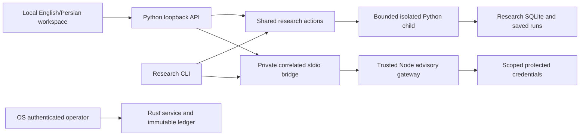

# Trade current audit, 2026-11-11

Canonical report. [Skill ledger](audit-skill-coverage-2026-11-11.md). This consolidates the earlier audit and refresh notes; application qualification is limited to the evidence below.

- Full initial index: 648 represented files, including code, documents, six inspected images and nine supplemental unclassified files. The graph is in `graphify-out/`; excluded private data, dependencies, caches and build outputs remain outside scope. Later audit edits receive a final refresh.
- A newly confirmed stale prospective-comparison defect was repaired in `prospective_comparisons.py`, using the existing `run_valuation` helper. Three dedicated cases failed before the fix. The related 52-test set passes after the fix; an independent reviewer found no introduced defect.
- Rust workspace tests, formatting and Clippy pass. Gateway: 37 passed, 1 skipped. Python full suite: 1 failed, 1,734 passed, 5 skipped, 39 subtests passed. Its one failure wraps two known model-panel UI test failures; the separately run Node UI suite has 21 passed, 2 failed.
- Browser checks now work against a synthetic DEMO application. All ten destinations were checked at mobile width in both languages/themes, and at tablet/desktop widths. Model draft loss and undersized market controls were reproduced. Graph/guide local-file rendering remains blocked.
- Three ordinary allocation defects remain, plus UI findings 13-15. They are documented with reproductions, not silently repaired or dismissed.

## Performance and architecture cleanup

Exact Decimal calculations now reuse centered vectors and covariance symmetry; float lag statistics use standard-library mapped dot products. Candidate selection computes its mean once instead of once per candidate. No array dependency, new dispatch layer, money conversion, or funded capability was added.

| Synthetic case | Before median (s) | After median (s) | Speedup |
| --- | --- | --- | --- |
| shrinkage_250x12 | 0.162249 | 0.103618 | 1.57x |
| policy_500x24 | 0.270662 | 0.196702 | 1.38x |
| selection_2000 | 0.231970 | 0.002291 | 101.25x |
| lo_10000 | 0.050540 | 0.020971 | 2.41x |

Three repetitions per implementation on the same deterministic inputs. Results match the pre-change implementation exactly on all four cases. These observations include local machine noise and do not establish an end-to-end speedup. Simulation state transitions and FIFO money postings remain sequential.

The candidate-dispersion regression failed before the change (65,536 values re-averaged for 256 candidates) and passes afterward. The focused portfolio/statistics set passed 67 tests; the additional minimum-row and near-collinear covariance cases pass. Independent review found no introduced defect, with 60 related tests and Ruff passing. These overlapping counts must not be added together. The previously recorded whole-suite UI failures remain open; the entire application suite was not rerun for this numerical-only change.

Cleanup covers existing tracked project files as well as this working change. A whole-source static import inventory found no unconsumed Python implementation module: its sole candidate, `adapters/model_credentials.py`, is the fixed Node gateway subprocess bridge and has direct tests. Existing research scripts have documented or tested consumers. The obsolete Phase 0 branch housekeeping log was removed; its durable data-preservation rule now lives in `gym-core/docs/storage.md`, beside the existing receipt migration procedure. The architecture map now points numeric review and notes to their actual shared `research_actions.py` owner instead of two removed modules. Four unreferenced `.pi` comparison/debug scratch programs were removed; study engines, observations, saved results, signed evidence and operator state remain intact. Reproducible graph extraction fragments, superseded graph snapshots and local lint/test/bytecode caches are cleanup targets; dependencies and build toolchains remain available.

The subsequent compatibility pass removed three old-layout DataPortal branches (depth, publication, candle-vintage fallback) in favor of one MarketDB open-time schema boundary. Read-only stores must be schema 5; older stores require the existing writable forward migration, while future schemas are rejected in both modes. Four new regression cases failed before the change and pass afterward; the 70-test storage/collector/research set and Ruff pass. No operator store or credential was opened or migrated by this cleanup. Forward migrations, purpose-bound credential rewrapping and historical wire inspection/revocation remain active recovery contracts, not orphaned shims.

## Research findings and repaired valuation

What this repo does: TradingGYM records public Wallex observations and performs local paper research. The separately protected executor owns real-money authority; this review neither enables it nor establishes a profitable strategy.

Assumed load: one local operator, a continuous collector, scheduled research processes and concurrent browser reads. This is a risk-directed review of current research paths, not a review limited to the working diff. It is not exhaustive branch or line coverage.

## Must fix — repaired

1. **[P1 / Important] A stale prospective result was advertised as comparable.**
   - **What this is:** `gym-core/src/gym/services/prospective_comparisons.py:132` builds the summary of a consumed future comparison. The browser uses `net_available` and `comparable` in `gym-core/src/gym/ui/research.js:343` and `:352`.
   - **Problem and reproduction:** The old code treated any non-null terminal record as an available result. With 240 synthetic quotes spaced ten seconds apart, a one-hour comparison, and two existing EMA configurations (2/3 and 3/5), both candidates made two fills. Both last marks were 1,210 seconds old, but the report returned `comparable=true`, `data_gaps=[]` and positive nets `1.53349480` / `0.76290345`. The shared report owner classifies marks older than 120 seconds as STALE. The summary did not expose that status.
   - **Fix:** Reuse `reports.run_valuation`; expose its status/age/as-of object, require CURRENT for available net, and use the existing incomplete-comparison path for stale/missing valuations. Native run artifacts, exact decimal nets, consume-before-read behavior and funded-authority denials remain intact. No UI edit was needed because it already handles unavailable net and incomplete comparisons.
   - **If skipped:** An observation outage can appear as a completed comparison with usable ending economics. The earlier walk-forward repair did not reach this independent caller.

The new `gym-core/tests/test_prospective_valuation.py` failed before the application edit: the stale case was incorrectly comparable, and current/missing cases lacked valuation metadata. All three cases now pass. They use real native paper calculations; only the missing-end case injects unavailable terminal evidence. They also assert two actual modeled fills, current/stale/unavailable status, net availability, retained authority denials and refusal of a second consumption attempt.

## Should fix — confirmed, not changed

2. **[P2 / Important] The daily allocation journal ignores known quantity precision and minimum notional.**
   - **What this is:** The maintained `gymctl allocate` command reaches `commands/research.py:317`, then the separate fill arithmetic in `services/allocation.py:66` and `:72`.
   - **Problem and reproduction:** In a disposable store using the existing allocation fixture, record an effective specification with `stepSize=2`, `minQty=0.01`, `minNotional=10000`. The command records a READY buy of `7.03966033` at `100.1`, notional `704.669999033`. That violates both the two-decimal quantity constraint and the known 10,000 minimum. `RuleService.check` checks regulation rules; it does not enforce instrument specifications. The allocation path never calls the existing `DataPortal.spec_at` owner and instead hardcodes eight decimals.
   - **Smallest fix:** Apply the existing point-in-time specification and quantity/minimum validation before either posting branch. Preserve the allocation journal's explicit quote-fee convention. Add a regression covering the above buy and a below-minimum exit; do not silently replace the accounting model or rewrite old journals.
   - **If skipped:** Forward paper evidence includes quantities the recorded venue specification forbids. No real order is placed, but the paper fill claim is wrong.

3. **[P2 / Important] Repeating a symbol in one allocation command records the same day twice.**
   - **What this is:** `services/allocation.py:33` snapshots the journal once; `:37` loops over every CLI symbol and `:47` checks only that initial snapshot. The CLI accepts repeated positional symbols.
   - **Problem and reproduction:** With the existing allocation seed, `run_day(db, temporary_root, ['BTCUSDT', 'BTCUSDT'], NOW)` returns two READY buys and writes two journal rows for the same completed candle. The second iteration starts from the same initial cash. A later invocation notices the day, but that does not prevent duplicate entries within the first invocation. The documented single-writer shortcut does not explain this single-process case.
   - **Smallest fix:** Deduplicate symbols while preserving order, or extend the already-decided set after a successful append. Keep a regression that checks one append for repeated input.
   - **If skipped:** The claimed one-decision-per-market/day audit record contains conflicting repeated evidence.

4. **[P2 / Important] Invalid moving-average lookbacks reach allocation arithmetic.**
   - **What this is:** `cli.py:209` accepts any integer for `--lookback`; `domain/allocation.py:19` validates other inputs but not lookback.
   - **Problem and reproduction:** `daily_target(existing_test_closes, 0, lookback=0)` raises ZeroDivisionError at `:24`. `lookback=-1` instead returns READY with an impossible negative average (`-8072.988884468175` for strictly positive prices). The public command forwards this value unchanged through `commands/research.py:318`.
   - **Smallest fix:** Validate the positive integer lookback at the domain boundary before evaluating history; use the same bounded-data limit as the supported allocation workflow. Include zero/negative rejection and an accepted-boundary test.
   - **If skipped:** A normal CLI option can crash or persist a meaningless signal in an append-only paper journal.

No changes were made for findings 2–4. These need their own scoped regressions and review. A displayed-depth overfill was also observed, but it is not promoted to a separate defect here: other default paper modes intentionally allow unconstrained participation. The known instrument-specification violation is the stronger contract finding.

## Skills actually applied

| Skill | Execution and evidence | Prerequisites / limits |
| --- | --- | --- |
| evolution-engine | Applied its held-out evaluation and failed-attempt retention checks to native frozen comparisons, walk-forward selection, consume-once evaluations and trial ledgers. Found the stale prospective-result defect. | No strategy discovery, new ticker, Binance fetch, LLM generation, evolution or paid job was run. Those operations need separate scope/data and provider authorization; generic graduation thresholds were not treated as proof of trading safety. |
| backtesting-frameworks | Traced chronology, causal vintages, selection/test separation, purge windows, shared snapshots, transaction costs and failed attempts. Ran temporal, walk-forward, prospective, identity and observation regressions. | Recorded market listings are not a complete delisted-market census; native historical comparisons are not independent final validation. |
| risk-metrics-calculation | Read exact cash/position reservations, loss latches, covariance/ES scaling, performance/FIFO arithmetic and causal FX risk. Ran risk-sizing, portfolio, FX, HRP, valuation, performance, Sharpe and post-fill tests. | No empirical tail calibration or live portfolio-risk claim; modeled ES and stops are not guaranteed loss limits. |
| ponytail-audit | Started with the indexed map, reviewed active callers and existing tests, and checked concrete counterexamples before reporting. Inspected the separate daily allocation owner rather than assuming all fills use the main simulator. | Read-only audit except the explicitly assigned P1 repair. No speculative deletion or unmeasured performance finding. |
| systematic-debugging | Reproduced stale native outcomes, traced summary → existing valuation owner → browser consumers, wrote failing regression, made one shared-owner fix, then reran affected tests. Used independent isolated checks for allocation findings. | An initial one-off duplicate-symbol probe used a nonexistent `db.close`; it was corrected to `db.c.close` and the successful reproduction rerun. That harness error is not a product defect. |
| code-review-and-quality | Reviewed correctness, contracts, readability, security boundaries and bounded work; checked final scoped diff and ran Ruff. | `.forge/contracts/` does not exist. Actual repository contracts/docs/tests were used instead; no invented forge contract or complete-release approval. Parent review is responsible for an independent Python review and integrated final run. |

## Current-source checks against the earlier audit

The existing `docs/audit-2026-11-11.md` was read in full. Its research fixes are present: walk-forward chaining requires CURRENT and counts completed folds; benchmark active-return mean is computed once; terminal equity samples use the cutoff; observation screening uses measurement-first vintages and measured freshness; the research child allowlist forwards only the enabled Rust-kernel selection. Focused storage-initialization and saved-report responsiveness tests also passed.

The earlier test counts describe an earlier checkpoint. They are not presented as current full-suite results here. Its claim that semantic extraction was not checked is superseded by the completed index work in this session. Its platform/browser limitations are not resolved by these research tests. The four interface findings are owned by the separate frontend/platform review.

Reviewed source includes `services/walk_forward.py`, `research_protocol.py` (evaluation/observation paths), `prospective_comparisons.py`, `temporal_validation.py`, `holdout_ledger.py`, `research_process.py`, `portfolio.py` (valuation, reservations, risk, close ordering and fills), `allocation.py`, `data_portal.py` (vintages/specifications), `rules.py`, `domain/portfolio_policy.py`, `allocation.py`, `performance.py`, and browser prospective-result consumers. Shared money simulation was inspected for precision, minimum and optional-capacity enforcement. These paths span current code rather than only changed files.

## Commands and results

Shell execution used the required RTK prefix. Graph queries used `GRAPHIFY_NO_AUTO_REFRESH=1` to avoid replacing the completed index during review.

1. `graphify query "research final evaluation walk forward portfolio risk money protocol"`: used the completed 7,459-node graph. Its 2,000-token result was explicitly truncated; source files were read directly afterward. This is navigation evidence, not a claim that all returned nodes were inspected.
2. From `gym-core`, `.venv/Scripts/python.exe -m pytest -q` on the following first group: **214 passed in 33.43 s**.

   `test_walk_forward.py`, `test_temporal_validation.py`, `test_validation_windows.py`, `test_performance.py`, `test_honest_sharpe.py`, `test_cashflow_returns.py`, `test_observation_vintages.py`, `test_research_protocol.py`, `test_observation_components.py`, `test_risk_sizing.py`, `test_portfolio_policy.py`, `test_portfolio_sizing.py`, `test_portfolio_valuation.py`, `test_phase_d_hrp_handworked.py`, `test_phase_d_fx_risk.py`, `test_phase_d_margin_depth.py`, `test_phase_e_client_admission.py`, `test_phase_e_promotion.py`, `test_global_trial_ledger.py`, `test_return_correlations.py`, `test_regressions_measurement_provenance.py`, `test_regressions_execution_gates.py`.
3. Second group, same runner: **117 passed in 12.25 s**.

   `test_allocation.py`, `test_research_process.py`, `test_sqlite_initialization.py`, `test_run_api_responsiveness.py`, `test_premium_twap_prospective.py`, `test_phase_c_execution_choice.py`, `test_execution_calibration.py`, `test_portfolio.py`, `test_phase_d_rebalance_comparison.py`, `test_phase_e_volume_twap.py`, `test_phase_e_postfill.py`, `test_phase_e_fee_coefficients.py`, `test_wallex_order_evidence.py`, `test_stop_wire_contract.py`, `test_run_identity_golden.py`, `test_architecture.py`.
4. Pre-fix dedicated regression `tests/test_prospective_valuation.py`: **3 failed** as described above. The stale native case reproduced incorrect comparability before any application edit.
5. After the repair: `pytest -q tests/test_prospective_valuation.py tests/test_premium_twap_prospective.py tests/test_research_workspace.py tests/test_walk_forward.py`: **52 passed in 102.36 s** during concurrent parent validation. This overlaps the earlier groups; do not add these counts as independent tests or treat timing as a performance benchmark.
6. `.venv/Scripts/ruff.exe check src/gym/services/prospective_comparisons.py tests/test_prospective_valuation.py`: **all checks passed**.
7. Disposable-store assertion checks reproduced duplicate same-day allocation entries and known-specification violations; a direct existing-fixture calculation reproduced zero/negative lookback behavior. No live data store, journal, credential or service was changed.

## Review and remaining acceptance

The P1 diff adds one import and routes summary valuation through the existing owner. It keeps one snapshot for candidates, preserves registration/attempt identities and consumes an attempt before loading observations. Old run files are neither rewritten nor promoted. The added valuation object changes newly generated summary/report digests as intended; engine fingerprinting also means older frozen registrations require their original engine, an existing safety constraint.

Verdict: the reproduced prospective-summary defect is repaired. Three concrete P2 allocation findings remain separate from that fix; passing broad research tests did not cover those input/specification cases.

Not checked: live exchange/account/provider behavior, funded execution, new evolution runs, independently attested future evidence, full branch/line coverage, physical-machine restore or browser rendering. Historical saved comparison summaries retain their original bytes; this fix applies to newly evaluated comparisons.

## Interface findings and browser evidence

Scope: current source and an isolated synthetic DEMO served on loopback. No production account, paid completion, venue call or funded permission was used. Antislop mode: both, explicitly selected in this chat. Direction: DESIGN.md's operator research register; ENERGY 1 / RHYTHM 1 / MOTION 1. Existing application source was not changed by this interface review.

## Numbered findings for selection

Numbers retain the earlier audit's identifiers.

13. **Language switching destroys model-panel state.** Medium engineering severity; high under antislop R-26/C-4. `gym-core/src/gym/ui/models.js:53` replaces the form and output nodes. In the real DEMO browser, enter an unsent prompt and switch EN to FA: the prompt becomes empty. The two existing Node regressions at `gym-core/tests/ui/models.test.cjs:64` and `:86` also fail for retained prompt/result and pending completion state. Preserve nonsecret prompt, selected preset, response and in-flight ownership across remount; clear credential inputs and prevent another completion. No paid call was made to demonstrate this.

14. **Zone-only changes leave saved portfolio/margin timestamps unchanged.** Medium, antislop R-26/C-4. `portfolio.js:8` and `margin.js:8` return when language is unchanged; `shell-events.js:2` invokes the shared language refresh on a zone change. Re-render timestamp presentation without remounting inputs or repeating a replay. This refresh confirmed the source path; it did not create a portfolio/margin receipt for a new rendered reproduction.

15. **Market-selection buttons still miss the 44px mobile target.** Medium, antislop R-03. The previous mobile override at `styles.css:331` now covers ordinary actions and tabs, but `.symbol-button` at `styles.css:173` remains uncovered. At 375px, all five synthetic market buttons measure 145px wide by approximately 38.65px high in both languages and themes. Add the existing selector to the mobile target rule and check actual geometry. The passing `test_mobile_targets.py` verifies a selector list, so it does not catch this rendered gap.

Finding 12 is repaired in the current working tree: gateway storage status distinguishes actual protection modes and legacy risk; its source-label regression passes. Finding 15 is partially repaired, rather than closed.

## Fresh browser evidence

The browser opened the actual application at `127.0.0.1` using a separate temporary synthetic store. It visited Overview, Markets, Paper research, AI connections, Account journal, Offline ticket, Safety, System health, Venue rules and Backups.

| Check | Evidence | Limit |
| --- | --- | --- |
| Mobile routes | All ten at 375x812, EN/FA and light/dark: 40 combinations, no document-level horizontal overflow | Does not prove every table cell, hidden state or interactive workflow |
| Tablet/desktop routes | All ten at widths 768 and 1280, height 900, EN dark: no document-level overflow | Not a full four-combination matrix at these widths |
| Market disclosure | BTCUSDT button changes `aria-expanded` from false to true and shows details | Synthetic observations |
| Theme keyboard control | Enter activates the theme button, changes theme and retains a solid focus outline | Not exhaustive keyboard/focus certification |
| Language control | Changes document title, language, reading direction and visible labels | Model draft loss reproduced above |
| Browser diagnostics | Captured warning/error log list was empty after route checks | Not all possible network/error paths |
| Touch geometry | Market buttons about 38.65px high in all four mobile theme/language combinations | FAIL against the requested 44px floor |

The Node UI suite, run from `gym-core`, has 21 passed and 2 failed tests. The two failures are finding 13. The full Python suite includes that Node suite through `test_ui.py`, so its overall result is also failing; this is not a second independent defect.

## Typography and palette

Applied typography-selector's hierarchy/readability and color-curator's semantic-role/contrast checks to the existing direction. No font or palette replacement was needed. Display/body use Segoe UI Variable Text, Segoe UI and Tahoma; monospace is confined to source records and identifiers. Local fonts preserve offline operation and Persian fallback.

The browser resolved these actual theme values:

| Role | Light | Dark |
| --- | --- | --- |
| Page | #f6f4ef | #171c20 |
| Surface | #fffefa | #20272d |
| Text | #282924 | #eceee9 |
| Muted text | #686a60 | #b0b9bc |
| Accent / text | #9b4d25 / #fffaf3 | #e7ac7a / #231e18 |
| Rail / text | #292824 / #eeede6 | #12171b / #eeede6 |
| Rail muted | #b9b7ad | #aeb7bb |

Copper marks actions and selection; semantic colors describe recorded evidence, not authority. Font weights and numeric alignment carry hierarchy. Full rendered contrast over every background and state was not measured.

## Live design-reference inspection

The trend-researcher workflow inspected [Dribbble web design](https://dribbble.com/shots/popular/web-design) and [mobile design](https://dribbble.com/shots/popular/mobile) on this date, including visible screenshots and a mobile scroll. The visible sample mixed large device mockups, light content surfaces with colored presentation backgrounds, prominent financial totals, compact charts and dark variants. Examples included Mobile App for Fintech, Finance Management & Banking Mobile App, Personal Finance & Digital Banking App, and an RTL tutoring interface.

This is a bounded observation of those visible pages, not a market-wide trend measurement. Their promotional mockups and decorative presentation do not justify replacing a dense evidence-review workspace. Keep the existing product direction; prioritize the actual interaction failures above. No exact sampled palette or downloaded font is claimed.

## Delivery and workflow limits

The antislop interface gate remains **not passed**: findings 13 and 15 are reproduced; finding 14 remains source-confirmed. No finished UI redesign or passing whole-interface gate is delivered. Under after mode, these repairs require selection of the numbered findings; the relevant instruction is: “Do not modify anything until the user approves specific numbers.” Existing UI source remains untouched by this pass.

The Ring checking-frontend-quality workflow requires `unit_id`, `implementation_files` and `gate0_handoffs`. This checkout has no Ring Gate 0 handoff. Equivalent local route/geometry/source tests ran as recorded above; the formal four-mode Ring pipeline did not run. Axe, Firefox/WebKit, Lighthouse and field Core Web Vitals remain unmeasured. Do not label those modes PASS.

Graphify's two HTML graph views and the new seven-view guide are separate local-file artifacts. Browser policy rejected file URLs; no alternate transport was used to bypass that restriction. Their code/static interaction checks are recorded elsewhere; their rendered interactions remain unverified. The application browser evidence above does not qualify those artifacts.

## Architecture, persistence and simplification

Date: 2026-11-11. Scope: the current working tree, including existing repairs and new tests. This is a read-only structural review, not a release certification or funded-execution approval.

No new critical or high defect was confirmed in the inspected architecture, model bridge, authorization or persistence paths. A known medium UI remount defect still reproduces and was sent to the parent UI review. The earlier claim that the full Node suite is blocked by Windows ACL setup is stale: the current suite passes, including its Windows ACL and real DPAPI checks.

## Current architecture and ownership

The Node model result remains advisory; it does not connect to the privileged Rust pipe. `gym-core/src/gym/api/models.py:8` installs a private control endpoint; the shared API guard at `gym-core/src/gym/api/__init__.py:29` checks loopback Host and the per-run token for private reads and writes. `model-gateway/runtime.mjs:79` bounds prompts, requests and deadlines, rejects model tool calls, and returns `RESEARCH_ONLY` with `funded_authority: false`.

`gym-core/src/gym/services/model_gateway.py:76` owns one busy-rejecting, correlated stdio channel and starts the fixed Node host; callers include `gym-core/src/gym/api/models.py:27`, `gym-core/src/gym/commands/research.py:347`, and `gym-core/src/gym/commands/maintenance.py:203`. Its environment allowlist retains the two explicit credential-protection settings and configuration-selected provider key names, rather than forwarding every ambient secret.

`gym-core/src/gym/services/research_process.py:72` accepts allowlisted research actions and a fixed module invocation. Lines 89-99 give the disposable child an isolated environment, forwarding `GYM_RUST_KERNEL` only when exactly enabled. Output, time and child cleanup are bounded; the failure report explicitly warns that an operation may have committed and forbids automatic retry. This is a distinct security responsibility from the trusted model gateway.

`executor/exec-svc/src/privileged_pipe.rs:40` impersonates the actual named-pipe caller, checks elevated-administrator identity, inspects the principal synchronously, and reverts before further work. `executor/exec-core/src/authority.rs:19` is only a permission floor, explicitly not an authenticated capability. The independent stop listener at `executor/exec-svc/src/main.rs:321` does not wait for the Python/UI path and stops the service if its listener fails. The reviewed paths do not grant funded authority.

## Persistence and comment review

The four Python stores import the same small `enable_wal` / `execute_schema` owners: `adapters/store.py`, `services/research_ledger.py`, `services/research_protocol.py`, and `services/offline_review_journal.py`. They acquire `BEGIN IMMEDIATE` before checking schema state. `gym-core/src/gym/adapters/sqlite_migrations.py:19` preserves that lock while executing fixed DDL; using `executescript` here would commit it prematurely. The bounded BUSY retry and complete-statement parser therefore survive the simplification review.

`gym-core/src/gym/services/offline_review_journal.py:116` verifies under a savepoint, keeping its preview/event reads in one snapshot and remaining usable inside an outer transaction. Node `State.tx` at `model-gateway/state.mjs:170` serializes durable credential modification and OAuth refresh; its `finally` rolls back an unfinished transaction and closes the database. Credential namespaces bind connection and provider (`state.mjs:202`), and configuration writes use a private temporary file, sync and rename (`state.mjs:44`). Rust immutable-ledger tests cover corruption, missing triggers, second writers and rollback recovery.

Comments explaining these lock, credential, protocol and shutdown constraints are useful and were retained. No comment-only edit or automated deletion was made. A whole-production-source TODO/HACK/FIXME/XXX search returned no unresolved task markers in the targeted Python, Rust and Node source directories. Matches for the ordinary word “temporary” describe real temporary files and are not debt findings.

## Refresh of existing findings 12-15

| Existing finding | Current evidence | Status |
| --- | --- | --- |
| 12: credential-protection status | `model-gateway/control.mjs:26` delegates to `state.protection()`; `state.mjs:79` distinguishes DPAPI, passphrase sealed, explicit plaintext and unavailable protection, with a separate legacy warning. Five focused sealing/status tests pass; the browser label source test also passes. | Repaired in working tree; do not report the old unconditional plaintext label as live. |
| 13: language remount loses draft/paid result | `gym-core/src/gym/ui/models.js:53` rebuilds the form/output DOM. Current tests at `gym-core/tests/ui/models.test.cjs:64` and `:86` fail: draft becomes empty, and an in-flight remount does not retain the expected busy UI state. | Known medium defect still reproduced; handed to parent UI review. |
| 14: zone-only portfolio/margin remount | `portfolio.js:8` and `margin.js:8` still guard only on language/busy; shell zone changes call `applyLang` (`shell-events.js:2`). | Source issue remains; current rendered reproduction belongs to parent UI review. |
| 15: small mobile targets | The current `styles.css` mobile block sets 44px minimum for action buttons, segmented controls, sidebar controls and tabs. | Old source omission is repaired; computed geometry and theme/language coverage require browser evidence. |

The debt registry remains useful but its DEBT-001 and source-only DEBT-004 descriptions need these refreshed statuses. This worker did not modify the shared registry while the parent was coordinating it.

## Structural decisions

| Decision | Component | Reason and affected consumers |
| --- | --- | --- |
| KEEP | Python/Node model bridge | Actual subprocess, bounded serialization, correlation and credential boundary; browser and CLI consumers. |
| KEEP | Python/Rust kernel seam | Actual cross-language arithmetic contract; shared golden fixtures and optional binding. |
| KEEP | Protected operator adapter | Actual OS identity boundary; collapse into research dispatch would erase authorization ownership. |
| KEEP | Shared research action registry | Browser and CLI share validation and operation ownership today. |
| KEEP | SQLite migration helper | Four live stores require lock-preserving DDL and bounded first-open WAL handling. |
| REVIEW | UI remount ownership | Reproduced state loss; smallest remedy is retaining nonsecret draft/output/busy state across remount, keeping credentials transient and preventing duplicate completion requests. |
| KILL | None established | No abstraction met the deletion burden after tracing its callers and constraints. |

No broad rewrite, new dependency, wrapper or parallel implementation is proposed. Runtime repairs should stay separate from behavior-preserving refactoring.

## Skill execution ledger

| Skill | Instructions executed | Limit or prerequisite |
| --- | --- | --- |
| architecture-analyst | Read skill, mapped current boundaries and risks from Graphify plus source; checked local CLI prerequisite. | `epis` is absent. No Episteme API call, law citation, compliance score or knowledge-graph audit claimed. |
| antislop-code | Applied comment purpose test in the money, auth, migration and process paths; retained valuable constraint comments. Consulted core mode/delivery rules under parent-resolved after mode. | No comment edits or UI delivery; no full visual gate claimed. |
| cleaning-comments | Architecture-aware dry review and targeted comment scan; preserved intent, side effects and API contracts. | Generated/third-party code excluded from cleanup; no blanket removal. |
| deslop | Ran installed deep detector with explicit tracked source files, overriding the default 200-file sample; inspected suspicious callbacks, unwraps and stubs in source. | 528 files, 1,479 mechanical signals; zero critical scanner matches. `jscpd` missing; secondary phase contributed zero findings. Untracked repair files were reviewed directly, outside this scanner count. |
| code-refactor | Traced gateway and migration owners and consumers before deciding whether a shared replacement was justified. | No requested rename or bulk transformation was needed; execution mode not invoked. |
| planning-backend-refactor | Checked prerequisites and stack. | Missing `docs/PROJECT_RULES.md`; no Go/TypeScript framework backend. Its specialist dispatch and mandatory Ring task pipeline were not run. |
| planning-frontend-refactor | Checked rules prerequisite and UI stack. | Missing project rules and no React/Next.js app; plain browser JS is not a reason for framework conversion. No Ring standards fetch/plan claimed. |
| refactoring-and-tech-debt | Read registry, refreshed live versus repaired issues, assessed owner/trigger completeness and KEEP/REVIEW decisions. | Owners remain explicitly unassigned. No invented cost or bus-factor fact; shared registry updates left to parent. |
| simplify-implementation | Existence/reuse test across bridge, worker, migration and kernel seams; prioritized the concrete remount repair. | No new simplification plan approved or source edit made; no latest devkit package downloaded. |
| planning-codebase-simplification | Used its KEEP evidence: actual cross-process/cross-language/authorization contracts. | Go/TS scope does not fit. Mandatory atomic five/six explorer pool also exceeds this session's four total slots; formal Ring workflow was not executed and is not claimed complete. |
| ai-integration-architect | Assessed systems, data flows, read/write boundaries, credential ownership, failure behavior, request budgets and advisory authority; documented landscape above. | Existing integration needs no second scaffold. No provider call, model launch, deployment or account mutation. |
| searching-code | Started from Graphify; then targeted exact caller, guard, persistence and test searches with source line references. | Graph query was deliberately budgeted and truncated; direct source established conclusions. CoD mode not requested or used. |
| dev-review | Holistic source/design/caller/contract/rollback review of current owners and current regression tests. | No configured AI-devkit feature lifecycle/local devkit command; its `npx ai-devkit@latest lint` was not run or installed. No pre-push readiness claimed. |
| codebase-documenter | Delivered ownership/dataflow map, source navigation, validation commands/results and limitations in this single report. | Uses existing onboarding rather than creating six competing documentation files; no new exploration-agent pool. |

## Verification performed in this refresh

| Check | Fresh result |
| --- | --- |
| `cargo test --locked --workspace --all-targets` | Passed, including the 200,000-row startup replay, Windows identity/policy tests, immutable ledger/recovery, account receipts, operator review, arming and fake execution suites. |
| `cargo fmt --all --check` | Passed. |
| `cargo clippy --locked --workspace --all-targets -- -D warnings` | Passed. |
| Full model gateway `npm test` | 37 passed, 1 skipped, zero failed; skip is Windows symlink privilege. Real Windows DPAPI and private-state ACL tests pass now. Provider protocol tests use local fixtures. |
| Focused gateway sealing/status | 5 passed; overlaps the full suite, not an additional independent total. |
| Focused Python architecture/model/security/SQLite/journal | 30 passed in 1.92 seconds. Parent owns full Python suite. |
| Model browser-source tests | 1 passed, 2 failed as described in existing finding 13; not a browser-rendered test. |
| Deep deslop scan | 528 explicitly listed tracked sources; 1,479 signals, not 1,479 defects; zero automatic changes. |

Representative scanner false positives were checked, not silently accepted: `exec-ipc/src/account.rs:106` converts fixed-width slices only after exact frame length validation at line 103; `runtime.mjs:62` ignores reader cancellation failure during cleanup; `state.mjs:54` preserves the original atomic-write error while best-effort cleaning up; `research_backup.py:76` correctly implements `RawIOBase.writable`. CLI output and test fixtures are not debug noise. These checks do not assert that every one of the 1,479 signals was individually adjudicated.

Skipped: live model/venue calls, installed-service end-to-end authority verification, disk-full/power-loss fault injection, exhaustive review of every source line, and full visual/browser accessibility certification. Tests and source review support the bounded conclusions above; keep funded execution disarmed.

## Independent change review

Reviewed: 2026-11-11. Read-only review of the current change to `gym-core/src/gym/services/prospective_comparisons.py`, new `gym-core/tests/test_prospective_valuation.py`, and `graphify-out/Trade-visualization.html`. Scope is introduced defects, not pre-existing issues elsewhere in the working tree. No application or guide source edits or delegation were performed.

## Findings

No findings.

## Financial correctness and compatibility

The change at `prospective_comparisons.py:134` reuses `reports.run_valuation` instead of treating any terminal record as available economic evidence. The shared helper at `reports.py:94` returns CURRENT only when a terminal mark exists and its age is nonnegative and within the existing stale limit. This keeps the subsequent `end["net"]` access safe. Stale, missing and future-dated marks do not expose net as comparable evidence.

The helper preserves the exact decimal net string; the change performs no monetary floating-point conversion. The added valuation record discloses mark timestamp and age. `last_mark_at` still refers to the same terminal price receipt through `valuation["as_of"]`, or None when unavailable.

Existing `data_gaps` and `comparable` fields at lines 147-149 now correctly follow the stricter availability predicate. The browser consumer at `gym-core/src/gym/ui/research.js:343` already checks `net_available` and non-null net, so it remains compatible. The new valuation field is additive to the existing report schema. Registration, one-attempt consumption, saved-run ownership, failure recording and nonfunded authority flags are unchanged.

## Tests and review method

Applied the review-agent defect criteria and Python-reviewer concerns: complete diff and surrounding control flow, helper/caller contracts, import direction, exception paths, precision, saved-artifact behavior and regression relevance. The three parameterized regression cases exercise real paper replay for CURRENT and STALE marks, and a missing terminal record for UNAVAILABLE. They assert data gaps, net availability, paper authority and consumed-attempt rejection.

Fresh checks:

- `pytest -q tests/test_prospective_valuation.py tests/test_architecture.py`: 6 passed.
- `pytest -q tests/test_premium_twap_prospective.py tests/test_prospective_valuation.py`: 12 passed; overlaps the preceding focused run.
- `ruff check src/gym/services/prospective_comparisons.py tests/test_prospective_valuation.py`: passed.

The new test does not directly inject INVALID future timestamps or the exact staleness-threshold boundary. The shared helper and equality predicate reject INVALID; this is a coverage limit rather than a demonstrated introduced defect. No live market/provider execution or funded authority was exercised.

## Guide JavaScript and HTML review

No findings.

Applied JavaScript/TypeScript-reviewer concerns to the complete inline script: initialization, missing element access, state transitions, DOM updates, escaping, keyboard handlers and input handling. The seven sections and buttons match the seven view IDs. The guide stores no credentials, performs no fetch or network action, and has no external script or stylesheet dependency. Dynamic component descriptions, file names, translations and connections enter the DOM through `textContent` and created elements. Search input affects string matching and visibility, not executable markup. The only dynamic selector uses an ID chosen from the six static component IDs.

Static checks confirmed unique HTML IDs, valid in-page anchors, all five referenced local files, every component source file, and every declared component connection target. The guide's 7,459 nodes, 21,601 relationships and 356 communities match the current `graph.json`; its index commit matches both `built_at_commit` and HEAD. Source paths and the distinction between advisory research, protected intent and absent funded submission agree with the traced architecture. Earlier Python figures are explicitly labeled dated evidence and current checks pending, rather than being presented as freshly verified results.

A lightweight DOM harness parsed and executed the actual inline JavaScript and exercised all seven view transitions, both English/Chinese language states, both themes, all six component panels, component/table searches, Enter-key component activation, all 15 flow steps, and reset. These checks passed. The harness initially lacked an element `id` property; that harness omission was corrected before reporting the successful result and was not a guide defect.

The source includes native buttons/details, a skip link, explicit diagram-control roles and keyboard handlers, focus styling, live status text, a user-controlled animation pause and reduced-motion CSS. This is source evidence, not a screen-reader or WCAG certification. Browser file-URL policy blocked viewing the guide; no browser-policy workaround was attempted. Responsive rendering, actual focus behavior, SVG accessibility-tree behavior, contrast and screen-reader output remain unverified for this artifact. Parent verification of the running demo application is separate evidence and cannot establish guide rendering.

## Visual guide qualification

Delivered [Trade-visualization.html](../graphify-out/Trade-visualization.html), a self-contained, read-only guide using the requested codebase-visualizer skill. It retains the skill template’s seven-view organization and inline component details while following DESIGN.md’s cream/charcoal/copper palette and local Segoe/Tahoma font stack. No external scripts, fonts, model requests or exchange calls are needed.

The seven views cover the seven-act story, searchable architecture, usage instructions, stepped data flows, quality/security evidence, project capabilities and SQLite schema. English/Chinese switching includes diagram labels and open component details. Light/dark themes, keyboard-operable component nodes, native story disclosures, searchable tables, reduced-motion support and an explicit animation play/pause control are implemented. Arrows start paused. The guide links the complete graph, source tree and index report.

## Source grounding

- Runtime manifests: root Cargo.toml, gym-core/pyproject.toml and model-gateway/package.json.
- Authority and workflow owners: README.md, PRODUCT.md, SECURITY.md, DESIGN.md, gym-core/docs/architecture.md and docs/adr/0001-authority-split.md.
- Current source inspected: gym-core/src/gym/services/collector.py, gym-core/src/gym/api/server.py, gym-core/src/gym/services/paper.py, gym-core/src/gym/services/model_gateway.py, model-gateway/host.mjs and executor/exec-svc/src/main.rs.
- Storage: gym-core/src/gym/adapters/store.py MIGRATIONS and executor/exec-store/schema.sql. Fixed schemas were executed only in isolated in-memory SQLite databases; no user database was opened. The explorer includes the ten market tables and ledger_events, with actual SQLite column types and primary keys. These schemas declare no foreign keys; matching field names are not presented as enforced relationships. Raw archives and saved run files remain separate from SQLite.
- Graph snapshot: commit 9d47dd92fa367fecc41d24c80ba5fe7d50977287; 7,459 nodes, 21,601 relationships and 356 named communities. These are extraction counts, not runtime or test measurements.

Graph queries used GRAPHIFY_NO_AUTO_REFRESH=1 to locate schema, collection, API and model-bridge owners. Broad queries were truncated, so the named source files and exact schema definitions were inspected directly rather than treating graph output as complete source evidence.

## Verification

Passed: JavaScript syntax parsing; HTML checks for seven sections, seven story acts, eleven schema tables, unique IDs, paired translation attributes, no unresolved template markers, no external script imports and no outbound request APIs. An isolated Node DOM-stub harness exercised all seven view switches, language/theme state, component detail open/close, empty/reset component search, flow step/reset/play/pause and schema filtering. The harness checks state logic only; it is not a rendering engine.

The guide preserves the earlier audit’s dated test evidence as historical and labels current application checks pending. It does not assert passing app UI tests, current coverage, live venue connectivity, profitable strategies, installed-service qualification or funded readiness. Parent-led application testing and independent JavaScript review are separate work.

Browser rendering, keyboard behavior in a real browser, responsive layout, contrast and axe accessibility remain unverified. File-URL browser access is denied by the available browser policy; no server or alternate transport was used to bypass that restriction. Open the HTML directly in an ordinary browser for manual review at 1280px, 768px and 480px, in both themes and languages.

No application, service, credential, account, task or trading state was changed. No insertion/approval trading demo was added; the schema explorer is read-only and flow stepping illustrates stored contracts only.

## Earlier repaired defects (retained evidence)

1. **Stale test equity entered chained out-of-sample results.** `gym-core/src/gym/services/walk_forward.py`, `chained_out_of_sample`.
   - **What this is:** Selected test folds are combined into a hypothetical performance curve.
   - **Problem:** A fold could finish with a stale price, while its overall report was incomplete, and still produce chained ending equity.
   - **Fix:** Require `CURRENT` valuation before chaining. A truncated-quote regression exercises the failure.
   - **If we skip it:** Research can present a result whose terminal price is unavailable.

2. **Benchmark statistics repeatedly averaged the same returns.** `gym-core/src/gym/domain/performance.py`, `_benchmark`.
   - **What this is:** Tracking error measures how strategy returns differ from holding the base asset.
   - **Problem:** The mean was recalculated for every observation, making work grow quadratically.
   - **Fix:** Compute it once. A regression counts consumed inputs and checks the values against Python's statistical functions.
   - **If we skip it:** Larger saved reports stall the local workspace. In one local 6,000-sample measurement, this calculation fell from 0.5216 s to 0.0087 s after repair.

3. **Research children silently lost the Rust-kernel selection.** `gym-core/src/gym/services/research_process.py`, `calculate`.
   - **What this is:** Heavy calculations run in isolated child interpreters.
   - **Problem:** The restricted child environment omitted `GYM_RUST_KERNEL=1`, causing supervised calculations to use Python despite the parent's explicit selection.
   - **Fix:** Forward exactly that nonsecret enabled value. Tests cover absent, disabled, enabled and unexpected values, while retaining unrelated-secret exclusion.
   - **If we skip it:** The selected arithmetic engine and the engine actually producing results can disagree.

4. **The model bridge discarded credential-protection settings.** `gym-core/src/gym/services/model_gateway.py`, `gateway_env`.
   - **What this is:** The Python launcher constructs an allowlisted environment for the trusted Node gateway.
   - **Problem:** It omitted the two settings required for non-Windows passphrase protection or explicit plaintext consent.
   - **Fix:** Allowlist only `GYM_GATEWAY_PASSPHRASE` and `GYM_GATEWAY_PLAINTEXT`; retain exclusion of unrelated secrets.
   - **If we skip it:** Documented credential storage and unlocking fail through the ordinary launcher on Linux/macOS.

### Should fix, repaired

5. **Observation screening preferred a late publication of an older measurement.** `gym-core/src/gym/services/research_protocol.py`, `screen`.
   - **What this is:** A screen chooses the latest known observation for each subject.
   - **Problem:** Publication-first ordering disagreed with measurement-first lookup, and publication time could make an old measurement appear fresh.
   - **Fix:** Match measurement-first vintage ordering and age measured values by measurement time. Keep publication fallback for legacy records and news.
   - **If we skip it:** The same dataset can produce inconsistent values and stale rankings. Regressions cover revisions, cutoffs and freshness boundaries.

6. **Concurrent first opens raced during SQLite initialization.** `adapters/store.py`, `services/research_ledger.py`, `services/research_protocol.py`, `services/offline_review_journal.py` under `gym-core/src/gym`.
   - **What this is:** The collector and local research processes can open a new store together.
   - **Problem:** Both could inspect an old schema version and attempt the same migration; initial WAL activation could also fail immediately with `SQLITE_BUSY`.
   - **Fix:** Acquire the migration write lock before inspecting the schema, execute fixed DDL without implicitly committing, and bound WAL conflict retries to five seconds.
   - **If we skip it:** A valid simultaneous startup can fail. A local fresh-file stress check changed from 25 failures in 80 opens to zero in 80. Nine regressions cover initialization and journal snapshots.

7. **Journal verification mixed two database snapshots.** `gym-core/src/gym/services/offline_review_journal.py`, `_verify`.
   - **What this is:** Verification checks that stored ticket previews and review events agree.
   - **Problem:** A concurrent valid record-and-review could appear to reference a missing preview.
   - **Fix:** Read under a savepoint that also works inside the caller's transaction.
   - **If we skip it:** Normal concurrent work can be reported as journal corruption.

8. **Final equity added a backward-time return sample.** `gym-core/src/gym/domain/performance.py`, `performance`.
   - **What this is:** The return series combines decision marks and terminal equity.
   - **Problem:** The terminal price receipt can predate the final decision mark, creating an extra artificial return period.
   - **Fix:** Sample terminal equity at the evaluation cutoff, replacing an existing cutoff sample. Preserve the original price receipt and stale-valuation status.
   - **If we skip it:** Sharpe inputs and period counts change because of an artificial endpoint. Tests cover current and stale receipts and preserve actual final equity.

9. **Saved reports blocked the collector's event loop.** `gym-core/src/gym/api/server.py`, saved-run detail and summary handlers.
   - **What this is:** The workspace loads and formats saved paper results.
   - **Problem:** Disk reads, report arithmetic and serialization ran synchronously on the collector's event loop.
   - **Fix:** Offload the complete report-read operation to a worker thread, passing no database connection or request object. Coordinated tests prove health reads finish while report loading is held.
   - **If we skip it:** Opening a large report delays other local work. In one 15,000-mark measurement, maximum heartbeat delay changed from 0.475 s to 0.032 s; request duration stayed approximately unchanged.

10. **Incomplete reports counted marks as completed folds.** `gym-core/src/gym/services/walk_forward.py`, `chained_out_of_sample`.
    - **What this is:** An incomplete report states how many test folds completed.
    - **Problem:** It reported the number of equity samples, which could be much larger.
    - **Fix:** Count the folds themselves. A two-fold regression distinguishes the counts.
    - **If we skip it:** Operators see incorrect progress.

11. **Windows Python integration tests were absent from CI.** `.github/workflows/validate.yml`, `browser-smoke-windows`.
    - **What this is:** Launcher-preview and native signature checks contain Windows-only branches.
    - **Problem:** The ordinary Python suites run on Ubuntu, where these branches do not execute.
    - **Fix:** Add both focused test files to the existing Windows job using the locked environment.
    - **If we skip it:** These Windows behaviors can regress without a CI failure. The new hosted-runner step has not executed in this session.
